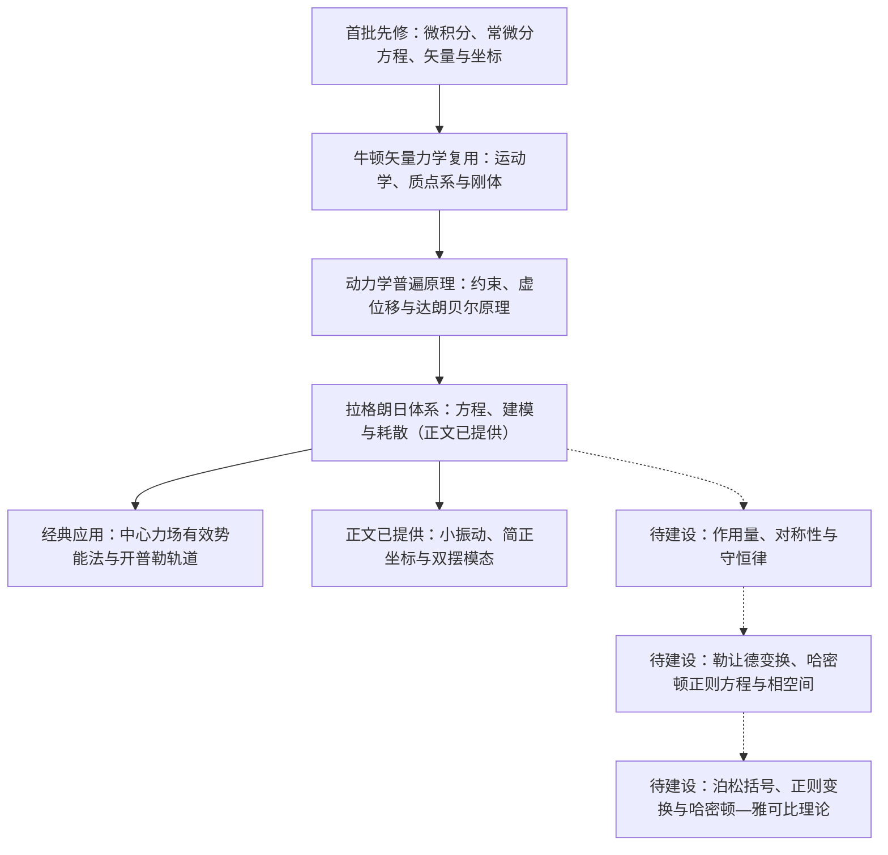

## 理论力学课程路线

这里的《理论力学》（Theoretical Mechanics）指大二开始学习的理论物理课程，先修是大一的经典力学与相关数学基础．两门课程虽然都研究力学问题，学习阶段与侧重点不同．

很多同学从大一经典力学进入大二理论力学时，最直观的感受是：*「明明又是质点、刚体和振动，为什么算起来完全不一样了？」*

本页是跟课阅读参考．[分析力学导论](../mechanics/analytical/index.md)已提供约束、虚功、达朗贝尔原理、拉格朗日建模、耗散与小振动主线；作用量、诺特定理、哈密顿体系及进阶刚体仍待建设，请配合课程教材使用．

这门课程的一条核心主线，是从牛顿力学进入拉格朗日与哈密顿表述：研究对象仍是同一类力学系统，组织约束、方程和守恒关系的方式逐步变化．

***

## 核心思维跃迁

| 维度           | 大一经典力学（牛顿体系）                               | 大二理论力学（分析力学体系）                    |
| :----------- | :----------------------------------------- | :------------------------------ |
| **研究基石**     | 力与加速度（矢量 $\boldsymbol{F}=m\boldsymbol{a}$） | 动能与势能（标量 $T, V$，拉格朗日量 $L=T-V$）  |
| **约束处理** | 通过动力学方程与约束关系处理反力，也可选用适合的坐标 | 完整理想约束下，用独立广义坐标与零虚功条件消去反力；非完整系统需另行处理 |
| **坐标选取** | 可用笛卡尔坐标或曲线坐标，需要正确计算加速度分量 | 广义坐标点变换下方程保持形式，便于统一组织建模步骤 |
| **与高等物理的连接** | 直观但不易推广到微观与场论                              | 分析力学是统计物理、电动力学、量子力学和量子场论的标准形式语言 |

***

## 课程主题与已有知识页

下表整理常见课程主题与已有知识页的对应关系，部分主题仍缺少正文或需要扩充．具体范围和顺序请对照学校教学大纲：

| 教学模块                  | 核心物理与数学概念                                                                                    | Wiki 对应知识页                                                                                                                                                                                                                         | 状态与学习建议                                                                           |
| :-------------------- | :------------------------------------------------------------------------------------------- | :--------------------------------------------------------------------------------------------------------------------------------------------------------------------------------------------------------------------------------- | :-------------------------------------------------------------------------------- |
| **1. 数学准备**           | 常微分方程求解、曲线正交坐标系、泛函极值与变分法                                                                     | [常微分方程](../math/differential-equations/ode-intro.md) [曲线坐标系](../math/vector-analysis/curvilinear-coordinates.md) [变分法](../math/variational-methods/calculus-of-variations.md)                                              | **[按阶段使用]** 导论先用微积分与坐标；作用量阶段再读变分法                                                |
| **2. 质点运动学与动力学**      | 矢径、速度、加速度、牛顿定律、非惯性系与惯性力（科里奥利力）                                                               | [运动学基础概念](../mechanics/kinematics/basic-concepts.md) [参考系与坐标系](../mechanics/kinematics/reference-frames.md) [牛顿运动定律](../mechanics/dynamics/newton-laws.md) [惯性力与转动参考系](../mechanics/dynamics/inertial-force.md)        | **\[成熟]** 可直接复用普物力学基础，重点强化非惯性系动力学                                                 |
| **3. 动量、能量与角动量**      | 动能定理、保守力与势能、角动量守恒、质点系质心运动定理                                                                  | [动量与能量](../mechanics/dynamics/momentum-energy.md) [质点系动力学](../mechanics/dynamics/system-of-particles.md)                                                                                                                       | **\[成熟]** 牢固建立守恒量与初积分的物理图景                                                        |
| **4. 刚体定轴转动与定点运动**    | 刚体角速度矢量、惯量张量、主惯性轴、定点运动欧拉角、欧拉动力学方程                                                            | [力矩与角动量](../mechanics/rigid-body/torque-angular-momentum.md) [转动惯量](../mechanics/rigid-body/moment-of-inertia.md) [刚体平面平行运动](../mechanics/rigid-body/rigid-body.md) [复摆](../mechanics/rigid-body/compound-pendulum.md) | **\[部分待扩充]** 普物内容已完备；刚体主轴与欧拉角进阶部分正计划补齐                                            |
| **5. 中心力场与引力**        | 二体问题简化为单体问题、有效势能曲线、开普勒轨道方程与偏心率                                                               | [万有引力与天体物理](../mechanics/gravitation.md)                                                                                                                                                                                           | **\[重点建设中]** 推荐自学时先掌握通过角动量守恒与有效势定性分析轨道的方法                                         |
| **6. 约束与广义坐标** | 完整与非完整约束、位形空间、独立约束、位形自由度与容许速度数 | [约束、自由度与广义坐标](../mechanics/analytical/constraints-generalized-coordinates.md) | **[正文已提供]** 用单摆、球面质点与圆盘辨析坐标和速度计数；非完整动力学留到后续 |
| **7. 虚功与达朗贝尔原理** | 等时虚位移、理想约束、平衡、广义力与惯性项的投影 | [虚功与理想约束](../mechanics/analytical/virtual-work.md) · [达朗贝尔原理与广义力](../mechanics/analytical/dalembert-principle.md) | **[正文已提供]** 先区分虚功与实功，再把静力平衡思路推广到动力学 |
| **8. 拉格朗日力学** | 第二类拉格朗日方程、动能与位置势能、单摆与双摆建模、非保守广义力 | [拉格朗日方程](../mechanics/analytical/lagrangian.md) · [建模实例](../mechanics/analytical/lagrangian-modeling.md) · [非保守力与耗散](../mechanics/analytical/nonconservative-forces.md) | **[导论正文已提供]** 乘子法、作用量、循环坐标与诺特定理为下一阶段待建设内容 |
| **9. 多自由度小振动** | 平衡附近的二次近似、质量与刚度矩阵、固有角频率、简正坐标与初态分解 | [小振动近似](../mechanics/analytical/small-oscillations.md) · [简正模](../mechanics/analytical/normal-modes.md) · [双摆应用](../mechanics/analytical/double-pendulum-modes.md) | **[正文已提供]** 先复习单自由度振动，再从二次能量求解多自由度运动 |
| **10. 哈密顿力学**         | 勒让德变换（Legendre Transformation）、哈密顿函数 $H=p\dot{q}-L$、哈密顿正则方程、相空间几何图景与刘维尔定理（Liouville Theorem） | [哈密顿力学](../mechanics/analytical/hamiltonian.md)                                                                                                                                                                                    | **\[重点建设中]** 一阶微分方程组的对称结构，量子力学算符表象的直接前身                                           |
| **11. 进阶形式理论**        | 正则变换、母函数、泊松括号（Poisson Bracket）、哈密顿 - 雅可比方程（Hamilton-Jacobi Equation）                         | - 分析力学进阶（规划中）                                                                                                                                                                                                                      | **\[高阶选修]** 奠定经典力学与量子力学对应原理的基石                                                    |

***

## 学习建议与常见误区

### 1. 什么时候用牛顿法，什么时候用拉格朗日法？

-   **牛顿法**：适用于自由度极少（单质点）、受力关系简单且必须直接求解支持力/绳子张力的情况；
-   **拉格朗日法**：适合完整理想约束下的多自由度系统，如轻杆双摆．先用独立坐标满足几何约束，再构造动能与势能；额外主动力通过广义力加入．滚动约束若非完整，不能直接套用普通独立坐标的方程．求反力时仍可回到牛顿方程或后续乘子法．

### 2. 区分虚位移 $\delta \boldsymbol{r}$ 与实位移 $\mathrm{d}\boldsymbol{r}$

-   **实位移** $\mathrm{d}\boldsymbol{r}$ 是质点在真实时间流逝 $\mathrm{d}t$ 内实际发生的位移，受力、初速度与约束共同决定；
-   **虚位移** $\delta \boldsymbol{r}$ 是假想在 **同一时刻**（时间「被冻结」，$\delta t = 0$）符合当时约束条件的任意微小位移．只有理解这一区别，才能理解为什么理想约束力在虚位移上做的虚功之和恒为零．

### 3. 广义动量与守恒律

以下是下一阶段的学习预告，相应分析力学正文尚未建设．首批先完成[导论主线](../mechanics/analytical/index.md)；此后再用[变分法](../math/variational-methods/calculus-of-variations.md)进入作用量与对称性．

在拉格朗日函数中，如果某个广义坐标 $q_k$ 不显式出现（即 $\frac{\partial L}{\partial q_k} = 0$），则称 $q_k$ 为 **循环坐标**，对应的广义动量 $p_k = \frac{\partial L}{\partial \dot{q}_k}$ 必定是运动守恒量．这不仅是一种解题技巧，更是 **诺特定理** 在力学中的直接体现：空间平移不变性对应动量守恒，空间各向同性对应角动量守恒，时间均匀性对应能量守恒．
