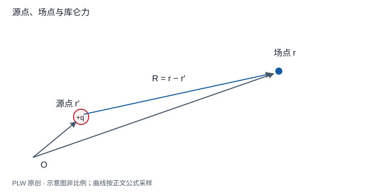

本页属于 [第 1 章：电荷与静电场](./index.md)，是本章第 1 个专题．

## 从带电现象提出可测量的问题

摩擦后的物体会吸引轻小物体，但吸引本身不能判定对方带有异号净电荷：中性物体也可能发生极化．我们需要一个有正负号、可以相加并能定量预测作用力的物理量，这就是电荷量 $q$．读完本页，应能区分电荷转移与产生、正确写出两点电荷作用力，并说明何时可以使用点电荷模型．先修仅需力和矢量分解．

## 电荷守恒与量子化

对孤立系统，总电荷代数和不变．摩擦起电通常是电子转移，不是凭空产生电荷；一方增多少，另一方减多少．正负号是约定，电子带负电，质子带正电．宏观物体的净电荷通常可写成 $q=ne$，其中 $n$ 为有符号整数，元电荷 $e=1.602176634\times10^{-19}\,\mathrm C$ 是 SI 中的精确定义值．这不意味着连续分布模型不能成立：当观察尺度远大于微观间距时，许多离散电荷的平均分布可以近似连续．

带电粒子的产生或湮灭也须满足总电荷守恒．量子化与守恒是不同命题：前者约束可能取值，后者约束过程前后的代数和．

## 库仑定律的矢量形式

真空中两个静止点电荷，源电荷 $q_1$ 位于 $\boldsymbol r_1$，受力电荷 $q_2$ 位于 $\boldsymbol r_2$，令 $\boldsymbol R=\boldsymbol r_2-\boldsymbol r_1$．则：

$$
\boldsymbol F_{2\leftarrow1}
=\dfrac{1}{4\pi\varepsilon_0}\dfrac{q_1q_2}{R^3}\boldsymbol R
=k\dfrac{q_1q_2}{R^2}\hat{\boldsymbol R}
$$

$k=1/(4\pi\varepsilon_0)$，在常见计算中约取 $8.99\times10^9\,\mathrm{N\,m^2/C^2}$．$q_1q_2>0$ 时力沿 $\boldsymbol R$ 排斥，乘积为负时反向吸引．交换两电荷可得反向力．大小公式若已取绝对值，就不能再用负号解释大小．

点电荷要求物体尺寸相对相关距离足够小，或另有严格的球对称结果支持等效．任意带电金属球受外部电荷影响后一般不再球对称，不能只因外形为球就替换成球心电荷．介质中也不能在未知极化条件下直接把 $\varepsilon_0$ 换成任意常数．

## 完整例题：同号电荷的力与距离尺度

把 $q_1=q_2=1.0\,\mathrm{nC}$ 放在真空中，相距 $0.10\,\mathrm m$．以从第一颗指向第二颗为正，得到：

$$
F=8.99\times10^9\dfrac{(10^{-9})^2}{(0.10)^2}
=8.99\times10^{-7}\,\mathrm N
$$

力为排斥．距离加倍，力降到四分之一；若第二颗改成负电荷，大小不变、方向相反．单位检验为 $\mathrm{N\,m^2/C^2}\cdot\mathrm{C^2/m^2}=\mathrm N$．若把厘米直接当作米代入，会产生四个数量级的错误．

## 即时辨析与迁移练习

两块中性材料摩擦后，一块带 $+3e$，另一块必定带 $-3e$ 吗？只有把所有电荷交换对象都纳入孤立系统、且两块最初各自中性时才能这样判断；若漏掉空气、手或接地通路，条件不充分．

两点电荷固定在 $x=\pm a$，电荷分别为 $+q$ 和 $+4q$．轴线上何处可使第三颗非零试验电荷受合力为零？

??? note "参考解答"
    只可能在两者之间，两侧区域的力同向．令场点距左电荷为 $s$，由 $q/s^2=4q/(2a-s)^2$ 得 $s=2a/3$，即 $x=-a/3$．先判方向再平方，避免引入区域不符的根．这一平衡位置是否稳定，要留到第二章分析三维扰动．

## 学习衔接

前一页：[本章导读](./index.md)；下一页：[电场、叠加与电场线](./electric-field.md)．
