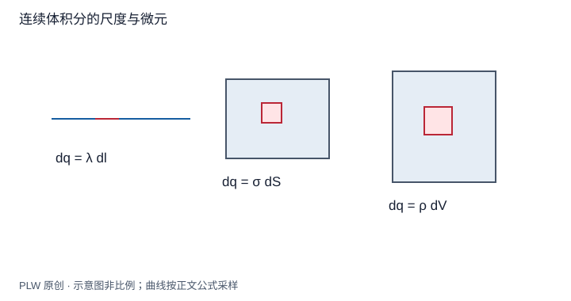

本页属于 [第 1 章：电荷与静电场](./index.md)，是本章第 3 个专题．

## 电荷很多时怎样求和

宏观带电体包含大量微观电荷．若我们只关心远大于粒子间距的尺度，可以先在小体元内平均，再把离散叠加近似成积分．读完本页，应能从几何与密度写出微元电荷和场，而不是先套某个结果公式．先修为定积分、基本矢量运算；柱球坐标的体积因子在这里随模型给出．

## 密度与连续体尺度

细线、薄面和体电荷分别使用：

$$
\mathrm{d}q=\lambda\,\mathrm{d}l',\qquad
\mathrm{d}q=\sigma\,\mathrm{d}S',\qquad
\mathrm{d}q=\rho\,\mathrm{d}V'
$$

密度的单位依次是 $\mathrm{C/m}$、$\mathrm{C/m^2}$、$\mathrm{C/m^3}$．它们可以有正负号，也可随位置变化．平均体元尺度应大于微观结构尺度，又小于宏观密度变化尺度．理想表面电荷是厚度被忽略的模型，不应再把同一电荷重复计作体分布．

## 一般积分与坐标权重

固定场点 $\boldsymbol r$，让源点 $\boldsymbol r'$ 遍历电荷所在区域：

$$
\boldsymbol E(\boldsymbol r)=k\int
\dfrac{\boldsymbol r-\boldsymbol r'}{|\boldsymbol r-\boldsymbol r'|^3}\,\mathrm{d}q
$$

距离的三次方已包含一个归一化方向因子；如果改用单位矢量，分母才是二次方．直角坐标 $\mathrm{d}V'=\mathrm{d}x'\mathrm{d}y'\mathrm{d}z'$，柱坐标为 $s'\mathrm{d}s'\mathrm{d}\theta'\mathrm{d}z'$，球坐标为 $r'^2\sin\theta'\mathrm{d}r'\mathrm{d}\theta'\mathrm{d}\phi'$．这些几何权重不能省掉．

实际建模按四步进行：先画几何、标场点和源点；再选积分变量与密度；用对称性判断抵消分量；最后积分并核对方向、量纲及远场．连续积分在源点附近可能需要单独处理，不能把表面跃变位置当作普通光滑场点．

## 完整例题：非均匀带电细棒的轴线场

细棒位于 $0\le x'\le L$，$\lambda(x')=\lambda_0x'/L$，求场点 $x=b>L$ 的场．每个微元到场点的方向都为 $+\boldsymbol e_x$，故：

$$
E_x=\dfrac{k\lambda_0}{L}\int_0^L\dfrac{x'}{(b-x')^2}\,\mathrm{d}x'
=\dfrac{k\lambda_0}{L}\left[\dfrac{b}{b-L}-1+\ln\dfrac{b-L}{b}\right]
$$

积分可令 $u=b-x'$，把被积函数拆成 $b/u^2-1/u$．总电荷是 $Q=\lambda_0L/2$；当 $b\gg L$，展开方括号的首个非零项为 $L^2/(2b^2)$，得到 $E_x\simeq kQ/b^2$，符合远场点电荷结果．对数中的比值无量纲．

## 即时辨析与迁移练习

同一根棒把 $x'$ 改记为 $u$，结果应改变吗？不应；积分变量只是源点的标签．但把积分过程中变化的距离 $b-x'$ 提到积分号外会改变问题．

均匀带电半圆弧半径为 $R$，位于上半平面，总电荷为 $Q>0$，求圆心电场．

??? note "参考解答"
    用极角 $0\le\theta\le\pi$，$\lambda=Q/(\pi R)$，$\mathrm{d}q=\lambda R\,\mathrm{d}\theta$．水平方向抵消，$E_y=-k\lambda\int_0^\pi\sin\theta\,\mathrm{d}\theta/R=-2kQ/(\pi R^2)$．方向向下，与正电荷推开正探针的直觉一致．

## 学习衔接

前一页：[电场、叠加与电场线](./electric-field.md)；下一页：[直线、圆环与圆盘的电场](./field-integrals.md)．
