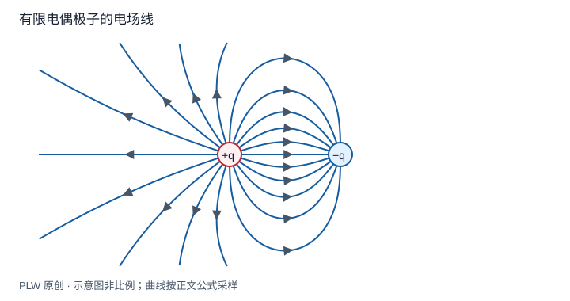

本页属于 [第 1 章：电荷与静电场](./index.md)，是本章第 2 个专题．

## 把空间的性质与探针的性质分开

同一位置放不同的小试验电荷，受力随其电荷量变化；比值可以描述该位置的场．理想的静止探针不显著扰动源分布，定义[电场](concept:electric-field)：

$$
\boldsymbol E(\boldsymbol r)=\lim_{q_0\to0}\dfrac{\boldsymbol F(\boldsymbol r)}{q_0},
\qquad \boldsymbol F=q_0\boldsymbol E
$$

极限表示忽略探针扰动的经典理想化，不是断言真实孤立电荷可以连续小于元电荷．电场单位为 $\mathrm{N/C}$，方向是正试验电荷受力方向；负电荷受力反向．本页要求你从源点写出总场，并读懂场线图．

## 叠加原理与场线

对给定的静态点电荷系，源点 $\boldsymbol r_i$ 不随探针改变：

$$
\boldsymbol E(\boldsymbol r)=k\sum_iq_i
\dfrac{\boldsymbol r-\boldsymbol r_i}{|\boldsymbol r-\boldsymbol r_i|^3}
$$

必须叠加矢量而非大小．若导体中的源电荷会移动，应先确定新的平衡分布，再叠加各部分的场．场线切向给出场方向，约定单位垂直面积的线数反映大小；这是一种绘图约定．静电场线在普通非零场点不能交叉，不表示粒子的运动轨迹，也不直接表示传播过程．从力的描述改用场，使每个空间位置都有可讨论的物理量；场能及有限传播速度将在后续理论中进一步说明．

## 完整例题：有限电偶极子的两条特殊线

负电荷在 $z=-a$，正电荷在 $z=a$，定义 $\boldsymbol p=2qa\boldsymbol e_z$．先求轴线正侧 $z>a$，再求中垂面上距中心 $s$ 的位置．轴线上：

$$
\boldsymbol E(z)=kq\left[\dfrac{1}{(z-a)^2}-\dfrac{1}{(z+a)^2}\right]\boldsymbol e_z
=\dfrac{4kqaz}{(z^2-a^2)^2}\boldsymbol e_z
$$

中垂面上两电荷到场点等距，横向分量相消，沿 $z$ 的分量同向：

$$
\boldsymbol E(s)=-\dfrac{2kqa}{(s^2+a^2)^{3/2}}\boldsymbol e_z
$$

前者仅写了 $z>a$ 分支，不可把带符号的负轴坐标直接代入这个受限表达式．远处分别趋于 $2kp/z^3$ 和 $-kp/s^3$，衰减快于单电荷的平方反比场，因为总电荷为零，领先项抵消．中垂面电势为零却存在电场，第二章将解释其原因．

## 即时辨析与迁移练习

在一个点总场为零，是否每个源的场也为零？不是．零是矢量合成的结果．电场线稀疏也不能说明那里没有电场．

在上面偶极子的中心放正试验电荷 $q_0$，求受力，并与把偶极子误当作总电荷为零的点源比较．

??? note "参考解答"
    中心到两电荷距离均为 $a$，两场均沿 $-\boldsymbol e_z$，因此 $\boldsymbol F=-2kqq_0\boldsymbol e_z/a^2$．「总电荷为零」只消除了远场单极项，不意味着处处无场，更不能把尺寸与观察距离相当的电荷系缩成一个点源．

## 学习衔接

前一页：[电荷与库仑定律](./charge-coulomb.md)；下一页：[连续电荷分布与积分建模](./continuous-charge.md)．
