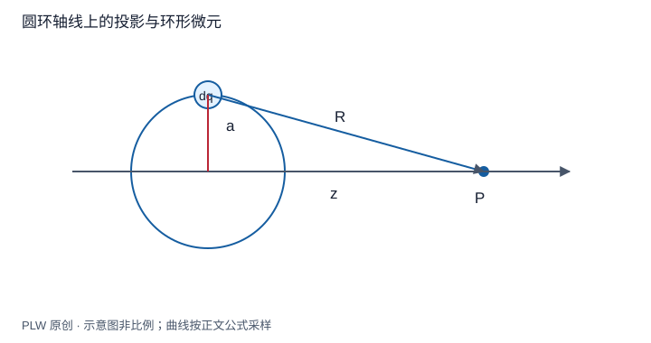

本页属于 [第 1 章：电荷与静电场](./index.md)，是本章第 4 个专题．

## 用少量模型学会积分方法

直棒、圆环和圆盘分别训练分量投影、横向抵消和分层积分．本页要求你不仅得到结果，还能说明所选微元为何让问题简化．先修是上一页的源场积分和基本定积分．

## 有限直线的中垂线场

带电棒位于 $-L\le x'\le L$，线密度 $\lambda$，场点为 $(0,s)$，$s>0$．左右微元的水平分量抵消，竖直投影为：

$$
\mathrm{d}E_s=k\lambda\dfrac{s\,\mathrm{d}x'}{(x'^2+s^2)^{3/2}},\qquad
E_s=k\lambda\left[\dfrac{x'}{s\sqrt{x'^2+s^2}}\right]_{-L}^{L}
=\dfrac{2k\lambda L}{s\sqrt{L^2+s^2}}
$$

当 $s\gg L$，恢复总电荷 $Q=2\lambda L$ 的 $kQ/s^2$；当 $L\gg s$，得到无限直线近似 $E_s=\lambda/(2\pi\varepsilon_0s)$．这里无限线近似要求离端点足够远，不能用于有限棒端部附近．

## 圆环轴线场

半径 $a$，总电荷 $Q$ 的均匀圆环位于 $z=0$．轴线上每个微元到 $(0,0,z)$ 距离相同，但仍须投影：

$$
E_z=k\int\dfrac{z\,\mathrm{d}q}{(a^2+z^2)^{3/2}}
=\dfrac{kQz}{(a^2+z^2)^{3/2}}
$$

这个有符号公式对轴线两侧都成立．$z=0$ 为零，远处为 $kQz/|z|^3$．若只把微元场的大小相加，就漏掉投影因子 $z/\sqrt{a^2+z^2}$．

## 圆盘：把面积分变成环积分

半径 $a$、面密度 $\sigma$ 的圆盘，把半径 $s$、宽 $\mathrm{d}s$ 的同心环作微元，$\mathrm{d}q=2\pi\sigma s\,\mathrm{d}s$．在 $z>0$：

$$
E_z=2\pi k\sigma z\int_0^a\dfrac{s\,\mathrm{d}s}{(s^2+z^2)^{3/2}}
=\dfrac{\sigma}{2\varepsilon_0}\left(1-\dfrac{z}{\sqrt{a^2+z^2}}\right)
$$

两侧统一写成 $E_z=\sigma[\operatorname{sgn}(z)-z/\sqrt{a^2+z^2}]/(2\varepsilon_0)$，但不在理想电荷面上直接取 $z=0$ 的普通场值．上、下极限相差 $\sigma/\varepsilon_0$．

## 完整例题：从圆盘检验无限平面和远场

固定 $\sigma,z>0$，令 $a\to\infty$，得到 $E_z=\sigma/(2\varepsilon_0)$．这解释了宽板中央附近为什么场近似恒定．若固定圆盘半径而令 $z\gg a$，由 $(1+a^2/z^2)^{-1/2}\simeq1-a^2/(2z^2)$ 得：

$$
E_z\simeq\dfrac{\sigma a^2}{4\varepsilon_0z^2}
=\dfrac{kQ}{z^2},\qquad Q=\pi a^2\sigma
$$

两个极限控制的尺度不同，不能先把圆盘当成无限平面，再期待在远处恢复有限总电荷的场．

## 即时辨析与迁移练习

圆环中心场为零，沿轴线是否也处处为零？不成立，只有中心的轴向分量也完全抵消．

均匀圆环的轴线上，正半轴何处场强最大？

??? note "参考解答"
    对 $E_z=kQz(a^2+z^2)^{-3/2}$ 求导，得到 $\mathrm{d}E_z/\mathrm{d}z=kQ(a^2-2z^2)/(a^2+z^2)^{5/2}$．故最大值位于 $z=a/\sqrt2$，大小为 $2kQ/(3\sqrt3a^2)$．中心与无穷远均为零，极值位置和量纲都合理．

## 学习衔接

前一页：[连续电荷分布与积分建模](./continuous-charge.md)；下一页：[电通量与高斯定理](./gauss-law.md)．
