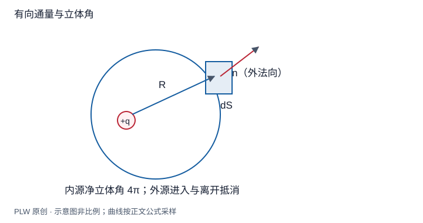

本页属于 [第 1 章：电荷与静电场](./index.md)，是本章第 5 个专题．

## 从局部电场走向整体通量

一张闭合曲面上有无穷多个场点，能否用一个量描述电场穿过整个边界的净效果？本页建立[电通量](concept:electric-flux)，并由库仑定律与叠加原理推出[高斯定理](concept:gauss-law)．读完后，你应能判断通量的符号、计算点电荷对闭合面的贡献，并说明为何通量不能直接给出每一点的电场．

## 面元、定向与积分

平面小片面积为 $\mathrm{d}S$，选定单位法向 $\hat{\boldsymbol n}$，定义面积矢量 $\mathrm{d}\boldsymbol S=\hat{\boldsymbol n}\,\mathrm{d}S$．小片通量为：

$$
\mathrm{d}\Phi_E=\boldsymbol E\cdot\hat{\boldsymbol n}\,\mathrm{d}S
=E\cos\theta\,\mathrm{d}S,\qquad
\Phi_E=\int_S\boldsymbol E\cdot\mathrm{d}\boldsymbol S
$$

正号表示沿所选法向穿过，负号表示反向．对闭合面统一选外法向；曲面本身不运动，通量也不表示电荷真的穿过它．单位是 $\mathrm{N\,m^2/C}$．改变开曲面的定向只改变符号．

## 从点电荷到任意闭合面

先让电荷 $q$ 位于半径 $r$ 的球心．由球对称性，场处处沿外法向，得：

$$
\Phi_E=\dfrac{q}{4\pi\varepsilon_0r^2}\,4\pi r^2
=\dfrac{q}{\varepsilon_0}
$$

这里半径消去来自平方反比律和球面积的共同作用．对于任意形状的曲面，令 $\boldsymbol R$ 从电荷指向面元，定义有向立体角：

$$
\mathrm{d}\Omega=\dfrac{\hat{\boldsymbol R}\cdot\hat{\boldsymbol n}}{R^2}\,\mathrm{d}S,
\qquad
\mathrm{d}\Phi_E=\dfrac{q}{4\pi\varepsilon_0}\,\mathrm{d}\Omega
$$

从电荷出发看闭合面，若电荷在内部，每条射线沿途的出入交点有向计数净为一次，故总有向立体角为 $4\pi$；即使表面有凹陷，多出的进入、离开贡献也成对抵消．若电荷在外部，每条射线的进入和离开成对，净立体角为零．此处要求闭合面分块光滑且不经过点电荷．

把各电荷的电场叠加，再利用积分的线性性：

$$
\oint_S\boldsymbol E\cdot\mathrm{d}\boldsymbol S
=\sum_i\oint_S\boldsymbol E_i\cdot\mathrm{d}\boldsymbol S
=\dfrac{Q_{\mathrm{enc}}}{\varepsilon_0}
$$

连续分布时 $Q_{\mathrm{enc}}=\int_V\rho\,\mathrm{d}V$．面上的 $\boldsymbol E$ 是内外全部电荷产生的总场；只有它的闭合面净通量由内部总电荷决定．这是经验静电规律的一个等价表达，不是仅凭曲面的几何就能得到的源场关系．

## 完整例题：立方体外的电荷

边长 $a$ 的立方体中心有点电荷 $q$，外部另有点电荷 $Q$，求总通量，能否求每个面的通量？

先按位置区分源：$q$ 被包围，$Q$ 不被包围．因此总通量是 $q/\varepsilon_0$．若只有中心电荷，六个面由对称性等价，每面通量为 $q/(6\varepsilon_0)$．加入一般位置的外电荷后，六面不再等价，各面通量需要对外电荷场另行积分，不能继续平均分配．

检验：令 $Q$ 移到很远，总通量不变，各面通量才逐渐接近中心电荷的结果．这同时说明「外电荷不贡献净通量」不等于「外电荷不改变面上的场」．

## 即时辨析

闭合面通量为零，面上电场是否处处为零？不一定．匀强场穿过一个没有内部电荷的盒子，进入和流出通量相等，但每一点电场均可非零．反过来，某一点电场为零也不能说明附近闭合面内净电荷为零．

## 迁移练习

均匀电场 $\boldsymbol E=E_0\boldsymbol e_z$ 中，半径 $R$ 的上半球面取向外法向．求半球面的通量，并用封闭曲面检验．

??? note "参考解答"
    以底面圆盘补成闭合面．底面外法向为 $-\boldsymbol e_z$，其通量为 $-E_0\pi R^2$；内部无电荷，故半球曲面通量为 $E_0\pi R^2$．不能使用半球面积 $2\pi R^2$ 直接乘以场强，因为局部法向在变化．

## 学习衔接

前一页：[直线、圆环与圆盘的电场](./field-integrals.md)；下一页：[高斯定理与三类对称性](./symmetry.md)．
