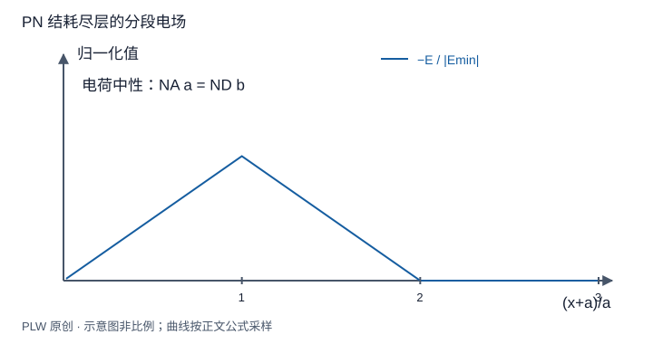

本页属于 [第 1 章：电荷与静电场](./index.md)，是本章第 7 个专题．

## 对称性被破坏后仍可保留对称模型

不对称问题未必需要直接三重积分．如果可以把它分解成若干已知的对称分布，就能先求各自场再做矢量叠加．本页用偏心空腔与分层模型训练这种思路，并判断何时需要外边界条件补足常数．

## 偏心球形空腔的割补

体密度 $\rho$ 的绝缘实心球挖去一个完全包含于球内的球形空腔，原球心 $O$，腔心 $O'$，令 $\boldsymbol a=\overrightarrow{OO'}$．把挖去的部分表示成密度 $-\rho$ 的小球．腔内点 $P$ 相对两心的位置满足 $\boldsymbol r=\boldsymbol a+\boldsymbol r'$，因此：

$$
\boldsymbol E(P)=\dfrac{\rho\boldsymbol r}{3\varepsilon_0}
-\dfrac{\rho\boldsymbol r'}{3\varepsilon_0}
=\dfrac{\rho\boldsymbol a}{3\varepsilon_0}
$$

腔内为匀强场，方向由密度和偏心方向决定．空腔内没有电荷却可以有非零场；该空腔属于给定体电荷分布的绝缘模型，不是导体静电平衡空腔．

## 共轴圆筒与双平面的分区叠加

无限长薄圆筒半径为 $a<b$，分别带线密度 $\lambda_1,\lambda_2$．由各圆筒的内外解叠加：

$$
E_s=
\begin{cases}
0, & s<a,\\
\lambda_1/(2\pi\varepsilon_0s), & a<s<b,\\
(\lambda_1+\lambda_2)/(2\pi\varepsilon_0s), & s>b.
\end{cases}
$$

等量异号时外部零场，内部间隙仍有场．两无限平面位于 $z_1,z_2$，给定面密度时可以统一写：

$$
E_z(z)=\dfrac{\sigma_1}{2\varepsilon_0}\operatorname{sgn}(z-z_1)
+\dfrac{\sigma_2}{2\varepsilon_0}\operatorname{sgn}(z-z_2)
$$

在两个面之间逐个判断方向，可避免把同号面和异号面的内外场关系记反．若平面代表可移动电荷的导体表面，面密度须先由导体约束确定．

## 完整例题：PN 结耗尽层的电场

仅建立一维静电近似：$-a<x<0$ 内 $\rho=-eN_A$，$0<x<b$ 内 $\rho=eN_D$，外部密度与场均取零．一维高斯关系 $\mathrm{d}E_x/\mathrm{d}x=\rho/\varepsilon_0$ 可由薄柱两端通量之差得到．从左侧边界积分：

$$
E_x(x)=
\begin{cases}
-eN_A(x+a)/\varepsilon_0, & -a<x<0,\\
eN_D(x-b)/\varepsilon_0, & 0<x<b,\\
0, & x<-a\ \text{或}\ x>b.
\end{cases}
$$

$x=0$ 没有面电荷，场连续，所以 $N_Aa=N_Db$．这正是耗尽区净电荷为零的条件．场从 n 侧正离子区指向 p 侧负离子区．

这个模型不解释载流子扩散和平衡电势的微观来源，只计算已给定空间电荷造成的场．第二章可由该分段场进一步积分求势差．

## 即时辨析与迁移练习

偏心挖孔球能否选一个球面，直接把总场提出通量积分？一般不能，因为挖孔破坏了球对称性．割补法恢复的是各个辅助分布的对称性．

在上面的球形空腔模型中令偏心量趋零，再把空腔半径缩小，腔内结果分别怎样变化？

??? note "参考解答"
    $\boldsymbol a\to0$ 时腔内场为零；固定非零 $\boldsymbol a$、缩小空腔半径时，腔内场公式不变，但可使用它的区域随之缩小．若缩至零体积，结果对应原球在 $\boldsymbol a$ 处的场，符合连续极限．

## 学习衔接

前一页：[高斯定理与三类对称性](./symmetry.md)；下一页：[本章综合练习](./exercises.md)．
