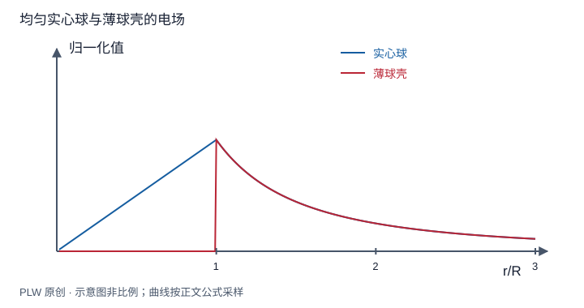

本页属于 [第 1 章：电荷与静电场](./index.md)，是本章第 6 个专题．

## 高斯定理何时能直接求场

高斯定理对一般静电场都成立，但一次通量积分只能给出一个整体约束．要从它求局部场，必须另有充分对称性确定方向和相应面上的大小．本页训练「先判断对称性，再选面」．先修是电通量和高斯定理．

## 球对称：球壳与实心球

若包括边界在内的整个物理问题在任意绕球心转动下不变，场只能为 $E_r(r)\boldsymbol e_r$，同心球面上大小相同．于是 $4\pi r^2E_r=Q_{\mathrm{enc}}/\varepsilon_0$．半径 $R$ 的均匀薄球壳总电荷为 $Q$，得到内部零场、外部 $kQ/r^2$．均匀实心球密度 $\rho=3Q/(4\pi R^3)$ 则为：

$$
E_r(r)=
\begin{cases}
\rho r/(3\varepsilon_0), & r<R,\\
kQ/r^2, & r>R.
\end{cases}
$$

实心球表面连续；薄壳表面有 $E_{\mathrm{out}}-E_{\mathrm{in}}=\sigma/\varepsilon_0$ 的跃变．两种分布不能仅因总电荷相同就混用内部解．

## 柱对称：不仅需要绕轴对称

无限长均匀线或圆柱还具有沿轴平移与相应反射对称性，场只沿径向．半径 $s$、长度 $l$ 的高斯柱面，其端面通量为零．对线电荷，$E_s2\pi sl=\lambda l/\varepsilon_0$．对半径 $R$、体密度 $\rho$ 的实心长圆柱：

$$
E_s=
\begin{cases}
\rho s/(2\varepsilon_0), & s<R,\\
\rho R^2/(2\varepsilon_0s), & s>R.
\end{cases}
$$

有限长圆柱只有绕轴对称，场一般还有轴向分量，不能直接套上述结果．

## 平面对称：薄面与厚平板

无限均匀薄面在两侧的场大小相同、方向相反．跨面小柱两端通量相加，得 $2EA=\sigma A/\varepsilon_0$．若均匀厚板占据 $|z|<h$，用中心对称小柱，内部包围电荷为 $2zA\rho$，所以：

$$
E_z=
\begin{cases}
\rho z/\varepsilon_0, & |z|<h,\\
(\rho h/\varepsilon_0)\operatorname{sgn}(z), & |z|>h.
\end{cases}
$$

边界处没有额外面电荷，因此场连续，斜率随体密度改变．理想无限面结果在有限板中央、距板远小于横向尺寸时才可近似使用．

## 完整例题：非均匀球对称密度

球内 $\rho(r)=\rho_0r/R$，球外无电荷，求内外场．因为仍球对称，可以积分包围电荷：

$$
Q(r)=4\pi\int_0^r\dfrac{\rho_0r'}Rr'^2\,\mathrm{d}r'
=\dfrac{\pi\rho_0r^4}R,\qquad
E_r(r<R)=\dfrac{\rho_0r^2}{4\varepsilon_0R}
$$

总电荷为 $\pi\rho_0R^3$，外场为 $\rho_0R^3/(4\varepsilon_0r^2)$．$r=R$ 连续，中心场趋零．密度不均匀并不妨碍高斯法，关键是对称性是否仍在．

## 即时辨析与迁移练习

在带电球旁放外电荷，同心高斯面还存在吗？面当然可以选，但总场不再具有所需球对称性，不能把总场提出积分号．

半径 $R$ 的无限长薄圆筒均匀带线电荷密度 $\lambda$，求内外场并检查表面跃变．

??? note "参考解答"
    内部包围电荷为零，结合完整柱对称性得 $E_s=0$；外部为 $\lambda/(2\pi\varepsilon_0s)$．面密度 $\sigma=\lambda/(2\pi R)$，表面跃变为 $\lambda/(2\pi\varepsilon_0R)=\sigma/\varepsilon_0$．这里零场依赖对称性，不能仅由零通量得出．

## 学习衔接

前一页：[电通量与高斯定理](./gauss-law.md)；下一页：[叠加、割补与分段电荷模型](./superposition.md)．
