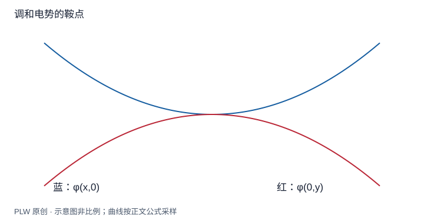

本页属于 [第 2 章：电势与静电场方程](./index.md)，是本章第 6 个专题．

## 为什么静电场难以构成稳定的真空陷阱

某点电场为零，只说明受力为零；稳定还要求微小位移后力把电荷拉回．本页把稳定性与无源区域电势的几何联系起来．先修是拉普拉斯方程和势能的极值；读完应能辨别局部平衡、鞍点与稳定势阱．

## 平均值性质的推导

取无电荷区域内一个完全包含于该区域的球，球心为 $O$．定义半径 $r$ 球面上的平均势 $\bar\varphi(r)=(4\pi)^{-1}\int\varphi(r,\theta,\phi)\,\mathrm{d}\Omega$．对半径求导，并使用 $\partial_r\varphi=-E_r$：

$$
\dfrac{\mathrm{d}\bar\varphi}{\mathrm{d}r}
=-\dfrac1{4\pi r^2}\oint_{S_r}\boldsymbol E\cdot\mathrm{d}\boldsymbol S=0
$$

球内无电荷使通量为零．当 $r\to0$，平均值趋于球心势，因此所有这样的球面平均势都等于球心势．这是调和电势的平均值性质．

若某内部点取得局部最大值，其邻近球面所有值均不大于球心；平均值却须相等，因此球面不能有更小值，邻域内势只能恒定．把这一结论沿连通区域延伸，就得到强最大值原理：非恒定调和函数不能在内部取得局部极大或极小值．有界区域的极值由边界控制．

## 恩绍定理与条件

固定外源的静电场，在不含源电荷的邻域内满足拉普拉斯方程．试验点电荷的势能为 $W=q\varphi$；无论 $q$ 正负，要形成严格稳定平衡都需要势能有孤立局部极小值，而调和性质排除了它．因此只靠固定源的静电力，不能在真空无源区域把自由点电荷稳定约束在三维位置上．

该结论不排除非静态电场、机械约束、其他力、带源区域或材料响应参与的稳定机制．沿一根轨道稳定不等于三维稳定；非严格平坦方向也不能提供恢复力．

## 完整例题：两颗同号固定电荷之间

两个 $+Q$ 固定在 $x=\pm a$，中心总场为零．令一颗小正电荷 $q$ 在中心附近移动．轴线上：

$$
\varphi(x,0)=kQ\left(\dfrac1{a-x}+\dfrac1{a+x}\right)
\simeq\dfrac{2kQ}{a}+\dfrac{2kQ}{a^3}x^2
$$

沿轴势能向两侧增大，看似稳定．但沿垂直方向：

$$
\varphi(0,y)=\dfrac{2kQ}{\sqrt{a^2+y^2}}
\simeq\dfrac{2kQ}{a}-\dfrac{kQ}{a^3}y^2
$$

势能反而下降，扰动把正电荷推离中心．负电荷则交换稳定与不稳定方向，仍不能三维稳定．展开中要求位移远小于 $a$．

## 即时辨析与迁移练习

某点满足 $\nabla\varphi=0$，是否已经是势的极值？不是，梯度为零是驻点条件，鞍点也满足．

电势 $\varphi=A(x^2+y^2+z^2)$ 能否在无源区域内作为静电势阱？

??? note "参考解答"
    $\nabla^2\varphi=6A$，所以若 $A\ne0$，需要体电荷 $\rho=-6\varepsilon_0A$，不满足无源条件．对正电荷且 $A>0$，它的确构成理想谐势阱，但使用的是含源模型，不能当作恩绍定理的反例．

## 学习衔接

前一页：[静电场的局域方程](./field-equations.md)；下一页：[电偶极子的完整远场](./dipole.md)．
