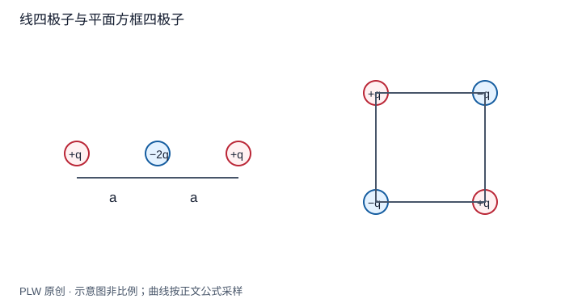

本页属于 [第 2 章：电势与静电场方程](./index.md)，是本章第 8 个专题．

## 远处如何辨认电荷分布的形状

远处首先看到总电荷；若它为零，领先信息可能是偶极矩；偶极矩也为零时，四极矩可能主导．本页从积分核推导这种层次，完整计算课件的线形与平面四极子．先修是多元 Taylor 展开、偶极远场与基本求导．

## 核的展开与矩的定义

原点选在局域分布附近，$r$ 大于所有源点距离 $r'$．记 $\boldsymbol n=\boldsymbol r/r$，从 $[r^2-2r\boldsymbol n\cdot\boldsymbol r'+r'^2]^{-1/2}$ 作二阶展开：

$$
\dfrac1{|\boldsymbol r-\boldsymbol r'|}
=\dfrac1r+\dfrac{\boldsymbol n\cdot\boldsymbol r'}{r^2}
+\dfrac{3(\boldsymbol n\cdot\boldsymbol r')^2-r'^2}{2r^3}
+O\left(\dfrac{r'^3}{r^4}\right)
$$

逐项乘 $\mathrm{d}q$ 并积分，定义 $Q=\int\mathrm{d}q$、$p_i=\int r'_i\,\mathrm{d}q$ 以及无迹四极矩张量：

$$
\mathcal Q_{ij}=\int(3r'_ir'_j-r'^2\delta_{ij})\,\mathrm{d}q,
\qquad \sum_i\mathcal Q_{ii}=0
$$

其中 $\delta_{ij}$ 是 Kronecker 符号．电势至四极阶为：

$$
\varphi=k\left[\dfrac Qr+\dfrac{\boldsymbol p\cdot\boldsymbol n}{r^2}
+\dfrac1{2r^3}\sum_{i,j}\mathcal Q_{ij}n_in_j\right]+O(r^{-4})
$$

四极矩有不同的归一化约定，比较资料时必须同时比较势公式前的系数．一般第 $l$ 阶势按 $r^{-(l+1)}$ 衰减，场再多一个倒数距离因子．观察方向可能使某一阶角因子为零，此时须查看更高阶．

## 完整例题一：线四极子

$z=\pm a$ 各放 $+q$，原点放 $-2q$．总电荷、偶极矩均为零．逐项求和得 $\mathcal Q_{zz}=4qa^2$，$\mathcal Q_{xx}=\mathcal Q_{yy}=-2qa^2$，非对角元为零．所以：

$$
\varphi=\dfrac{kqa^2}{r^3}(3\cos^2\theta-1)+O(r^{-5})
$$

因构型反演对称，奇数阶消失．正轴精确势 $kq[(z-a)^{-1}+(z+a)^{-1}-2/z]$ 在 $z\gg a$ 时趋于 $2kqa^2/z^3$；再求导得正轴 $E_z\simeq6kqa^2/z^4$，与四极公式相符．

## 完整例题二：平面方框四极子

在 $(a,a,0)$、$(-a,-a,0)$ 放 $+q$，另两角放 $-q$．对角矩相消，仅 $\mathcal Q_{xy}=\mathcal Q_{yx}=12qa^2$ 非零．得到：

$$
\varphi=\dfrac{12kqa^2xy}{r^5}+O(r^{-5})
=\dfrac{6kqa^2}{r^3}\sin^2\theta\sin2\phi+O(r^{-5})
$$

第一式的余项按远场总阶数理解，$x,y$ 本身随 $r$ 同阶变化．在 $x=0$ 或 $y=0$ 平面，精确势也因相消为零；但不能据此认为这些平面上的法向电场为零．

## 原点选择、辨析与迁移练习

原点平移 $\boldsymbol a$ 后，$\boldsymbol p'=\boldsymbol p-Q\boldsymbol a$．因此只有 $Q=0$ 时偶极矩与原点无关；当 $Q=0$ 且 $\boldsymbol p=0$，四极矩也与平移无关．改变原点会重新分配各阶贡献，但完整电势不变．

把单个电荷 $q$ 放在 $z=a$，分别以原点和电荷自身为原点描述，是否出现物理矛盾？

??? note "参考解答"
    以原点展开有 $Q=q$、$\boldsymbol p=qa\boldsymbol e_z$ 及更高阶矩；以电荷自身为原点只有单极项．两套径向距离、方向也不同，完整求和给出同一库仑势．保留有限阶时只在各自满足尺度条件的远场区域作近似比较．

## 学习衔接

前一页：[电偶极子的完整远场](./dipole.md)；下一页：[本章综合练习](./exercises.md)．
