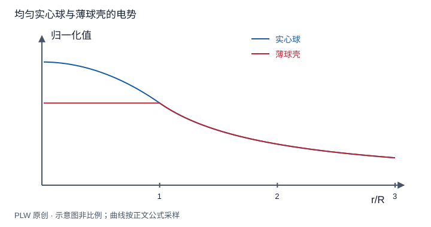

本页属于 [第 2 章：电势与静电场方程](./index.md)，是本章第 3 个专题．

## 两种算法如何选择

已知电荷分布时，电势可直接标量相加；若电场容易通过对称性求得，则沿路径积分更方便．本页要求你在这两条路线之间选择，并能正确拼接分段解．先修是电势定义、场强积分和高斯模型．

## 电荷积分：圆环与圆盘

在允许取无穷远零势的局域体系中：

$$
\varphi(\boldsymbol r)=k\int\dfrac{\mathrm{d}q}{|\boldsymbol r-\boldsymbol r'|}
$$

半径 $a$ 的均匀圆环轴线上所有微元到场点等距，所以 $\varphi(z)=kQ/\sqrt{a^2+z^2}$．圆盘可看成同心环，利用 $\mathrm{d}q=2\pi\sigma s\,\mathrm{d}s$：

$$
\varphi(z)=2\pi k\sigma\int_0^a\dfrac{s\,\mathrm{d}s}{\sqrt{s^2+z^2}}
=\dfrac{\sigma}{2\varepsilon_0}\left(\sqrt{a^2+z^2}-|z|\right)
$$

对 $z\ne0$ 求负导数，恢复第一章圆盘场．绝对值使两侧方向正确；不能在 $z=0$ 忽略不可微性．若中心挖去半径 $b$ 的圆孔，只需减去小盘势，得到 $\sigma[\sqrt{a^2+z^2}-\sqrt{b^2+z^2}]/(2\varepsilon_0)$．

## 场积分：球壳与均匀实心球

球壳外 $E_r=kQ/r^2$，故外势为 $kQ/r$；内部场为零，势是边界值 $kQ/R$．实心球内部不能套点电荷势，应从表面往内积分：

$$
\varphi(r)=\varphi(R)-\int_R^r\dfrac{kQr'}{R^3}\,\mathrm{d}r'
=\dfrac{kQ}{2R}\left(3-\dfrac{r^2}{R^2}\right),\qquad r<R
$$

分段积分产生的常数由势连续及统一零点决定．这里没有理想偶极层，势连续；表面面电荷可以使法向导数跃变．

## 完整例题：无限长圆柱的势差

均匀带电实心长圆柱半径 $R$、体密度 $\rho$，选 $\varphi(R)=0$．分别积分内外场，得到：

$$
\varphi(s)=
\begin{cases}
\rho(R^2-s^2)/(4\varepsilon_0), & s<R,\\
-\rho R^2\ln(s/R)/(2\varepsilon_0), & s>R.
\end{cases}
$$

在表面势与径向导数均连续；无穷远势发散不是计算错误，而是无限电荷模型与无穷远零势不相容．式中对数变量必须无量纲．若只求两半径之间的电压，结果完全有限．

## 即时辨析与迁移练习

「势是标量，所以任何情况下直接叠加已知公式即可」还缺少什么？各项必须使用相容的零点，且源分布是实际问题中的分布；导体感应后不能保留原先的均匀密度不变．

对第一章 PN 结模型，由分段场求 $\varphi(b)-\varphi(-a)$．

??? note "参考解答"
    势差是负的场积分．两侧场均负，故结果为 $e(N_Aa^2+N_Db^2)/(2\varepsilon_0)>0$，并使用 $N_Aa=N_Db$ 保证接口场连续．势差等于场强图中两个三角形面积的绝对值之和．

## 学习衔接

前一页：[电势、电势差与参考零点](./potential-reference.md)；下一页：[等势面与电势梯度](./potential-gradient.md)．
