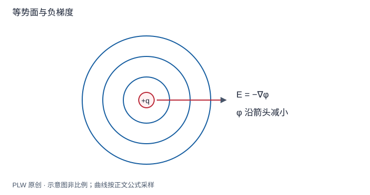

本页属于 [第 2 章：电势与静电场方程](./index.md)，是本章第 4 个专题．

## 一个方向上的变化如何确定整个场

电势是标量，但它在各方向上的变化率合起来能够恢复矢量电场．本页从微小位移推导[梯度](concept:gradient)，再说明曲线坐标中的尺度因子．先修是偏导数和电势差定义；读完应能由三维势求场，而不只会沿一条曲线求导．

## 方向导数与负梯度

在光滑区域，电势全微分一方面由偏导数给出，另一方面由场积分定义给出：

$$
\mathrm{d}\varphi=\dfrac{\partial\varphi}{\partial x}\mathrm{d}x
+\dfrac{\partial\varphi}{\partial y}\mathrm{d}y+\dfrac{\partial\varphi}{\partial z}\mathrm{d}z
=-\boldsymbol E\cdot\mathrm{d}\boldsymbol r
$$

任意微位移都成立，因此：

$$
\boldsymbol E=-\nabla\varphi,
\qquad \nabla\varphi=\boldsymbol e_x\partial_x\varphi+
\boldsymbol e_y\partial_y\varphi+\boldsymbol e_z\partial_z\varphi
$$

沿单位方向 $\boldsymbol u$ 的变化率为 $\nabla\varphi\cdot\boldsymbol u$，由点积的界知梯度指向增长最快方向．电场则指向下降最快方向．等势面切向位移使 $\mathrm{d}\varphi=0$，所以在场非零、势面光滑处，电场与等势面正交．

## 曲线坐标为何有额外因子

柱坐标使用 $(s,\theta,z)$，局部实际位移为 $\mathrm{d}\boldsymbol r=\boldsymbol e_s\mathrm{d}s+\boldsymbol e_\theta s\mathrm{d}\theta+\boldsymbol e_z\mathrm{d}z$．将其与全微分比较：

$$
\nabla\varphi=\boldsymbol e_s\dfrac{\partial\varphi}{\partial s}
+\boldsymbol e_\theta\dfrac1s\dfrac{\partial\varphi}{\partial\theta}
+\boldsymbol e_z\dfrac{\partial\varphi}{\partial z}
$$

球坐标约定极角 $\theta$ 从正 $z$ 轴量起，方位角为 $\phi$；局部弧长分别是 $\mathrm{d}r,r\mathrm{d}\theta,r\sin\theta\mathrm{d}\phi$，所以：

$$
\nabla\varphi=\boldsymbol e_r\partial_r\varphi
+\boldsymbol e_\theta\dfrac1r\partial_\theta\varphi
+\boldsymbol e_\phi\dfrac1{r\sin\theta}\partial_\phi\varphi
$$

电势符号 $\varphi$ 与方位角 $\phi$ 在此有不同含义．因子来自角度与实际长度的换算，不能把三个偏导数直接当成三个正交方向的场分量．

## 完整例题：由三维势求场

设 $\varphi=\alpha(x^2-y^2)+\beta z$，系数具有使电势单位为伏特的量纲．逐项偏导得 $\boldsymbol E=-2\alpha x\boldsymbol e_x+2\alpha y\boldsymbol e_y-\beta\boldsymbol e_z$．沿 $x$ 方向势增大处，场确实反向；$\beta$ 项对应匀强电场．

如果只给出圆环轴线上的 $\varphi(z)$，只能直接得到轴向分量 $E_z=-\mathrm{d}\varphi/\mathrm{d}z$；横向分量为零还依赖圆环对称性．不能把轴线上取得的函数当成整个三维空间的势再求任意方向偏导．

## 即时辨析与迁移练习

等势面画得更密是否必然场更强？只有相邻曲线代表相同势差，且比较实际垂直距离时，才能作这种判断．

设球坐标势为 $\varphi=A\cos\theta/r^2$，求三个场分量并核对单位．

??? note "参考解答"
    $E_r=2A\cos\theta/r^3$，$E_\theta=A\sin\theta/r^3$，$E_\phi=0$．角向分量必须有 $1/r$，因此两非零分量具有相同单位 $\mathrm{V/m}$．这将在偶极远场中再次出现．

## 学习衔接

前一页：[电势的计算](./potential-calculation.md)；下一页：[静电场的局域方程](./field-equations.md)．
