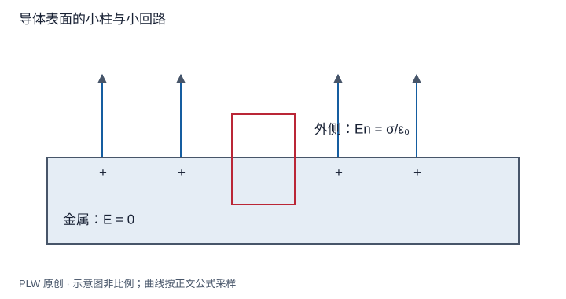

本页属于 [第 3 章：静电场中的导体与边值问题](./index.md)，是本章第 1 个专题．

## 从给定电荷分布到未知电荷分布

前两章通常先给密度，再求场．金属中的自由电荷却会重新分布，直到不再发生宏观定向迁移．本页建立[静电平衡](concept:electrostatic-equilibrium)的约束，作为求解未知表面电荷的起点．先修为高斯定理、环路定理与电势；读完应能推导内外边界条件并区分材料与空腔．

## 材料内部为何场为零

在理想宏观导体的静电平衡模型中，若材料内部有持续驱动自由电荷的电场，电荷就会继续调整，所以平衡要求 $\boldsymbol E_{\mathrm{metal}}=\boldsymbol0$．这不是所有导电状态都满足的规律；稳恒电流中的普通电阻导体可以有非零内部场．

沿导体材料中任意路径，$\Delta\varphi=-\int\boldsymbol E\cdot\mathrm{d}\boldsymbol l=0$，所以一个连通导体等势．对完全位于材料中的任意小高斯体积，通量为零，故净体电荷密度为零；宏观过剩净电荷分布在表面．原子尺度的正负电荷依然存在，不能把「净体密度为零」写成「材料内部没有任何电荷」．

## 从小柱和小回路得到边界条件

把高斯小柱跨在带面密度 $\sigma$ 的边界上，侧面通量在高度趋零时消失：

$$
E_{\mathrm{out},n}-E_{\mathrm{in},n}=\dfrac\sigma{\varepsilon_0}
$$

这里法向从金属指向真空，内部场为零，因此 $E_{\mathrm{out},n}=\sigma/\varepsilon_0$．再把窄矩形回路跨界，长边平行界面，高度趋零得切向场连续；金属内切向场为零，因此外侧切向场也为零．场在光滑导体表面沿法向．

## 完整例题：孤立导体球

半径 $R$、净电荷 $Q$ 的孤立导体球，没有其他源且无穷远零势．由完整球对称性得 $\sigma=Q/(4\pi R^2)$，外场 $kQ/r^2$，球势为 $kQ/R$．表面外侧法向场为 $Q/(4\pi\varepsilon_0R^2)$，与小柱关系一致．

若把一个外部点电荷靠近球，表面仍等势，但 $\sigma$ 一般不再均匀，不能继续用 $Q/(4\pi R^2)$ 表示局部分布．第三章球面镜像法会真正求出这一分布．

## 曲率、尖端与表面力

某些特定几何或相距很远、相连的导体球，在共同电势下有较小半径对应较大面密度的现象．但局部曲率不能独自决定 $\sigma$：它还取决于整个形状、其他源及边界条件．尖端增强是有条件的整体边值结果，不是普遍的 $\sigma\propto1/R_{\mathrm{curv}}$ 定律．

求表面一层电荷的力时，不应把它自身的局部奇异自场计入．第四章会说明实际外来场对应内外极限平均值，在真空光滑导体表面给出电压力 $\sigma^2/(2\varepsilon_0)$．

## 即时辨析与迁移练习

一个导体带电时，内部可以存在空腔场吗？可以；内部零场说的是金属材料，空腔要另外分析．

两个相距远大于自身半径的导体球用细线相连，半径为 $R_1,R_2$，总电荷 $Q$．忽略相互影响及连线电荷，求电荷分配．

??? note "参考解答"
    等势给 $q_1/R_1=q_2/R_2$，再用 $q_1+q_2=Q$，得 $q_i=QR_i/(R_1+R_2)$．面密度之比为 $\sigma_1/\sigma_2=R_2/R_1$．远距离近似不可省略；靠近时须同时计入互相的势与感应．

## 学习衔接

前一页：[本章导读](./index.md)；下一页：[静电感应与多导体系统](./induction.md)．
