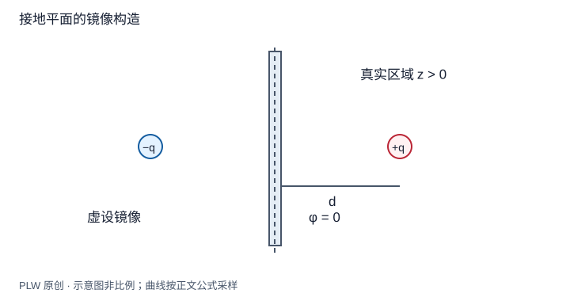

本页属于 [第 3 章：静电场中的导体与边值问题](./index.md)，是本章第 5 个专题．

## 把未知面电荷替换成可验证的构造

点电荷 $q$ 位于真空 $z>0$ 的 $(0,0,d)$，$z=0$ 是接地导体表面，导体占据下半空间．求真空侧的场．未知面密度很难直接求，但[镜像法](concept:image-charge-method)允许在求解区域外引入虚设电荷，只要不改变内部源并满足边界条件．先修为唯一性定理和电势叠加．

## 构造与验证

在 $(0,0,-d)$ 放虚设电荷 $-q$，记场点到两电荷的距离为 $r_+,r_-$．候选势为：

$$
\varphi(\boldsymbol r)=kq\left(\dfrac1{r_+}-\dfrac1{r_-}\right),\qquad z>0
$$

平面上 $r_+=r_-$，势为零；无穷远衰减到零；求解区域内只有真实电荷位置有正确的库仑奇点，像电荷在区域外．因此由唯一性定理，该势在真空侧就是实际解．导体内部真实势仍为零，不能把候选式延伸到导体内当成物理解．

## 完整例题：感应面密度及总量

用柱半径 $s$ 表示表面位置．对势取外侧法向导数，再用 $\sigma=\varepsilon_0E_z(0^+)$，得到：

$$
\sigma(s)=-\dfrac{qd}{2\pi(s^2+d^2)^{3/2}}
$$

正源电荷对应负面密度，越靠近垂足绝对值越大．它在整个平面上的积分为：

$$
Q_{\mathrm{ind}}=2\pi\int_0^\infty\sigma(s)s\,\mathrm{d}s
=-qd\left[-\dfrac1{\sqrt{s^2+d^2}}\right]_0^\infty=-q
$$

与像电荷总量一致，但真实电荷分布是连续面电荷，不是一个点．$\sigma$ 的单位为电荷除以面积；远处按 $s^{-3}$ 衰减，总积分收敛．

## 求真实电荷受力

真实电荷处应去掉它自身的库仑场，只保留感应场；构造中这恰由像电荷给出：

$$
\boldsymbol F=-\dfrac{kq^2}{(2d)^2}\boldsymbol e_z
=-\dfrac{q^2}{16\pi\varepsilon_0d^2}\boldsymbol e_z
$$

无论真实电荷正负，力都指向平面．然而实际体系的能量不能简单写成两颗独立真实电荷的相互作用能，第四章会推导二分之一因子．

## 即时辨析与迁移练习

镜像法是否只验证平面上某一点势为零就够了？不够，整个边界都须满足；还要检查源、求解区域及无穷远条件．

接地平面上方有两个点电荷 $q_1,q_2$，分别位于 $\boldsymbol r_1,\boldsymbol r_2$，怎样写总势？求其中一颗的力时应保留哪些项？

??? note "参考解答"
    对每颗真实电荷在平面反射位置各放一个反号像，四项库仑势相加．求第一颗受力时，保留第二颗真实电荷、第一颗的像和第二颗的像产生的场，去掉第一颗自己的奇异场．叠加依赖边界条件线性，不能随意把接地平面换成给定净电荷的孤立有限板．

## 学习衔接

前一页：[边值问题与唯一性定理](./uniqueness.md)；下一页：[导体球的镜像法](./image-sphere.md)．
