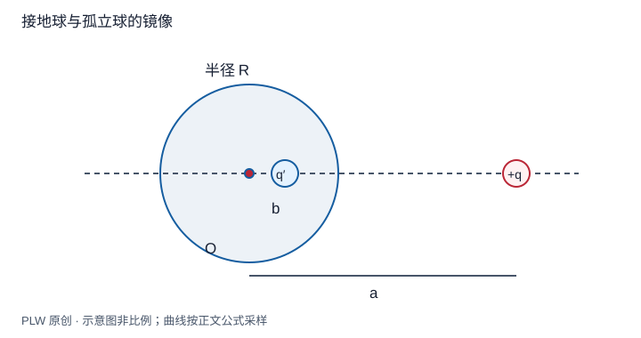

本页属于 [第 3 章：静电场中的导体与边值问题](./index.md)，是本章第 6 个专题．

## 曲面边界如何被镜像满足

半径 $R$ 的导体球外，在正 $z$ 轴距球心 $a>R$ 处放真实电荷 $q$．本页分别求接地球和给定净电荷 $Q_0$ 的孤立球，展示改变约束怎样改变镜像构造．先修为接地平面镜像、唯一性和球坐标法向导数．

## 从整个球面的势条件推导参数

设球内轴线上像电荷 $q'$ 位于 $z=b$．球面点与轴夹角为 $\theta$，到真实电荷和像的距离分别为：

$$
d_1^2=R^2+a^2-2Ra\cos\theta,\qquad
d_2^2=R^2+b^2-2Rb\cos\theta
$$

要使所有角度都满足 $q/d_1+q'/d_2=0$，距离比应为与角度无关的常数 $d_2=c d_1$．比较常数项与余弦系数得 $c=R/a$、$b=R^2/a$，于是：

$$
q'=-\dfrac Ra q,\qquad b=\dfrac{R^2}a
$$

球外候选势为真实电荷与像的势之和．它在球面和无穷远均为零，在球外源正确，像在被排除的球内，因此接地解成立．

## 完整例题：接地球表面电荷与受力

从 $E_r=-\partial_r\varphi|_{R^+}$ 计算：

$$
\sigma(\theta)=-\dfrac{q(a^2-R^2)}{4\pi R\,[a^2+R^2-2aR\cos\theta]^{3/2}}
$$

对正 $q$，整个球面均为负，最近点密度绝对值最大．积分可令 $u=a^2+R^2-2aR\cos\theta$，结果为 $Q_{\mathrm{ind}}=-qR/a=q'$．真实电荷受力沿轴线：

$$
F_z=\dfrac{kqq'}{(a-b)^2}=-\dfrac{kq^2Ra}{(a^2-R^2)^2}
$$

当 $a\gg R$，力按 $a^{-3}$ 衰减；这包含接地球可获得净电荷的影响，不能与孤立中性球的远场力混用．

## 给定净电荷的孤立球

孤立球只要求表面等势，电势值未知．保留上述像，再在球心加 $q_c=Q_0-q'=Q_0+qR/a$．中心电荷在球面产生常数势，不破坏等势；包围球、排除真实电荷的高斯面上，构造解给出总像电荷 $q'+q_c=Q_0$，满足净电荷约束．

$$
\varphi_{\mathrm{out}}=k\left(\dfrac q{|\boldsymbol r-a\boldsymbol e_z|}
+\dfrac{q'}{|\boldsymbol r-b\boldsymbol e_z|}+\dfrac{q_c}r\right)
$$

球势为 $kq_c/R$，面密度是在接地结果上加 $q_c/(4\pi R^2)$，真实电荷受力再加中心像贡献 $kqq_c/a^2$．对于中性球，近侧负感应、远侧正感应，净感应电荷为零；远处领先净力为吸引且按 $a^{-5}$ 衰减．

## 即时辨析与迁移练习

把接地球的像电荷直接用于中性孤立球，错误在哪里？它使球获得非零净电荷，违反孤立中性条件．

孤立球总电荷为 $Q_0$，令真实电荷远离到无穷远，说明球势、面密度和真实电荷受力的领先项．

??? note "参考解答"
    $q'\to0$、$q_c\to Q_0$，球势趋于 $kQ_0/R$，面密度趋于均匀的 $Q_0/(4\pi R^2)$．若 $Q_0\ne0$，受力领先为 $kqQ_0/a^2$；若 $Q_0=0$，此项抵消，必须保留诱导偶极响应，不能因单极项为零断言没有力．

## 学习衔接

前一页：[接地平面的镜像法](./image-plane.md)；下一页：[本章综合练习](./exercises.md)．
