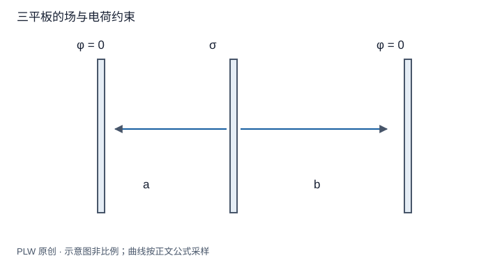

本页属于 [第 3 章：静电场中的导体与边值问题](./index.md)，是本章第 2 个专题．

## 感应分布由哪些条件决定

金属靠近电荷后，两侧出现异号感应电荷；孤立中性金属的净电荷仍为零，接地金属则可与大地交换电荷．本页用平板模型把这两个约束写进方程．先修为无限面的场与导体边界条件；读完应能列出足够条件，而不是假定两面总会平均分电荷．

## 两板：给定带电面与孤立中性板

无限绝缘带电面位于 $z=0$，面密度 $\sigma_0$；金属厚板位于 $a<z<b$，孤立且净面电荷为零．左、右表面密度分别为 $\sigma_L,\sigma_R$，有 $\sigma_L+\sigma_R=0$．由三个平面的场叠加，金属内部：

$$
0=\dfrac{\sigma_0+\sigma_L-\sigma_R}{2\varepsilon_0}
$$

解得 $\sigma_L=-\sigma_0/2$、$\sigma_R=\sigma_0/2$．这依赖无限面理想化和所选的无附加匀强外场条件；有限板存在边缘场，不能机械套用．

## 完整例题：两接地板之间的带电板

两接地外板位于 $z=-a,b$，中间薄导体板位于 $z=0$，净面密度为 $\sigma$．忽略边缘，只计算两个间隙；中板电势记为 $V$．由间隙电势线性变化：

$$
E_L=-\dfrac Va,\qquad E_R=\dfrac Vb
$$

中板两表面法向相反，分别有 $\sigma_L=-\varepsilon_0E_L$ 与 $\sigma_R=\varepsilon_0E_R$．再由总电荷约束：

$$
\sigma=\varepsilon_0V\left(\dfrac1a+\dfrac1b\right),\qquad
V=\dfrac{\sigma ab}{\varepsilon_0(a+b)}
$$

所以 $\sigma_L=\sigma b/(a+b)$，$\sigma_R=\sigma a/(a+b)$；左间隙宽度变小时，较多电荷分配到左侧．外板相向面分别带相反电荷．该间隙模型不要求推断外板背面分布；背面的场还需外部问题的数据．

## 接地改变的是约束，不是库仑定律

有限孤立导体给定净电荷、未知电势；接地后给定电势、净电荷变为求解结果．两种边值问题一般产生不同的场．对无限单带电面，不能同时生搬有限体系的无穷远零势；接地必须用相容的电压和远处条件建模．

## 即时辨析与迁移练习

中性导体是否必须处处不带面电荷？不是；「中性」是表面分布的积分约束．导体接地后也不必总带负电，感应符号取决于周围源与电位条件．

在三板例题中令 $a=b=d$，再将中板净面密度改成零但保持中板电势为外加的 $V$．能否同时满足所有条件？

??? note "参考解答"
    若中板确实孤立且净密度为零，两外板又都接地，则 $\sigma=2\varepsilon_0V/d=0$，只能有 $V=0$．若外接电源强制非零 $V$，它必须向中板提供净电荷，不能还要求它保持孤立中性．边界数据不能互相矛盾．

## 学习衔接

前一页：[导体静电平衡与表面边界条件](./equilibrium.md)；下一页：[空腔导体与静电屏蔽](./shielding.md)．
