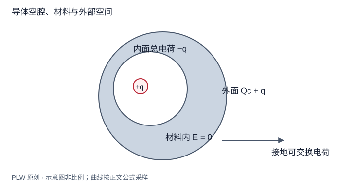

本页属于 [第 3 章：静电场中的导体与边值问题](./index.md)，是本章第 3 个专题．

## 把三个区域分开

一个金属壳包含空腔、金属材料和外部空间．只有第二个区域必定零场；空腔内是否有场、内部电荷能否影响外部，还要看源和接地条件．本页用高斯定理与最大值原理给出明确结论，下一页再证明一般唯一性．

## 无电荷的封闭空腔

静电平衡导体的内壁是常电势面 $\varphi=V_c$．若腔内没有电荷，势满足拉普拉斯方程；最大值原理要求腔内处处为 $V_c$，所以 $\boldsymbol E=0$．外部电荷可改变孤立壳的电势常数，却不改变这个零场结论．导体必须形成封闭边界；有开口时，不能直接援引此证明．

## 空腔内有电荷

在金属中取包围整个空腔的高斯面，面上场为零．若腔内净电荷为 $q$，内表面总电荷必为 $-q$．它的具体分布取决于内部几何和电荷位置，一般不均匀；高斯定理只确定总量．腔内场也一般非零．

对于给定且不随外部变化的腔内电荷分布，外部源的改变只可能使内壁共同电势常数改变；两个内部解之差满足零源和常数边界，因此腔内场不变．这就是屏蔽外部静电干扰的意义．

## 完整例题：内部点电荷与孤立球壳

导体壳外表面为半径 $R$ 的球，金属净电荷为 $Q_c$，腔内固定点电荷为 $q$，外部没有其他源．内表面总电荷为 $-q$，所以外表面总电荷为 $Q_c+q$．球形外边界等势，外部唯一的衰减解为：

$$
\varphi_{\mathrm{out}}=\dfrac{k(Q_c+q)}r,\qquad
\boldsymbol E_{\mathrm{out}}=\dfrac{k(Q_c+q)}{r^2}\boldsymbol e_r
$$

即使腔内点电荷偏心，外部解仍如此；关键是外表面球形等势、总电荷已知且外部无其他源．若改变 $q$ 而保持孤立金属的 $Q_c$，外部场随之改变．所以「屏蔽」不等于不论条件如何，腔内电荷对外部都无影响．

## 接地壳为何不同

若壳接地且无其他外部源，无穷远和壳面势均为零，外部解为零，外表面无电荷；地面可补入净电荷，使金属总电荷变成 $-q$．若外部另有源，内部电荷的改变在接地边界不变时不改变外部场，但外部本来可以非零．

屏蔽讨论均限于静电或足够慢的相应近似；不能据此断言薄金属壳屏蔽任意频率或稳恒磁场．

## 即时辨析与迁移练习

「金属材料内电势为零」对吗？一般只知道常数，不必为零．接地且采用大地为零基准时才取零．

孤立中性导体壳内放 $+q$，再把壳接地，最后先断开接地再取走 $q$．壳最终净电荷是多少？

??? note "参考解答"
    初始金属中性，内面 $-q$、外面 $+q$．接地后在无外部源条件下，外面电荷为零，金属净电荷变成 $-q$．断开接地后净电荷守恒，取走内部电荷后内面为零，$-q$ 重新分布到外面．改变操作顺序可能改变最终结果．

## 学习衔接

前一页：[静电感应与多导体系统](./induction.md)；下一页：[边值问题与唯一性定理](./uniqueness.md)．
