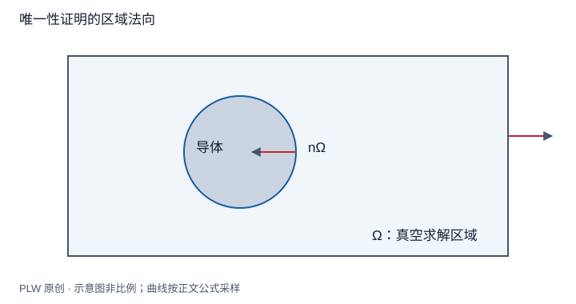

本页属于 [第 3 章：静电场中的导体与边值问题](./index.md)，是本章第 4 个专题．

## 为什么猜出的解也可能是严格解

给定一段空间中的电荷密度，并不能单独确定该区域的场；外部电荷可通过边界影响内部．本页把研究对象写成「区域、源、边界数据」，证明满足这些条件的场唯一，为后面的镜像法提供依据．先修是泊松方程、导体等势性和体积分；下面会现场推导所需的 Green 恒等式．

## 问题的数据必须完整

在连通真空区域 $\Omega$ 内，已知 $\rho(\boldsymbol r)$，要求：

$$
\nabla^2\varphi=-\dfrac{\rho}{\varepsilon_0}
$$

每个导体表面等势．可对每个导体指定电势，或指定净电荷；也可对不同导体分别采用这两类条件．外边界还须给定相容的边界条件；无界问题通常要求局域电荷体系的势在无穷远趋于指定常数．以下唯一性均以解存在、源相同及外边界条件相同为前提．指定导体净电荷不等于逐点指定其表面电荷密度．

## 固定电势：两解之差与最大值原理

假设有两个解 $\varphi_1,\varphi_2$，令 $w=\varphi_1-\varphi_2$．源项相消，所以 $\nabla^2w=0$．在指定相同电势的边界上 $w=0$．由[调和函数的最大值原理](../chapter-2/harmonic-stability.md)，在有界区域内 $w$ 的最大、最小值均被边界的零值限制，因此 $w=0$．

无界区域可先用大球截断，再令球半径增大；两解满足相同的远处条件，使球面上的差趋于零，得到相同结论．无穷远并不是可以遗漏的边界．若有相同点源，可在点源附近挖去小球；两解的共同库仑奇点抵消，差函数不保留该奇性．

## Green 恒等式从哪里来

对光滑的 $w$ 应用乘积求导：

$$
\nabla\cdot(w\nabla w)=|\nabla w|^2+w\nabla^2w
$$

积分并用散度定理，得到 Green 第一恒等式的本题形式：

$$
\int_\Omega|\nabla w|^2\,\mathrm{d}V
=\oint_{\partial\Omega}w\dfrac{\partial w}{\partial n_\Omega}\,\mathrm{d}S
-\int_\Omega w\nabla^2w\,\mathrm{d}V
$$

$\hat{\boldsymbol n}_\Omega$ 始终指向求解区域外部．在包围内侧导体的边界上，这个法向指入金属，与「从导体指向真空」的法向相反．

## 固定净电荷与混合条件的证明

因为差函数调和，体积分最后一项为零．逐个看边界项：固定电势的导体上 $w=0$；固定净电荷的导体上 $w=c_k$ 是常数，而高斯定理给出：

$$
\oint_{S_k}\dfrac{\partial w}{\partial n_\Omega}\,\mathrm{d}S
=\dfrac{Q_{1k}-Q_{2k}}{\varepsilon_0}=0
$$

所以该导体的边界积分也是零．外边界按共同的齐次差条件处理，无穷远项在通常的局域源衰减条件下消失．于是：

$$
\int_\Omega|\nabla w|^2\,\mathrm{d}V=0
\quad\Longrightarrow\quad
\nabla w=\boldsymbol0
\quad\Longrightarrow\quad
\boldsymbol E_1=\boldsymbol E_2
$$

被积函数非负，连续时只能处处为零．连通区域内 $w$ 是一个常数；若任一电势基准已经固定，这个常数也被固定．若只指定净电荷而没有固定电势基准，则共同加常数仍是同一物理场．这个结论没有要求不同导体的实际电势彼此相等．

## 完整例题：平行板间还有别的解吗

忽略边缘，真空区域 $0<z<d$ 无体电荷，板电势分别为 $0,V$，取横向平移不变的无限板模型．候选解 $\varphi=Vz/d$ 满足拉普拉斯方程和两板条件．在有界的对应边值问题中由唯一性即为唯一解；对无限板还必须限制横向行为，例如要求势有界，排除从横向无穷远引入的额外解．得到 $\boldsymbol E=-(V/d)\boldsymbol e_z$．

检验 $V=0$ 时场消失．若只说「两板电势已给定」却容许横向指数增长，则不足以直接援引有界域证明．理想模型的远处条件同样需要说清．

## 即时辨析与迁移练习

「找到满足边界的函数就是解」还缺少什么？还要验证求解区域内的源方程，且不能引入额外奇点．

两块互不接触的中性导体靠近一个外部点电荷，能否因净电荷均为零断言它们等势？

??? note "参考解答"
    不能．净电荷条件只约束各表面场的积分；每个导体分别等势，但电势值一般不同．唯一性证明中的常数差是两候选解的差，不能移用成不同导体之间的电势差．应把每块导体净电荷为零及共同外边界写入问题，再确定其各自电势．

## 学习衔接

前一页：[空腔导体与静电屏蔽](./shielding.md)；下一页：[接地平面的镜像法](./image-plane.md)．
