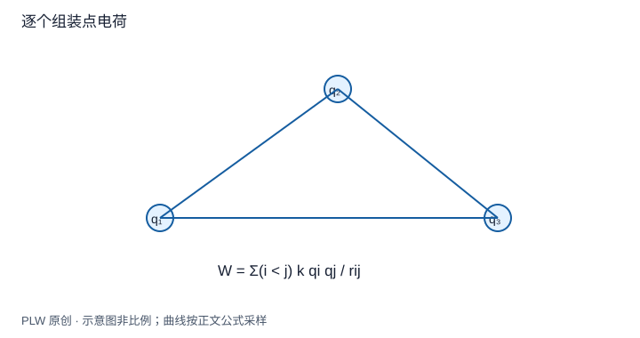

本页属于 [第 4 章：电容与静电能](./index.md)，是本章第 3 个专题．

## 能量属于哪一个系统

电荷在固定外场中的势能与一整组电荷的组装能，使用的势不同，求和系数也不同．本页通过逐个组装明确[静电能](concept:electrostatic-energy)的计数方式．先修是外力功与电势；读完应能在不重复计算的前提下求能量．

## 给定外场：每个电荷计算一次

若外部源保持不变，待研究电荷 $q_i$ 与这个预先给定场的相互作用能为：

$$
W_{\mathrm{ext}}=\sum_iq_i\varphi_{\mathrm{ext}}(\boldsymbol r_i)
$$

连续分布时改写成 $\int\rho\varphi_{\mathrm{ext}}\,\mathrm{d}V$．这里没有二分之一，因为外部源与研究电荷不在同一求和集合中．若外部导体会随电荷移动而感应调整，就不能把它当作始终不变的外场．

## 内部相互作用：电荷对只计一次

从无穷远逐个移入点电荷．第一颗没有相互作用组装功；第二颗要克服第一颗的场；第三颗要克服前两颗的场．一般得到：

$$
W=\sum_{i<j}\dfrac{kq_iq_j}{r_{ij}}
=\dfrac12\sum_iq_i\varphi_{\mathrm{others}}(\boldsymbol r_i)
$$

第二个写法把每一对 $(i,j)$ 计了两次，所以乘二分之一；势必须排除自身点电荷的发散自势．能量可以为负，表示相对无限分离状态释放了能量．

## 完整例题：三颗电荷组成的等边三角形

边长为 $a$，三角形顶点电荷分别为 $q,q,-q$．共有三对，相互作用能为：

$$
W=\dfrac{kq^2}{a}-\dfrac{kq^2}{a}-\dfrac{kq^2}{a}
=-\dfrac{kq^2}{a}
$$

检验另一种求和：两颗正电荷处的其他电荷势均为零，负电荷处其他电荷势为 $2kq/a$，故二分之一求和仍为 $-kq^2/a$．正电荷处总势恰好零，不代表它们没有受力．

## 晶格求和示例与模型边界

对理想 NaCl 点离子模型，最近邻距离为 $a$，选一个正离子，其余离子在该点的势可写成 $\varphi_{\mathrm{others}}=-Me/(4\pi\varepsilon_0a)$．$M$ 是由晶格几何和相容求和程序定义的 Madelung 常数．含 $N$ 对离子的晶体共有 $2N$ 个离子，所以：

$$
W_{\mathrm{Coulomb}}=-\dfrac{NM e^2}{4\pi\varepsilon_0a}
$$

从近邻壳层可见最初几项有 $6-12/\sqrt2+8/\sqrt3-6/2+\cdots$ 的交替结构，但三维长程库仑求和不能随意重排或用任意截断就当作收敛值．这里只把 $M$ 作为给定几何量；真实晶体平衡还需要短程排斥等贡献，纯吸引模型不能独自决定稳定晶格常数．

## 即时辨析与迁移练习

把 $\dfrac12q\varphi$ 用于一颗电荷在不变外场中的势能，会少算一半．相反，把全体系其他电荷的势乘 $q_i$ 后直接求和，会重复计算电荷对．

两电荷 $+q,-q$ 相距 $a$，缓慢拉到 $2a$，外力做多少功？

??? note "参考解答"
    初能量 $-kq^2/a$，末能量 $-kq^2/(2a)$，外力准静态做功为能量增加 $kq^2/(2a)$．与沿吸引力反方向分离的正功一致．

## 学习衔接

前一页：[组合电容与插入金属板](./capacitor-networks.md)；下一页：[连续分布的自能与场能](./field-energy.md)．
