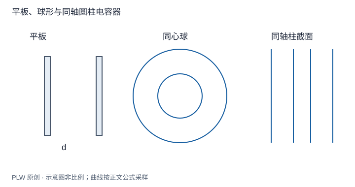

本页属于 [第 4 章：电容与静电能](./index.md)，是本章第 1 个专题．

## 几何怎样决定储电能力

同样的电压可以使不同导体结构储存不同电荷．在几何固定、真空或线性介质、无独立外部源的条件下，静电方程线性，电荷随电压成比例，比例系数就是[电容](concept:capacitance)．本页要求你沿「假设电荷 → 求场 → 积分电压 → 取比值」完成计算．

## 两端电容与孤立导体电容

两导体带等量异号电荷 $\pm Q$，定义正的端电压 $U=\varphi_+-\varphi_-$，有 $C=Q/U$，单位为法拉，$1\,\mathrm F=1\,\mathrm{C/V}$．孤立导体则相对于选定参考导体或无穷远定义电容；孤立球 $\varphi=kQ/R$，所以 $C=4\pi\varepsilon_0R$．

一般多导体各自带任意净电荷时，电荷与各导体电势由一组电容系数关联，不能总压缩成一个 $Q/U$．本章两端公式须保持对应模型条件．

## 三种基本几何

平板面积 $A$、间距 $d$，忽略边缘：$E=Q/(\varepsilon_0A)$，$U=Ed$，得 $C=\varepsilon_0A/d$．同心球半径 $a<b$，场仅在间隙，故：

$$
U=\int_a^b\dfrac{Q}{4\pi\varepsilon_0r^2}\,\mathrm{d}r
=\dfrac{Q}{4\pi\varepsilon_0}\left(\dfrac1a-\dfrac1b\right),
\qquad C=4\pi\varepsilon_0\dfrac{ab}{b-a}
$$

同轴长圆柱半径 $a<b$，长度 $l$ 远大于间距且忽略端部：

$$
U=\dfrac{\lambda}{2\pi\varepsilon_0}\ln\dfrac ba,
\qquad C=\dfrac{2\pi\varepsilon_0l}{\ln(b/a)}
$$

当球壳间距远小于半径，球电容近似为 $\varepsilon_0(4\pi a^2)/(b-a)$，与局部平板结果一致．令外球半径趋无穷则恢复孤立球电容．

## 完整例题：双长导线单位长度电容

两导线半径 $R$、中心距 $d\gg R$，分别带 $\pm\lambda$．把远离导线尺度上的场近似为轴线电荷场，在两中心之间：

$$
E_x\simeq\dfrac{\lambda}{2\pi\varepsilon_0}
\left(\dfrac1x+\dfrac1{d-x}\right)
$$

从 $R$ 到 $d-R$ 积分，得 $U\simeq\lambda\ln[(d-R)/R]/(\pi\varepsilon_0)\simeq\lambda\ln(d/R)/(\pi\varepsilon_0)$，所以 $C'=C/l\simeq\pi\varepsilon_0/\ln(d/R)$．

这不是任意间距下的精确解：相互感应使真实圆柱面密度不均匀．近似中连心线积分只用于估计两导体电势差．单位长度电容单位为 $\mathrm{F/m}$，不可误当作总电容．

## 即时辨析与迁移练习

把电荷加倍，线性固定几何电容是否也加倍？不变，电压同步加倍．若材料响应非线性，$Q/U$ 与微分电容 $\mathrm{d}Q/\mathrm{d}U$ 可能不同．

同轴电容器内导体半径增大而外导体半径不变，电容如何变化？

??? note "参考解答"
    $\ln(b/a)$ 减小，电容增加；间隙更窄，同样线电荷产生的电压更小．但在几何逼近接触、击穿或端部效应显著时，理想模型需要重新检查．

## 学习衔接

前一页：[本章导读](./index.md)；下一页：[组合电容与插入金属板](./capacitor-networks.md)．
