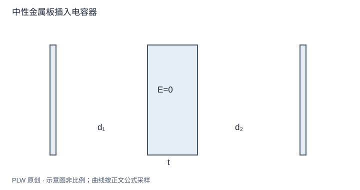

本页属于 [第 4 章：电容与静电能](./index.md)，是本章第 2 个专题．

## 元件关系如何来自导体约束

电容器串并联并不是独立于场论的口诀，它们分别来自共同电势差与浮置节点的电荷守恒．本页要求你识别导线连接形成的等势节点，并判断公式何时需要修改．先修是电容定义与孤立、接地约束．

## 并联与串联的推导

并联的每个电容两端连接到相同节点，所以 $Q_i=C_iU$，端口总电荷为 $Q=\sum_iQ_i$，得 $C_{\mathrm{eq}}=\sum_iC_i$．

串联两个电容且中间浮置节点初始净电荷为零时，该节点两侧的极板电荷等量异号，两个电容储电量大小相同为 $Q$．端口电压 $U=Q/C_1+Q/C_2$，因此 $1/C_{\mathrm{eq}}=1/C_1+1/C_2$．若中间节点预先带净电荷，这一步不成立，应先列该节点的电荷方程．

## 完整例题：插入中性金属厚板

真空平行板间距 $d$、面积 $A$，插入面积同样大、厚度 $t<d$ 的中性浮置金属板．两侧真空间隙为 $d_1,d_2$，总和 $d-t$，忽略边缘．中板内部零场，中板净电荷为零保证两间隙的场大小相同．

$$
U=Ed_1+Ed_2=E(d-t),\qquad
Q=\varepsilon_0AE,\qquad C=\dfrac{\varepsilon_0A}{d-t}
$$

也可把两真空间隙作为串联电容，得到同一结果．在这一理想模型下，电容与中板放在何处无关，只与总真空间隙有关．这不意味着金属内部也储存同样场能．

## 接电源与断电的区别

若原电容器先充到 $U_0$ 后断电，$Q$ 不变；插入后电压降为 $U_0(d-t)/d$．若电源始终保持 $U_0$，则电荷由 $\varepsilon_0AU_0/d$ 增到 $\varepsilon_0AU_0/(d-t)$，额外电荷来自电源．两种过程的最终场、电荷及能量不同．

## 带电浮置节点的通用列式

两个电容 $C_1,C_2$ 的外节点电势为 $V_L,V_R$，浮置中节点为 $V_m$、净电荷为 $q_m$．直接写：

$$
q_m=C_1(V_m-V_L)+C_2(V_m-V_R)
$$

从而求 $V_m$ 和各极板电荷；只有 $q_m=0$ 时才恢复普通串联的等量结论．这是以后从连续场过渡到节点电路方法的入口．

## 即时辨析与迁移练习

两只带不同初始电压的电容直接并联，总能量是否一定守恒在电场中？一般不，连接瞬态中可能向电阻、辐射等通道转移能量；只用最终静电模型不能解释全过程．

两个相同电容 $C$ 串联，外端电压为 $U$，中节点净电荷为 $q_m$，取 $V_R=0,V_L=U$，求中节点电势．

??? note "参考解答"
    $V_m=(U+q_m/C)/2$．当 $q_m=0$ 才是均分电压；$q_m$ 足够大时，中节点电势甚至可以超出两外节点区间，因为它本身是带电的浮置导体．

## 学习衔接

前一页：[电容的定义与几何计算](./capacitance.md)；下一页：[组装功与电荷系相互作用能](./assembly-energy.md)．
