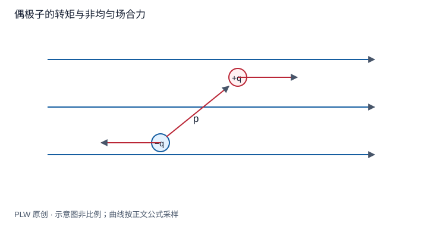

本页属于 [第 4 章：电容与静电能](./index.md)，是本章第 6 个专题．

## 旋转、平移与响应是不同过程

偶极子在均匀外场中可以旋转，在非均匀外场中还可能整体移动；如果偶极矩本身由外场诱导，还需计算建立偶极矩的代价．本页分别处理这三种问题．先修是偶极矩、势能梯度和能量求力．

## 永久偶极的外场能量与力矩

两端电荷 $\pm q$ 相距小矢量 $\boldsymbol l$，外场在该尺度内平滑．Taylor 展开两端的外势差：

$$
W=q[\varphi(\boldsymbol r+\boldsymbol l/2)-\varphi(\boldsymbol r-\boldsymbol l/2)]
\simeq\boldsymbol p\cdot\nabla\varphi=-\boldsymbol p\cdot\boldsymbol E
$$

均匀外场中合力为零，但转动角 $\theta$ 改变能量 $W=-pE\cos\theta$，所以恢复方向的力矩为 $\boldsymbol\tau=\boldsymbol p\times\boldsymbol E$．平行排列能量低，反平行为不稳定转动平衡．这里势忽略常数，偶极本身自能不参与刚性旋转的变化．

## 非均匀场的净力

固定永久偶极矩和方向，对位置求负梯度：

$$
\boldsymbol F=\nabla(\boldsymbol p\cdot\boldsymbol E)
=(\boldsymbol p\cdot\nabla)\boldsymbol E
$$

第二个等号使用 $\boldsymbol p$ 在求导中固定，以及静电场旋度为零．也可由 $q[\boldsymbol E(\boldsymbol r+\boldsymbol l/2)-\boldsymbol E(\boldsymbol r-\boldsymbol l/2)]$ 直接展开核验．偶极尺寸须小于场变化尺度．

## 完整例题：点电荷轴线旁的永久偶极

外源 $Q>0$ 在原点，偶极中心在 $z=r>0$，$\boldsymbol p=p\boldsymbol e_z$ 保持方向．轴线上 $E_z=kQ/r^2$，故 $W=-kpQ/r^2$，$F_z=-2kpQ/r^3$，指向场较强的近侧．若把偶极反向并固定，力转为向外；不能脱离取向笼统说所有偶极总被强场吸引．

## 感生偶极：建立响应也需要能量

线性各向同性粒子有 $\boldsymbol p=\alpha\boldsymbol E$，$\alpha>0$．建立偶极的内部代价可写为 $p^2/(2\alpha)$，加上外场耦合得 $W(p)=p^2/(2\alpha)-\boldsymbol p\cdot\boldsymbol E$．对 $\boldsymbol p$ 极小化给出响应关系，再代回：

$$
W_{\mathrm{eq}}=-\dfrac12\alpha E^2,\qquad
\boldsymbol F=\dfrac12\alpha\nabla E^2
$$

若直接把 $p=\alpha E$ 代进永久偶极的 $-pE$，会漏掉内部建立能量而多算一倍．该有效能用于给定外源场中的小粒子，不可不加说明地当作整个电源—介质体系的总能量．

## 两个永久偶极的相互作用

两偶极间距 $r$ 远大于各自尺寸，令 $\boldsymbol n$ 从第一颗指向第二颗，用第二颗在第一颗场中的能量得到：

$$
W_{12}=\dfrac{k}{r^3}\left[\boldsymbol p_1\cdot\boldsymbol p_2
-3(\boldsymbol p_1\cdot\boldsymbol n)(\boldsymbol p_2\cdot\boldsymbol n)\right]
$$

已计过一对，不再将对称表达相加．头尾同向时能量为 $-2kp_1p_2/r^3$，并排同向时为 $kp_1p_2/r^3$．

## 即时辨析与迁移练习

均匀外场可以给永久偶极力矩，却不给刚性中性偶极净力；受力与力矩必须分别计算．

两个同样大小的永久偶极同向沿连线排列，方向被固定，求径向力并判断吸引或排斥．

??? note "参考解答"
    $W=-2kp^2/r^3$，所以 $F_r=-\mathrm{d}W/\mathrm{d}r=-6kp^2/r^4$，为吸引．若只是把其中一颗反转并固定，能量和径向力均反号．

## 学习衔接

前一页：[能量法与电容器受力](./energy-force.md)；下一页：[本章综合练习](./exercises.md)．
