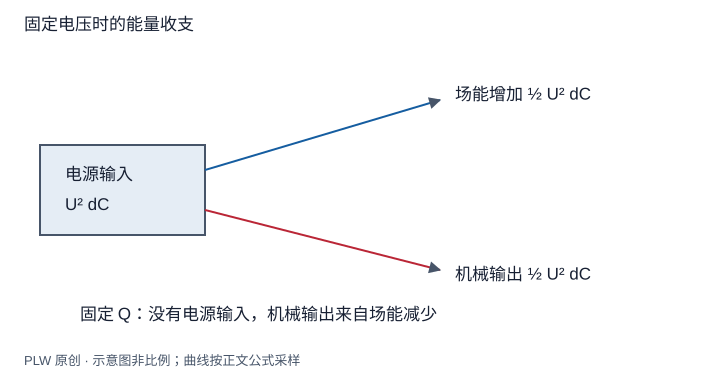

本页属于 [第 4 章：电容与静电能](./index.md)，是本章第 5 个专题．

## 对哪个能量、保持什么条件求导

电容器极板相互吸引，但连接电源后，极板靠近时场能可能增加．这并不矛盾：电源也在交换能量．本页从准静态功平衡出发推导两种约束下的求力公式，学会在求导前写明系统边界和固定量．

## 固定电荷：场能转成机械功

取构型坐标 $x$ 增大的方向为广义力正方向．缓慢变化、无辐射与耗散，若极板电荷 $Q$ 固定，电源没有输入，场力做功 $F_x\,\mathrm{d}x=-\mathrm{d}W$．用 $W=Q^2/[2C(x)]$：

$$
F_x=-\left(\dfrac{\partial W}{\partial x}\right)_Q
=\dfrac{Q^2}{2C^2}\dfrac{\mathrm{d}C}{\mathrm{d}x}
$$

因此在这一模型下，静电力倾向于增大电容．坐标若改为板间距，电容对它的导数为负，力也就为负．

## 固定电压：把电源功计入

电源保持两板电势差 $U$，电荷变化为 $\mathrm{d}Q=U\,\mathrm{d}C$．电源向电容器—机械系统输入的功是 $\delta A_{\mathrm{src}}=U\,\mathrm{d}Q$．能量守恒为：

$$
\mathrm{d}W=U\,\mathrm{d}Q-F_x\,\mathrm{d}x
$$

由于 $W=CU^2/2$，固定 $U$ 时，电源输入 $U^2\mathrm{d}C$，其中一半增加场能，另一半成为场力对机械部分做的功．所以：

$$
F_x=\dfrac12U^2\dfrac{\mathrm{d}C}{\mathrm{d}x}
$$

也可以定义包含理想电源交换贡献的有效能量 $\mathcal G=W-UQ=-CU^2/2$，再写 $F_x=-(\partial\mathcal G/\partial x)_U$．$\mathcal G$ 不是单独的场能，不能混用．

## 完整例题：平行板的吸引力

板面积 $A$，间距 $d$，忽略边缘，$C=\varepsilon_0A/d$．固定电荷时：

$$
W_Q=\dfrac{Q^2d}{2\varepsilon_0A},\qquad
F_d=-\dfrac{Q^2}{2\varepsilon_0A}
$$

固定电压时：

$$
F_d=\dfrac12U^2\dfrac{\mathrm{d}}{\mathrm{d}d}
\left(\dfrac{\varepsilon_0A}{d}\right)
=-\dfrac{\varepsilon_0AU^2}{2d^2}
$$

在同一瞬时场强 $E=Q/(\varepsilon_0A)=U/d$ 下，两者均为 $F_d=-\varepsilon_0E^2A/2$．用受力交叉检查：每板面密度为 $\sigma$，应只用另一板产生的场 $E_{\mathrm{other}}=\sigma/(2\varepsilon_0)$ 乘本板电荷，得到相同结果．若乘板间总场就会多出一倍，因为把本板自场也计进了受力．

电压力的大小是 $p=\varepsilon_0E^2/2$，单位为 $\mathrm{J/m^3}=\mathrm{N/m^2}$．面积固定时，固定 $Q$ 的场强不随间距变；固定 $U$ 的场强随间距减小而增强．瞬时力公式相同不代表两个过程的力随构型变化相同．

## 浮置中板与两侧压力

若金属中板把两个板间区域分开，其向右合力由右侧吸引与左侧吸引之差决定：

$$
F_x=\dfrac{\varepsilon_0A}{2}(E_{\mathrm R}^2-E_{\mathrm L}^2)
$$

应先由中板净电荷及外板的电压或电荷条件求两侧场．若中板两侧还有气体，平衡条件需另加气体压差，不能只比较电压力．该方法将第三章多导体约束与本章能量观点连接起来．

## 即时辨析

固定电压时，直接把 $CU^2/2$ 对间距求负导数会预测排斥．错误来自把场能当成整个封闭系统的能量；不是吸引力的符号约定改变了．

## 迁移练习

理想平行板在固定电压下，电容从 $C_1$ 缓慢增大到 $C_2$．求电源输入、场能增加和机械输出，并改为断电后比较．

??? note "参考解答"
    接电源时三者分别为 $U^2(C_2-C_1)$、$U^2(C_2-C_1)/2$ 和 $U^2(C_2-C_1)/2$．断电后 $Q$ 固定，电源输入为零，机械输出为 $Q^2(1/C_1-1/C_2)/2$，场能同量减少．比较时必须给出同一初态，例如令 $Q=C_1U$；两种终态电压不同．

## 学习衔接

前一页：[连续分布的自能与场能](./field-energy.md)；下一页：[电偶极子的能量、力矩与相互作用](./dipole-energy.md)．
