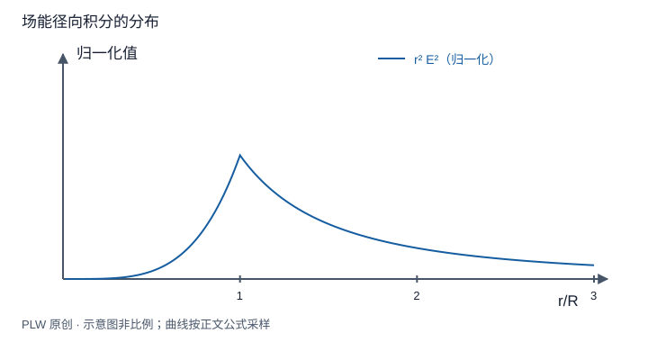

本页属于 [第 4 章：电容与静电能](./index.md)，是本章第 4 个专题．

## 从电荷位置转向空间中的能量

连续电荷可按比例缓慢建立：瞬时密度为 $t\rho$，相应势为 $t\varphi$，加进 $\rho\,\mathrm{d}t$ 的电荷所需功为 $t\,\mathrm{d}t\int\rho\varphi\,\mathrm{d}V$．从 $t=0$ 积到 $1$，得到：

$$
W=\dfrac12\int\rho\varphi\,\mathrm{d}V
$$

本页要把这一式变成场积分，明确边界项，并对球与接地平面进行完整计算．先修是泊松方程、散度定理和组装能．

## 场能推导与边界项

利用 $\rho=\varepsilon_0\nabla\cdot\boldsymbol E$ 以及乘积求导：

$$
\rho\varphi=\varepsilon_0\nabla\cdot(\varphi\boldsymbol E)
-\varepsilon_0\boldsymbol E\cdot\nabla\varphi
=\varepsilon_0\nabla\cdot(\varphi\boldsymbol E)+\varepsilon_0E^2
$$

对体积积分得到边界项 $\varepsilon_0\oint\varphi\boldsymbol E\cdot\mathrm{d}\boldsymbol S/2$ 加场积分．对局域电荷全空间、无穷远零势且足够衰减时，边界项消失：

$$
W=\dfrac{\varepsilon_0}{2}\int_{\mathbb R^3}E^2\,\mathrm{d}V,
\qquad w_e=\dfrac12\varepsilon_0E^2
$$

有限区域或无限线、无限面等模型不能无条件丢弃边界项．$w_e$ 的单位为 $\mathrm{J/m^3}$．

## 完整例题：球壳与实心球自能

球壳仅外部有场，用球壳体积微元积分：

$$
W_{\mathrm{shell}}=\dfrac{\varepsilon_0}{2}\int_R^\infty
\left(\dfrac{kQ}{r^2}\right)^2 4\pi r^2\,\mathrm{d}r
=\dfrac{kQ^2}{2R}
$$

均匀实心球外部贡献相同，内部 $E=kQr/R^3$ 的贡献为 $kQ^2/(10R)$，所以 $W_{\mathrm{solid}}=3kQ^2/(5R)$．也可用第二章内外势计算 $\dfrac12\int\rho\varphi\,\mathrm{d}V$ 核验．相同总电荷与半径不代表相同内部能量．

## 镜像体系的能量为何少一半

真实点电荷 $q$ 距接地平面 $d$，受力 $F_d=-kq^2/(4d^2)$．从无穷远缓慢接近，取相互作用能无穷远为零，由 $F_d=-\mathrm{d}W/\mathrm{d}d$ 得：

$$
W(d)=-\dfrac{kq^2}{4d}
=\dfrac12q\varphi_{\mathrm{induced}}(q)
$$

像电荷在距离 $2d$ 处，故感应势是 $-kq/(2d)$．少一半来自感应分布随真实电荷组装而改变；像不是独立固定的真实外源．直接写两颗真实点电荷能量 $-kq^2/(2d)$ 会多一倍．

## 自能、交互能与模型极限

令球壳半径趋零，$W_{\mathrm{shell}}$ 发散，揭示经典点模型自能的局限；不能把这一模型延伸为电子内部结构的已验证描述．两源的场相加后，平方中含交叉项 $\varepsilon_0\int\boldsymbol E_1\cdot\boldsymbol E_2\,\mathrm{d}V$，它对应交互能，可正可负．总场能非负与点电荷相互作用能为负并不冲突：后者已剔除发散自能．

## 即时辨析与迁移练习

只积分电容器某一小块空间的 $w_e$，能否当作完整体系的组装能？一般不能；应包括全部实际有场的空间及相应边界条件．

由平板场能密度求真空电容器储能，并与 $Q^2/(2C)$ 比较．

??? note "参考解答"
    忽略边缘，$W=\varepsilon_0E^2Ad/2=Q^2d/(2\varepsilon_0A)=Q^2/(2C)=CU^2/2$．这也说明若插入金属厚板，其无场材料部分不贡献该真空场能积分．

## 学习衔接

前一页：[组装功与电荷系相互作用能](./assembly-energy.md)；下一页：[能量法与电容器受力](./energy-force.md)．
