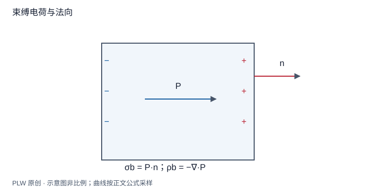

本页属于 [第 5 章：电介质](./index.md)，是本章第 2 个专题．

## 偶极密度如何变成可求场的电荷

知道 $\boldsymbol P$ 后，可以把许多微观偶极的宏观场等效为[束缚电荷](concept:bound-charge)产生的场．本页推导面、体密度并检验总电荷，要求你始终写明边界法向．先修是偶极势、散度及散度定理．

## 从极化电势推导

位于源点 $\boldsymbol r'$ 的偶极微元为 $\boldsymbol P(\boldsymbol r')\,\mathrm{d}V'$．利用 $\nabla'[1/|\boldsymbol r-\boldsymbol r'|]=(\boldsymbol r-\boldsymbol r')/|\boldsymbol r-\boldsymbol r'|^3$：

$$
\varphi_b=k\int_V\boldsymbol P\cdot\nabla'\dfrac1{|\boldsymbol r-\boldsymbol r'|}\,\mathrm{d}V'
$$

将点积改写成乘积散度减去散度项，得到：

$$
\varphi_b=k\oint_{\partial V}\dfrac{\boldsymbol P\cdot\hat{\boldsymbol n}}{|\boldsymbol r-\boldsymbol r'|}\,\mathrm{d}S'
-k\int_V\dfrac{\nabla'\cdot\boldsymbol P}{|\boldsymbol r-\boldsymbol r'|}\,\mathrm{d}V'
$$

因此在相应光滑区域可识别：

$$
\rho_b=-\nabla\cdot\boldsymbol P,\qquad
\sigma_b=\boldsymbol P\cdot\hat{\boldsymbol n}
$$

外边界法向从介质指向外部．两种介质相接，法向 $\boldsymbol n$ 从 1 指向 2 时，将各自表面贡献合并得 $\sigma_b=(\boldsymbol P_1-\boldsymbol P_2)\cdot\boldsymbol n$．不能把两个法向都取成同一方向后直接相加．

## 完整例题：非均匀极化圆柱

半径 $R$、长度 $L$ 的圆柱，$\boldsymbol P=\alpha s\boldsymbol e_s$，$s$ 为柱半径．柱坐标散度给：

$$
\rho_b=-\dfrac1s\dfrac{\mathrm{d}(sP_s)}{\mathrm{d}s}=-2\alpha
$$

侧面 $\sigma_b=\alpha R$，端面因为法向沿轴而无面电荷．体总量为 $-2\alpha\pi R^2L$，侧面总量为 $\alpha R\cdot2\pi RL$，二者恰好抵消．净束缚电荷为零，与极化只是内部电荷重排一致．

若换成均匀轴向极化 $\boldsymbol P=P\boldsymbol e_z$，体密度与侧面密度都为零，两端面分别带 $\pm P$．

## 一般总电荷检验

对于完整局域介质，所有边界都计入时，$Q_b=\int_V(-\nabla\cdot\boldsymbol P)\,\mathrm{d}V+\oint\boldsymbol P\cdot\mathrm{d}\boldsymbol S=0$．若只积分部分体积，边界被切开的偶极贡献不能漏掉．均匀极化的体密度为零，不等于所有表面都无束缚电荷．

## 即时辨析与迁移练习

束缚电荷是否不产生真实电场？它们同样参与总场的库仑源，只是来源和宏观记账方式不同于自由电荷．

均匀极化球 $\boldsymbol P=P\boldsymbol e_z$，求体面密度与总偶极矩．

??? note "参考解答"
    $\rho_b=0$，$\sigma_b=P\cos\theta$．面电荷总量为零；由 $\int\boldsymbol P\,\mathrm{d}V$ 得总偶极矩 $4\pi R^3\boldsymbol P/3$．正负半球并非各自均匀带电，因为表面法向随角度变化．

## 学习衔接

前一页：[极化机制与极化强度](./polarization.md)；下一页：[极化电荷产生的附加场](./polarization-field.md)．
