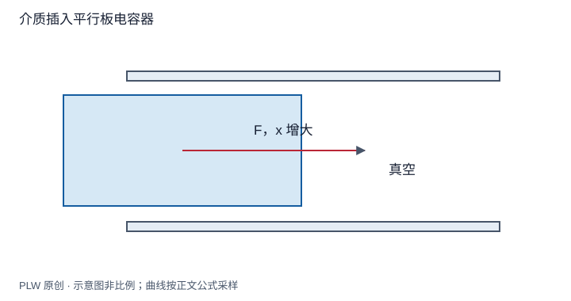

本页属于 [第 5 章：电介质](./index.md)，是本章第 6 个专题．

## 储能包含材料的响应代价

介质的极化会随充电改变，宏观储能不能只沿用真空 $\varepsilon_0E^2/2$ 然后忽略材料响应．本页在线性、可逆、几何和材料参数固定的静态模型中推导储能，再计算可移动介质的准静态力．先修是电容器能量、电源功与本构关系．

## 从充电功到能量密度

在线性固定几何体系中，逐步把自由电荷和场从零按比例建立，充电功给 $W=\dfrac12\int\rho_f\varphi\,\mathrm{d}V$，也包含边界导体的自由面电荷项．用 $\rho_f=\nabla\cdot\boldsymbol D$ 分部积分，在相容边界项处理后：

$$
W=\dfrac12\int\boldsymbol E\cdot\boldsymbol D\,\mathrm{d}V,
\qquad w=\dfrac12\boldsymbol E\cdot\boldsymbol D
=\dfrac12\varepsilon E^2
$$

这里的宏观储能包括可逆极化过程．对更一般但仍可逆的响应，应沿实际充电路径积分 $\mathrm{d}w=\boldsymbol E\cdot\mathrm{d}\boldsymbol D$；有滞回或损耗时，不能仅用终态 $\boldsymbol E,\boldsymbol D$ 的乘积描述全部输入功．上述简单式不无条件适用于非线性、色散或变形耦合介质．

## 完整例题：介质充满电容器的两种过程

真空电容为 $C_0$，充至电压 $U_0$ 后，缓慢插入相对介电系数 $\varepsilon_r$ 的介质使其完全填充，末电容 $C_f=\varepsilon_rC_0$．

断开电源时 $Q=C_0U_0$ 固定，末电压 $U_f=U_0/\varepsilon_r$，储能从 $W_i=C_0U_0^2/2$ 降至 $W_f=W_i/\varepsilon_r$．忽略损耗时，差额成为对外机械功．

保持电源时电压不变，储能增加 $(\varepsilon_r-1)C_0U_0^2/2$；电源输入为 $U_0(Q_f-Q_i)=(\varepsilon_r-1)C_0U_0^2$，另一半输出为机械功．两个过程均可能把介质吸入，但能量来源的记账不同．

## 介质部分插入时的力

平板长度 $L$、宽度 $b$、间距 $d$，刚性介质板填满间距，插入长度为 $x$．忽略边缘的电容估计可按两个并排区域相加：

$$
C(x)=\dfrac{\varepsilon_0b}{d}\left[L+(\varepsilon_r-1)x\right]
$$

由能量法，固定电压时：

$$
F_x=\dfrac12U^2\dfrac{\mathrm{d}C}{\mathrm{d}x}
=\dfrac{\varepsilon_0(\varepsilon_r-1)bU^2}{2d}
$$

固定电荷时则为 $F_x=Q^2C'(x)/[2C(x)^2]$．两式均指向增大插入量的方向，前提为 $\varepsilon_r>1$ 的普通静态介质．实际局部力集中与边缘场有关；这里通过总电容随构型的领先变化求合力，不是声称没有边缘场也能在均匀体内找到全部局部力．

## 即时辨析与迁移练习

把「介质使能量降低」当作普遍说法会混淆约束．固定电荷时储能降低，固定电压时储能增加，但有效能量含电源贡献后仍给出吸入趋势．

两层介质串联填充电容器，已知自由电荷 $Q$，求各层能量并与等效电容核验．

??? note "参考解答"
    两层 $D=Q/A$ 相同，$W_i=Q^2d_i/(2A\varepsilon_i)$．求和得 $W=Q^2(d_1/\varepsilon_1+d_2/\varepsilon_2)/(2A)=Q^2/(2C)$．不能把同一电压直接分别代到两层，因为串联时两层电压一般不同．读完本章可继续沿 [恒定电流与电路](../dc-circuit.md) 的建设路线学习电荷流动．

## 学习衔接

前一页：[介质界面与静电场求解](./interfaces.md)；下一页：[本章综合练习](./exercises.md)．
