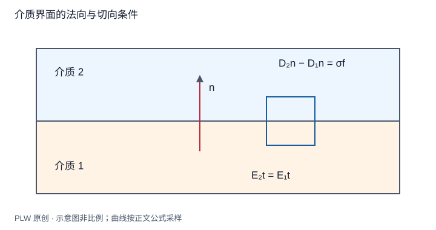

本页属于 [第 5 章：电介质](./index.md)，是本章第 5 个专题．

## 界面把各区域的解连接起来

不同材料中分别求解微分方程还不够，还须让它们在界面满足相容条件．本页由小柱与小回路推导条件，再求两种典型分区问题．先修为电位移、静电环路定理和球内外调和势．

## 两个条件与一个法向约定

界面法向 $\boldsymbol n$ 从介质 1 指向介质 2，自由面密度为 $\sigma_f$．小柱与窄回路分别给：

$$
(\boldsymbol D_2-\boldsymbol D_1)\cdot\boldsymbol n=\sigma_f,
\qquad \boldsymbol E_{2t}=\boldsymbol E_{1t}
$$

普通极化界面不包含理想偶极面层时，电势也连续．没有自由面电荷只说明 $D_n$ 连续，并不说明 $E_n$ 连续；束缚面电荷使总电场的法向分量发生跃变．

## 完整例题一：沿法向分层的电容器

平板面积 $A$，两层介质厚度 $d_1,d_2$、介电系数 $\varepsilon_1,\varepsilon_2$，界面无自由电荷，忽略边缘．平移对称使场沿法向，$D_n$ 相同为 $Q/A$，故：

$$
U=\dfrac QA\left(\dfrac{d_1}{\varepsilon_1}+\dfrac{d_2}{\varepsilon_2}\right),
\qquad C=\dfrac A{d_1/\varepsilon_1+d_2/\varepsilon_2}
$$

当两介质相同，恢复 $\varepsilon A/(d_1+d_2)$．若改为并排填充、每区都连接两板，则共同的是电压，电容按面积并联相加；不能只看「两块介质」就判断串联．

## 完整例题二：均匀外场中的介质球

半径 $R$、介电系数 $\varepsilon$ 的球置于真空中，远处场为 $E_0\boldsymbol e_z$，界面无自由电荷．利用轴对称和均匀场的角依赖构造：

$$
\varphi_{\mathrm{in}}=-Ar\cos\theta,\qquad
\varphi_{\mathrm{out}}=-E_0r\cos\theta+\dfrac{B\cos\theta}{r^2}
$$

两者分别满足拉普拉斯方程，内解在中心有限，外解满足远处均匀场．势连续给 $A=E_0-B/R^3$，法向 $D$ 连续给 $\varepsilon A=\varepsilon_0(E_0+2B/R^3)$．联立：

$$
A=\dfrac{3\varepsilon_0}{\varepsilon+2\varepsilon_0}E_0,
\qquad B=\dfrac{\varepsilon-\varepsilon_0}{\varepsilon+2\varepsilon_0}E_0R^3
$$

球内场为 $A\boldsymbol e_z$，外部附加场对应偶极矩 $p=4\pi\varepsilon_0B$．由 $\boldsymbol P=(\varepsilon-\varepsilon_0)A\boldsymbol e_z$ 再乘球体积，可独立得到同一个总偶极矩．

若 $\varepsilon=\varepsilon_0$，球的影响消失；$\varepsilon/\varepsilon_0\to\infty$ 的理想静态极限给内部零场与导体球外形的场解．常规正介电系数模型的唯一性也可由差函数积分 $\int\varepsilon|\nabla w|^2$ 推出，需指定同一远处外场．

## 即时辨析与迁移练习

没有自由界面电荷，场线是否一定不折转？不一定，连续的是切向 $E$ 与法向 $D$，介电系数不同会改变场方向．

两线性介质界面无自由面电荷，$\theta_1,\theta_2$ 是场与同一界面法向的夹角，推导方向关系．

??? note "参考解答"
    $E_1\sin\theta_1=E_2\sin\theta_2$，$\varepsilon_1E_1\cos\theta_1=\varepsilon_2E_2\cos\theta_2$，所以 $\tan\theta_2/\tan\theta_1=\varepsilon_2/\varepsilon_1$．应先定义角度，若与界面本身量角，关系会改写．

## 学习衔接

前一页：[电位移与本构关系](./displacement.md)；下一页：[介质中的储能与受力](./dielectric-energy.md)．
