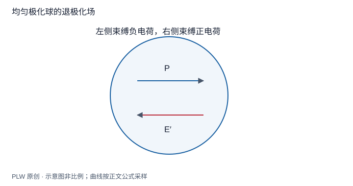

本页属于 [第 5 章：电介质](./index.md)，是本章第 3 个专题．

## 先知道极化，还是先知道外场

课件中的部分题直接给定 $\boldsymbol P$，要求求它产生的附加场；实际材料问题则常给外场和响应关系，需要让极化与总场共同满足方程．本页先完成前一种问题，为后面的自洽求解准备几何结果．

## 均匀极化平板

大板法向与 $\boldsymbol P$ 同向，两大表面束缚面密度为 $\pm P$．忽略边缘，每个面产生 $P/(2\varepsilon_0)$ 的场，内部叠加得：

$$
\boldsymbol E_b=-\dfrac{\boldsymbol P}{\varepsilon_0},\qquad
\boldsymbol E_{\mathrm{total}}=\boldsymbol E_0+\boldsymbol E_b
$$

反向的附加场称退极化场．若 $\boldsymbol P$ 平行于大板表面，大表面无束缚电荷；有限板侧面仍可能有电荷，不能据此把整个有限板的附加场都取零．

## 完整例题：均匀极化球

球半径 $R$、$\boldsymbol P=P\boldsymbol e_z$，无体电荷，表面 $\sigma_b=P\cos\theta$．构造内部势 $\varphi_{\mathrm{in}}=Ar\cos\theta$，外部势 $\varphi_{\mathrm{out}}=B\cos\theta/r^2$，均满足相应无源方程．势连续给 $B=AR^3$，法向场跃变给：

$$
(2B/R^3+A)\cos\theta=\dfrac{P\cos\theta}{\varepsilon_0}
\quad\Longrightarrow\quad A=\dfrac P{3\varepsilon_0}
$$

因此球内 $\boldsymbol E_b=-\boldsymbol P/(3\varepsilon_0)$，球外恰为总偶极矩 $\boldsymbol p=4\pi R^3\boldsymbol P/3$ 的场．这里球外偶极形式是该给定面分布的精确解，不仅是远场领先项．

## 长圆柱与薄圆盘

无限长圆柱若均匀横向极化，面密度为 $P\cos\theta$．同样构造二维内外调和势 $As\cos\theta$、$B\cos\theta/s$，势连续和法向跃变给 $A=P/(2\varepsilon_0)$，所以内部附加场为 $-\boldsymbol P/(2\varepsilon_0)$．若沿无限长轴向极化，没有端面，附加场为零；有限长柱则有端部贡献．

半径 $R$、厚度 $h\ll R$ 的薄圆盘，$\boldsymbol P$ 在盘面内．上下表面不带束缚电荷，侧壁有 $\sigma_b=P\cos\theta$．用 $\mathrm{d}S\simeq hR\,\mathrm{d}\theta$，将侧壁电荷近似放到中面圆周，在中心投影积分：

$$
E_{b,\parallel}\simeq-\dfrac{kPh}{R}\int_0^{2\pi}\cos^2\theta\,\mathrm{d}\theta
=-\dfrac{Ph}{4\varepsilon_0R}
$$

这是薄盘中心的近似结果，不能外推成整个盘内的均匀场．

## 即时辨析与迁移练习

退极化系数是只与材料有关的常数吗？不是，上述板、球、柱差异来自几何与方向．材料响应则由下一页的本构关系描述．

已给定均匀外场 $\boldsymbol E_0$ 和均匀极化球的 $\boldsymbol P$，写内部总场．若只给 $\boldsymbol E_0$，是否已经能确定总场？

??? note "参考解答"
    给定 $\boldsymbol P$ 时为 $\boldsymbol E=\boldsymbol E_0-\boldsymbol P/(3\varepsilon_0)$．只给外场则还缺材料对总场的响应关系．不能把 $\boldsymbol P$ 先随意指定为某值，又同时要求它服从不相容的本构关系．

## 学习衔接

前一页：[束缚面电荷与体电荷](./bound-charge.md)；下一页：[电位移与本构关系](./displacement.md)．
