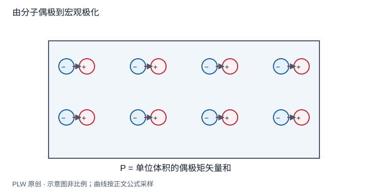

本页属于 [第 5 章：电介质](./index.md)，是本章第 1 个专题．

## 不导电的材料为什么也改变电场

在电容器中插入绝缘材料，即使没有自由电荷贯穿材料流动，也会改变电压或储电量．原因是分子中的正负电荷可发生相对位移，已有偶极也可调整取向．本页从这些过程建立[极化强度](concept:polarization)．先修是偶极矩和偶极转矩；读完应能区分微观偶极、宏观极化与净电荷密度．

## 位移与取向

无极分子在未加场时可无永久偶极矩，外场使电荷分布变形，形成感生偶极；离子晶体中不同离子的相对位移也能贡献极化．有极分子本来具有永久偶极矩，但无外场时热运动可能使取向平均近于零；外场转矩使分布偏向与场同向，热运动抵抗这种排列．

这些是静态响应模型．材料在交变场中的滞后、损耗和频率依赖需要进一步理论，不能仅由 $\boldsymbol p\times\boldsymbol E$ 就推出加热功率．

## 从微观偶极到宏观场

取大于分子间距、又小于宏观变化尺度的体元 $\Delta V$，定义：

$$
\boldsymbol P(\boldsymbol r)=\dfrac1{\Delta V}\sum_{i\in\Delta V}\boldsymbol p_i
$$

这是单位体积的偶极矩矢量和，单位 $\mathrm{C/m^2}$．它与体电荷密度 $\rho$ 不同：一个体元可以净电荷为零，却有非零偶极矩和非零 $\boldsymbol P$．若 $\boldsymbol P$ 均匀，整个物体总偶极矩为 $\boldsymbol p_{\mathrm{tot}}=\boldsymbol P V$．

材料内部单个分子实际感受到的局域场包括附近电荷的细节，不必等于宏观平均场．后面使用 $\boldsymbol P=\varepsilon_0\chi_e\boldsymbol E$ 时，$\chi_e$ 是已经包含微观相互作用影响的宏观响应参数，不能直接把单分子极化率乘数密度就当成所有材料的精确结果．

## 完整例题：完全取向的偶极气体上限

分子数密度为 $n$，每个分子永久偶极矩大小 $p_0$．若在理想极限中全部沿 $+z$ 排列，则 $\boldsymbol P=np_0\boldsymbol e_z$；若方向各向同性分布，平均为零．

例如 $n=10^{25}\,\mathrm{m^{-3}}$、$p_0=10^{-29}\,\mathrm{C\,m}$，完全取向时 $P=10^{-4}\,\mathrm{C/m^2}$．这只是给定分子密度下的取向上限，不是普通弱场热平衡的实际极化．检验单位可见 $\mathrm{m^{-3}}\cdot\mathrm{C\,m}=\mathrm{C/m^2}$．

## 即时辨析与迁移练习

「所有分子净电荷为零，所以材料对外电场无响应」对吗？不对，净电荷零并不排除偶极响应．

一半分子沿 $+z$、一半沿 $-z$，但前者偶极矩大小为 $2p_0$，后者为 $p_0$，数密度总计 $n$，求宏观极化．

??? note "参考解答"
    先作矢量和而非只数取向，$\boldsymbol P=(n/2)(2p_0-p_0)\boldsymbol e_z=np_0\boldsymbol e_z/2$．平均偶极矩不等于平均偶极矩大小；方向与大小都须计入．

## 学习衔接

前一页：[本章导读](./index.md)；下一页：[束缚面电荷与体电荷](./bound-charge.md)．
