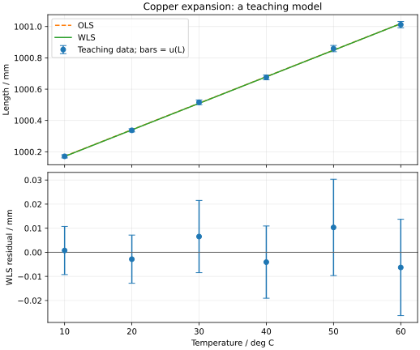
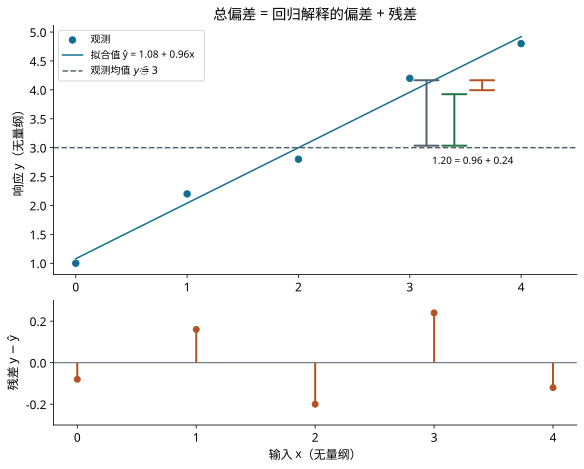

---
assessments:
- placement: footer
  set: experiment.error-analysis.least-squares
author: Physics Learning Wiki Team
description: 推导直线最小二乘、残差与参数不确定度，用铜棒热膨胀示例比较普通和加权拟合，讨论协方差、误差棒与模型限制．
learning_objectives:
- anchor: course-concepts
  id: experiment.error-analysis.least-squares.concepts
  title: 直线拟合与结果检验：辨认概念与适用条件
- anchor: course-calculation
  id: experiment.error-analysis.least-squares.calculation
  title: 直线拟合与结果检验：完成定量计算并检查单位
- anchor: course-analysis
  id: experiment.error-analysis.least-squares.analysis
  title: 直线拟合与结果检验：说明方法、结果与限制
page_id: experiment.error-analysis.least-squares
prerequisites:
- standard-uncertainty
- uncertainty-propagation
status: review
title: 直线拟合与结果检验
---

<span id="course-concepts"></span>

## 一条看起来顺眼的直线能告诉我们什么

测得几组温度和铜棒长度后，散点大致沿直线分布．手动画线可以看趋势，却不能明确回答斜率是多少、估计有多不确定、不同点应占多大权重．[最小二乘法](concept:least-squares) 为这些问题提供了一套可检查的计算方法．

本页先在横坐标不确定度可忽略的条件下推导直线拟合，再讨论不等精度观测、参数协方差和残差检查．拟合参数有物理意义，前提是模型适合实验条件．

## 从残差平方和出发

设模型为 $y_i=a+bx_i+\epsilon_i$，残差为 $v_i=y_i-a-bx_i$．普通最小二乘选择使下式最小的参数：

$$
S(a,b)=\sum_{i=1}^n(y_i-a-bx_i)^2.
$$

对截距求导时，每个残差对 $a$ 的导数都是 $-1$；对斜率求导时，导数为 $-x_i$．因此

$$
\frac{\partial S}{\partial a}=-2\sum_i v_i,\qquad
\frac{\partial S}{\partial b}=-2\sum_i x_i v_i.
$$

令两式为零，得到两条正规方程：

$$
\sum_i v_i=0,\qquad \sum_i x_i v_i=0.
$$

定义 $\bar x,\bar y$ 为样本平均值，$S_{xx}=\sum_i(x_i-\bar x)^2$，$S_{xy}=\sum_i(x_i-\bar x)(y_i-\bar y)$，则

$$
b=\frac{S_{xy}}{S_{xx}},\qquad a=\bar y-b\bar x.
$$

第一条方程给出 $na+b\sum_i x_i=\sum_i y_i$，故 $a=\bar y-b\bar x$．把它代入第二条方程并整理，得到 $bS_{xx}=S_{xy}$．至少需要不同的横坐标使 $S_{xx}>0$，此时这个驻点是唯一的最小值．两个点虽可确定一条直线，但不足以由残差估计噪声方差．有截距时残差和为零是拟合方程的结果，不是误差已消失的证明．

## 参数不确定度从哪里来

若纵坐标误差独立、均值为零、方差相同，横坐标可视为已知，且直线模型充分，则未知的共同噪声方差可由

$$
s_{\rm res}^2=\frac{\sum_i v_i^2}{n-2}
$$

估计．残差原有 $n$ 个分量，但正规方程施加了残差和与横坐标加权残差和两个独立约束，剩下 $n-2$ 个自由度．当误差独立同方差且模型正确时，残差平方和的期望是 $(n-2)\sigma^2$，因此除以 $n-2$ 估计共同方差．参数方差与协方差为

$$
u^2(b)=\frac{s_{\rm res}^2}{S_{xx}},\qquad
u^2(a)=s_{\rm res}^2\left(\frac1n+\frac{\bar x^2}{S_{xx}}\right),
$$

$$
\operatorname{Cov}(a,b)=-\frac{\bar x s_{\rm res}^2}{S_{xx}}.
$$

不需要先假定正态才能定义和求出最小二乘解；但正态假设与额外条件会影响似然解释和精确区间推断．这里的参数不确定度也不自动包含遗漏的共同校准和模型偏差．[^nist]

<span id="course-calculation"></span>

## 例题：由长度斜率求线膨胀系数

采用自编教学数据：

| 温度/摄氏度      | 10       | 20       | 30       | 40       | 50       | 60       |
| ----------- | -------- | -------- | -------- | -------- | -------- | -------- |
| 长度/毫米       | 1000.171 | 1000.337 | 1000.516 | 1000.675 | 1000.859 | 1001.012 |
| 长度标准不确定度/毫米 | 0.010    | 0.010    | 0.015    | 0.015    | 0.020    | 0.020    |

设温度均匀且已稳定，温度不确定度相对长度测量影响可忽略；长度各项标准不确定度相互独立，系统修正已经施加，未遗漏共同校准分量．铜棒在此范围内满足线性模型

$$
L(\theta)=L_0(1+\alpha\theta)=a+b\theta,
\qquad \alpha=\frac ba.
$$

$\theta$ 是以摄氏度表示的温度数值，$a$ 是外推到 $0\,{}^\circ\mathrm C$ 的长度，$b$ 是每单位温差的长度斜率．温差 1 摄氏度等于 1 开尔文，故 $\alpha$ 的单位为 $\mathrm{K^{-1}}$．此定义对应本例线性模型，实际材料的系数可能随温度变化．

先做普通最小二乘以理解计算．由 $\bar\theta=35$、$S_{xx}=1750$、$S_{xy}=29.65$ 得

$$
b=0.016942857\ldots\,\mathrm{mm/K},\qquad
a=1000.002000\ldots\,\mathrm{mm}.
$$

残差平方和为 $0.0002102857\ldots\,\mathrm{mm^2}$，所以 $s_{\rm res}=0.00725062\ldots\,\mathrm{mm}$，$u(b)=0.000173323\ldots\,\mathrm{mm/K}$．

此处普通拟合把误差看成相同未知尺度来估计．但题目已经给出各点不同且已知的标准不确定度，因此最终分析应使用下节的加权拟合．普通拟合与加权拟合的不确定度不能在忽略假设差异时直接比较大小．

## 不同精度观测如何加权

已知各点独立标准不确定度 $u_i$ 时，最小化

$$
\chi^2(a,b)=\sum_i\frac{(y_i-a-bx_i)^2}{u_i^2},\qquad w_i=\frac1{u_i^2}.
$$

定义加权平均 $\bar x_w=\sum_iw_ix_i/\sum_iw_i$、$\bar y_w=\sum_iw_iy_i/\sum_iw_i$，则

$$
b=\frac{\sum_iw_i(x_i-\bar x_w)(y_i-\bar y_w)}
{\sum_iw_i(x_i-\bar x_w)^2},\qquad
a=\bar y_w-b\bar x_w.
$$

精度较高的点获得较大权重，但仍需要模型条件成立．本例加权结果为

$$
a=1000.000644\ldots\,\mathrm{mm},\qquad
b=0.016960628\ldots\,\mathrm{mm/K}.
$$

已知不确定度的参数标准不确定度为 $u(a)=0.0106288\ldots\,\mathrm{mm}$、$u(b)=0.000349397\ldots\,\mathrm{mm/K}$，并有负的参数协方差．

## 协方差与派生物理量

令 $S_{xx,w}=\sum_iw_i(x_i-\bar x_w)^2$．当提供的 $u_i$ 是已知独立标准不确定度时，$u^2(b)=1/S_{xx,w}$，$u^2(a)=1/\sum_iw_i+\bar x_w^2/S_{xx,w}$，$\operatorname{Cov}(a,b)=-\bar x_w/S_{xx,w}$，不再额外乘残差方差估计．本例按参数顺序 $(a,b)$，协方差矩阵数值为

$$
\begin{pmatrix}
1.12972177\times10^{-4} & -3.19203936\times10^{-6}\\
-3.19203936\times10^{-6} & 1.22077994\times10^{-7}
\end{pmatrix}.
$$

左上、右下和非对角元素的单位分别是 $\mathrm{mm^2}$、$\mathrm{mm^2/K^2}$、$\mathrm{mm^2/K}$．对 $\alpha=b/a$，灵敏系数为 $\partial\alpha/\partial a=-b/a^2$、$\partial\alpha/\partial b=1/a$．因此

$$
u^2(\alpha)=\frac{b^2}{a^4}u^2(a)+\frac1{a^2}u^2(b)
-\frac{2b}{a^3}\operatorname{Cov}(a,b).
$$

得 $\alpha=1.69606167\ldots\times10^{-5}\,\mathrm{K^{-1}}$，$u(\alpha)=3.49551351\ldots\times10^{-7}\,\mathrm{K^{-1}}$．按本章约定报告 $\alpha=1.696\times10^{-5}\,\mathrm{K^{-1}}$、$u(\alpha)=0.035\times10^{-5}\,\mathrm{K^{-1}}$．原始观测独立不意味着由同组数据拟合的参数也独立．

<span id="course-analysis"></span>

## 用残差检查模型



观察残差是否有弯曲、随温度增大的散布、时间顺序依赖或孤立异常．图中误差棒表示输入的标准不确定度，不是严格上下界，也不是参数置信带．$R^2$ 很高仍可能伴随弯曲或共同偏差，不足以单独证明模型正确．

本例 $\chi^2=0.715883\ldots$，自由度为 4，约化值为 $0.178971\ldots$．在六个教学点中出现小值，可能与输入不确定度设定较宽、样本偶然性或未识别相关性有关；不要为了让它等于 1 就自动缩小已知标准不确定度．

??? note "进阶补充：横坐标也不确定时"
    本页把温度当作已知输入．若温度标准不确定度为 $u_\theta$，可先比较 $|b|u_\theta$ 与长度标准不确定度的量级；不可忽略时，需要处理双轴不确定度、共同温标误差及相关性．普通纵向最小二乘可能使参数产生偏差，单纯给图加上横向误差棒并没有改变拟合模型．本章不展开正交距离回归或一般误差变量模型．

## 回归是在估计什么

把横坐标 $x$ 看作给定的实验条件时，直线回归模型写作 $Y_i=\beta_0+\beta_1x_i+\epsilon_i$．其中直线表示给定 $x_i$ 下的平均响应，$\epsilon_i$ 表示每次观测围绕平均响应的波动．最小二乘给出 $\hat y=a+bx$；它既可用于拟合已知物理模型，也可用于描述数据中的经验关系．相关关系本身不证明因果关系．

下面用另一组自编数据示范统计检验：$x=(0,1,2,3,4)$，$y=(1,2.2,2.8,4.2,4.8)$．假设横坐标固定、误差相互独立且具有相同未知方差；下面的精确 $F$ 与 $t$ 检验还要求误差正态分布．由 $\bar x=2$、$\bar y=3$、$S_{xx}=10$、$S_{xy}=9.6$，得到 $b=0.96$、$a=1.08$．五个残差依次为 $-0.08,0.16,-0.20,0.24,-0.12$，所以残差平方和为 $0.144$，残差方差估计为 $0.144/(5-2)=0.048$．

[](images/regression-decomposition.svg)

## 平方和分解与显著性

对有截距的普通最小二乘，每个观测的总偏差可拆成 $y_i-\bar y=(\hat y_i-\bar y)+(y_i-\hat y_i)$．平方求和后，交叉项为零：因为 $\hat y_i-\bar y=b(x_i-\bar x)$，而正规方程使 $\sum_i v_i=\sum_i x_iv_i=0$．于是

$$
\underbrace{\sum_i(y_i-\bar y)^2}_{S_{\rm total}}
=\underbrace{\sum_i(\hat y_i-\bar y)^2}_{S_{\rm reg}}
+\underbrace{\sum_i(y_i-\hat y_i)^2}_{S_{\rm res}}.
$$

例中三项分别为 $9.36=9.216+0.144$，自由度分别为 $4=1+3$．在上述正态同方差模型下，检验零假设「总体斜率为零」的统计量为

$$
F=\frac{S_{\rm reg}/1}{S_{\rm res}/(n-2)}
=\frac{9.216}{0.144/3}=192.
$$

它在零假设下服从自由度为 $(1,3)$ 的 $F$ 分布，对应 $p\approx0.00081$．若预先取显著性水平 0.05，则拒绝零斜率假设．这说明数据与零斜率模型不相容，并不证明因果关系，也不证明直线模型无失拟；仍需检查残差和实验设计．

## 均值响应与新观测的区间

在某个固定 $x_*$，拟合均值 $\hat y_*=a+bx_*$ 的方差来自截距和斜率的协方差，整理得标准误差

$$
s_{\rm mean}=s_{\rm res}\sqrt{\frac1n+\frac{(x_*-\bar x)^2}{S_{xx}}}.
$$

预测同一条件下**一次新的独立观测**时，还需加上这次观测本身的随机方差，所以其标准误差是

$$
s_{\rm pred}=s_{\rm res}\sqrt{1+\frac1n+\frac{(x_*-\bar x)^2}{S_{xx}}}.
$$

以上面五点为例，$x_*=3$ 时 $\hat y_*=3.96$，$s_{\rm res}=\sqrt{0.048}=0.21909$，且 $t_{0.975,3}=3.18245$．因此 95% 的均值响应置信区间约为 $3.96\pm0.382$，新观测预测区间约为 $3.96\pm0.795$．两者解释对象不同；这里的区间依赖独立、正态、同方差和模型正确的条件，外推远离已测范围时尤其应审慎．

## 有重复观测时检查失拟

若在 $m$ 个不同横坐标处分别独立重复观测，总次数为 $n$，可将残差平方和拆为组内纯误差平方和 $S_{\rm pure}=\sum_j\sum_i(y_{ij}-\bar y_j)^2$ 与失拟平方和 $S_{\rm lack}=\sum_j n_j(\bar y_j-\hat y_j)^2$．这里 $\bar y_j$ 是同一横坐标处的观测均值，$n_j$ 是该组观测次数．前者衡量重复散布，后者衡量各组均值偏离所拟直线的程度．

若 $m>2$、$n>m$，且误差独立正态同方差，在直线均值模型成立时，

$$
F_{\rm lack}=\frac{S_{\rm lack}/(m-2)}{S_{\rm pure}/(n-m)}
$$

服从自由度 $(m-2,n-m)$ 的 $F$ 分布．大值提示失拟；未达到显著水平并不证明模型正确．没有重复点时无法从这组数据单独估计纯误差，不能直接套用这个检验．[^lackfit]

例如在 $x=0,1,2$ 处各测两次，依次得到 $(0.9,1.1)$、$(2.4,2.6)$、$(4.9,5.1)$．各组均值为 $1,2.5,5$，拟合直线在三处的值分别为 $5/6,17/6,29/6$．六个观测各偏离本组均值 $0.1$，故 $S_{\rm pure}=6(0.1)^2=0.06$；各组均值与拟合值之差依次为 $1/6,-1/3,1/6$，每组有两次观测，所以 $S_{\rm lack}=2[(1/6)^2+(-1/3)^2+(1/6)^2]=1/3$．自由度分别是 $6-3=3$ 和 $3-2=1$，因此 $F_{\rm lack}=(1/3)/(0.06/3)=16.67$．比较预先选定水平的 $F(1,3)$ 临界值后才能作检验结论；按 0.05 水平临界值约 10.13，这组数据提示直线模型失拟．

## Python 复现要核对哪些选项

核心调用如下，参数顺序与正文相同：[^scipy]

```python
def linear_model(theta, a, b):
    return a + b * theta


params, covariance = curve_fit(
    linear_model, temperature, length,
    sigma=u_length, absolute_sigma=True,
)
```

这里 `curve_fit` 来自 `scipy.optimize`．`sigma` 传入标准不确定度，不是其平方或权重；`absolute_sigma=True` 保留输入的绝对尺度．默认的相对尺度处理会按残差重缩放协方差，不能在本例中悄悄替换．完整脚本还提供解析雅可比和数据检查，见 [下载与复现](case-studies.md#下载与复现)．

## 与一般参数估计的连接

算术平均是常数模型 $y_i=a+\epsilon_i$ 的最小二乘解；已知不等方差时令 $\sum_i w_i(y_i-a)=0$，便得逆方差加权平均．因此直线、结果合并和组合测量属于同一线性参数框架．本页 $n-2$ 是一般残差自由度 $n-p$ 在两个参数时的特例，不是所有拟合都减二．

继续 [一般线性参数估计](linear-parameters.md)，学习矩阵正规方程、秩和一般参数协方差；[非线性拟合](nonlinear-fitting.md) 再说明怎样求初值修正并更新．

## 参考资料与注释

[^nist]: NIST/SEMATECH，[*e-Handbook of Statistical Methods*，4.4.3.1：Least Squares](https://www.itl.nist.gov/div898/handbook/pmd/section4/pmd431.htm)．本页数据和叙述自编．

[^lackfit]: NIST/SEMATECH，[*Lack-of-Fit Testing*](https://www.itl.nist.gov/div898/handbook/pmd/section4/pmd446.htm)．

[^scipy]: SciPy，[`scipy.optimize.curve_fit` 官方文档](https://docs.scipy.org/doc/scipy/reference/generated/scipy.optimize.curve_fit.html)，`sigma`、`absolute_sigma`、`pcov` 的说明．

## 阅读连接

上一页：[误差分配与测量方案优化](error-allocation.md)．下一页：[一般线性参数估计](linear-parameters.md)．
