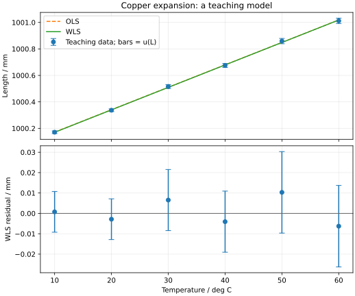

---
assessments:
- placement: footer
  set: experiment.error-analysis.least-squares
author: Physics Learning Wiki Team
description: 推导直线最小二乘、残差与参数不确定度，用铜棒热膨胀示例比较普通和加权拟合，讨论协方差、误差棒与模型限制．
learning_objectives:
- anchor: course-concepts
  id: experiment.error-analysis.least-squares.concepts
  title: 直线拟合与结果检验：辨认概念与适用条件
- anchor: course-calculation
  id: experiment.error-analysis.least-squares.calculation
  title: 直线拟合与结果检验：完成定量计算并检查单位
- anchor: course-analysis
  id: experiment.error-analysis.least-squares.analysis
  title: 直线拟合与结果检验：说明方法、结果与限制
page_id: experiment.error-analysis.least-squares
prerequisites:
- standard-uncertainty
- uncertainty-propagation
status: review
title: 直线拟合与结果检验
---

## 本页学习目标

<span id="course-concepts"></span>

直线拟合与结果检验：辨认概念与适用条件．

<span id="course-calculation"></span>

直线拟合与结果检验：完成定量计算并检查单位．

<span id="course-analysis"></span>

直线拟合与结果检验：说明方法、结果与限制．

## 一条看起来顺眼的直线能告诉我们什么

测得几组温度和铜棒长度后，散点大致沿直线分布．手动画线可以看趋势，却不能明确回答斜率是多少、估计有多不确定、不同点应占多大权重．[最小二乘法](concept:least-squares) 为这些问题提供了一套可检查的计算方法．

本页先在横坐标不确定度可忽略的条件下推导直线拟合，再讨论不等精度观测、参数协方差和残差检查．拟合参数有物理意义，前提是模型适合实验条件．

## 从残差平方和出发

设模型为 $y_i=a+bx_i+\epsilon_i$，残差为 $v_i=y_i-a-bx_i$．普通最小二乘选择使下式最小的参数：

$$
S(a,b)=\sum_{i=1}^n(y_i-a-bx_i)^2.
$$

对 $a,b$ 求偏导并令其为零，得到两条正规方程：

$$
\sum_i v_i=0,\qquad \sum_i x_i v_i=0.
$$

定义 $\bar x,\bar y$ 为样本平均值，$S_{xx}=\sum_i(x_i-\bar x)^2$，$S_{xy}=\sum_i(x_i-\bar x)(y_i-\bar y)$，则

$$
b=\frac{S_{xy}}{S_{xx}},\qquad a=\bar y-b\bar x.
$$

至少需要不同的横坐标使 $S_{xx}>0$．两个点虽可确定一条直线，但不足以由残差估计噪声方差．有截距时残差和为零是拟合方程的结果，不是误差已消失的证明．

## 参数不确定度从哪里来

若纵坐标误差独立、均值为零、方差相同，横坐标可视为已知，且直线模型充分，则未知的共同噪声方差可由

$$
s_{\rm res}^2=\frac{\sum_i v_i^2}{n-2}
$$

估计．分母减二是因为从这些数据中估计了截距与斜率．参数方差与协方差为

$$
u^2(b)=\frac{s_{\rm res}^2}{S_{xx}},\qquad
u^2(a)=s_{\rm res}^2\left(\frac1n+\frac{\bar x^2}{S_{xx}}\right),
$$

$$
\operatorname{Cov}(a,b)=-\frac{\bar x s_{\rm res}^2}{S_{xx}}.
$$

不需要先假定正态才能定义和求出最小二乘解；但正态假设与额外条件会影响似然解释和精确区间推断．这里的参数不确定度也不自动包含遗漏的共同校准和模型偏差．[^nist]

## 例题：由长度斜率求线膨胀系数

采用自编教学数据：

| 温度/摄氏度      | 10       | 20       | 30       | 40       | 50       | 60       |
| ----------- | -------- | -------- | -------- | -------- | -------- | -------- |
| 长度/毫米       | 1000.171 | 1000.337 | 1000.516 | 1000.675 | 1000.859 | 1001.012 |
| 长度标准不确定度/毫米 | 0.010    | 0.010    | 0.015    | 0.015    | 0.020    | 0.020    |

设温度均匀且已稳定，温度不确定度相对长度测量影响可忽略；长度各项标准不确定度相互独立，系统修正已经施加，未遗漏共同校准分量．铜棒在此范围内满足线性模型

$$
L(\theta)=L_0(1+\alpha\theta)=a+b\theta,
\qquad \alpha=\frac ba.
$$

$\theta$ 是以摄氏度表示的温度数值，$a$ 是外推到 $0\,{}^\circ\mathrm C$ 的长度，$b$ 是每单位温差的长度斜率．温差 1 摄氏度等于 1 开尔文，故 $\alpha$ 的单位为 $\mathrm{K^{-1}}$．此定义对应本例线性模型，实际材料的系数可能随温度变化．

先做普通最小二乘以理解计算．由 $\bar\theta=35$、$S_{xx}=1750$、$S_{xy}=29.65$ 得

$$
b=0.016942857\ldots\,\mathrm{mm/K},\qquad
a=1000.002000\ldots\,\mathrm{mm}.
$$

残差平方和为 $0.0002102857\ldots\,\mathrm{mm^2}$，所以 $s_{\rm res}=0.00725062\ldots\,\mathrm{mm}$，$u(b)=0.000173323\ldots\,\mathrm{mm/K}$．

此处普通拟合把误差看成相同未知尺度来估计．但题目已经给出各点不同且已知的标准不确定度，因此最终分析应使用下节的加权拟合．普通拟合与加权拟合的不确定度不能在忽略假设差异时直接比较大小．

## 不同精度观测如何加权

已知各点独立标准不确定度 $u_i$ 时，最小化

$$
\chi^2(a,b)=\sum_i\frac{(y_i-a-bx_i)^2}{u_i^2},\qquad w_i=\frac1{u_i^2}.
$$

定义加权平均 $\bar x_w=\sum_iw_ix_i/\sum_iw_i$、$\bar y_w=\sum_iw_iy_i/\sum_iw_i$，则

$$
b=\frac{\sum_iw_i(x_i-\bar x_w)(y_i-\bar y_w)}
{\sum_iw_i(x_i-\bar x_w)^2},\qquad
a=\bar y_w-b\bar x_w.
$$

精度较高的点获得较大权重，但仍需要模型条件成立．本例加权结果为

$$
a=1000.000644\ldots\,\mathrm{mm},\qquad
b=0.016960628\ldots\,\mathrm{mm/K}.
$$

已知不确定度的参数标准不确定度为 $u(a)=0.0106288\ldots\,\mathrm{mm}$、$u(b)=0.000349397\ldots\,\mathrm{mm/K}$，并有负的参数协方差．

??? note "进阶补充：协方差与派生物理量"
    令 $S_{xx,w}=\sum_iw_i(x_i-\bar x_w)^2$．当提供的 $u_i$ 是已知独立标准不确定度时，$u^2(b)=1/S_{xx,w}$，$u^2(a)=1/\sum_iw_i+\bar x_w^2/S_{xx,w}$，$\operatorname{Cov}(a,b)=-\bar x_w/S_{xx,w}$，不再额外乘残差方差估计．本例按参数顺序 $(a,b)$，协方差矩阵数值为
    
    $$
    \begin{pmatrix}
    1.12972177\times10^{-4} & -3.19203936\times10^{-6}\\
    -3.19203936\times10^{-6} & 1.22077994\times10^{-7}
    \end{pmatrix}.
    $$
    
    左上、右下和非对角元素的单位分别是 $\mathrm{mm^2}$、$\mathrm{mm^2/K^2}$、$\mathrm{mm^2/K}$．对 $\alpha=b/a$，灵敏系数为 $\partial\alpha/\partial a=-b/a^2$、$\partial\alpha/\partial b=1/a$．因此
    
    $$
    u^2(\alpha)=\frac{b^2}{a^4}u^2(a)+\frac1{a^2}u^2(b)
    -\frac{2b}{a^3}\operatorname{Cov}(a,b).
    $$
    
    得 $\alpha=1.69606167\ldots\times10^{-5}\,\mathrm{K^{-1}}$，$u(\alpha)=3.49551351\ldots\times10^{-7}\,\mathrm{K^{-1}}$．按本章约定报告 $\alpha=1.696\times10^{-5}\,\mathrm{K^{-1}}$、$u(\alpha)=0.035\times10^{-5}\,\mathrm{K^{-1}}$．原始观测独立不意味着由同组数据拟合的参数也独立．

## 用残差检查模型



观察残差是否有弯曲、随温度增大的散布、时间顺序依赖或孤立异常．图中误差棒表示输入的标准不确定度，不是严格上下界，也不是参数置信带．$R^2$ 很高仍可能伴随弯曲或共同偏差，不足以单独证明模型正确．

本例 $\chi^2=0.715883\ldots$，自由度为 4，约化值为 $0.178971\ldots$．在六个教学点中出现小值，可能与输入不确定度设定较宽、样本偶然性或未识别相关性有关；不要为了让它等于 1 就自动缩小已知标准不确定度．

??? note "进阶补充：横坐标也不确定时"
    本页把温度当作已知输入．若温度标准不确定度为 $u_\theta$，可先比较 $|b|u_\theta$ 与长度标准不确定度的量级；不可忽略时，需要处理双轴不确定度、共同温标误差及相关性．普通纵向最小二乘可能使参数产生偏差，单纯给图加上横向误差棒并没有改变拟合模型．本章不展开正交距离回归或一般误差变量模型．

## Python 复现要核对哪些选项

核心调用如下，参数顺序与正文相同：[^scipy]

```python
def linear_model(theta, a, b):
    return a + b * theta


params, covariance = curve_fit(
    linear_model, temperature, length,
    sigma=u_length, absolute_sigma=True,
)
```

这里 `curve_fit` 来自 `scipy.optimize`．`sigma` 传入标准不确定度，不是其平方或权重；`absolute_sigma=True` 保留输入的绝对尺度．默认的相对尺度处理会按残差重缩放协方差，不能在本例中悄悄替换．完整脚本还提供解析雅可比和数据检查，见 [下载与复现](case-studies.md#下载与复现)．

## 与一般参数估计的连接

算术平均是常数模型 $y_i=a+\epsilon_i$ 的最小二乘解；已知不等方差时令 $\sum_i w_i(y_i-a)=0$，便得逆方差加权平均．因此直线、结果合并和组合测量属于同一线性参数框架．本页 $n-2$ 是一般残差自由度 $n-p$ 在两个参数时的特例，不是所有拟合都减二．

继续 [一般线性参数估计](linear-parameters.md)，学习矩阵正规方程、秩和一般参数协方差；[非线性拟合](nonlinear-fitting.md) 再说明怎样求初值修正并更新．

## 参考资料与注释

[^nist]: NIST/SEMATECH，[*e-Handbook of Statistical Methods*，4.4.3.1：Least Squares](https://www.itl.nist.gov/div898/handbook/pmd/section4/pmd431.htm)．选题参考李祝《误差分析与数据处理》课程讲义，文件「07 第五章 线性参数的最小二乘 1」，最小二乘原理、正规方程与铜棒例题；文件「08 第五章 线性参数的最小二乘 2」，精度估计．本页数据和叙述自编．

[^scipy]: SciPy，[`scipy.optimize.curve_fit` 官方文档](https://docs.scipy.org/doc/scipy/reference/generated/scipy.optimize.curve_fit.html)，`sigma`、`absolute_sigma`、`pcov` 的说明．

## 阅读连接

上一页：[误差分配与测量方案优化](error-allocation.md)．下一页：[一般线性参数估计](linear-parameters.md)．
