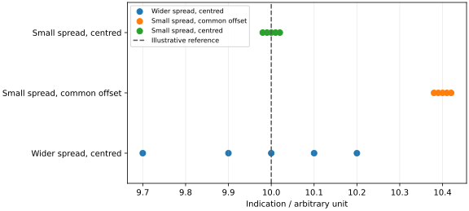

## 一组很整齐的数据就可靠吗

同一物体连续称量五次，读数几乎一样；换一台校准过的天平，却发现整体偏大．「重复性好」只说明这些观测彼此接近，并不能保证结果没有共同偏移．误差分析首先要问的是：测量对象和比较依据究竟是什么？

读完本页，你应能清楚定义被测量，写出最简单的修正模型，并区分误差、偏差、精密度、准确度和不确定度．

## 先说清楚测什么

**被测量** 是拟测量的量．「铜棒的长度」通常还不够明确：是在什么温度下、哪两个端面之间、是否承受拉力的长度？条件不同，数值可以真实地变化，并非所有变化都来自测量错误．

仪器读数是获得结果的输入，而不一定就是最终被测量．例如尺的示值为 $r$，零点偏差的估计值为 $b$，最简单的测量模型是

$$
L=r-b=r+C,\qquad C=-b.
$$

这里 $C$ 是修正值．若还要把非标准温度下的长度换算到规定温度，模型中就要加入温度和热膨胀系数．模型说明从哪些输入、在什么假设下得到结果．

## 误差、偏差和残差各指什么

[测量误差](concept:measurement-error) 是测得量值减去参考量值：[^error]

$$
e=x-x_{\rm ref}.
$$

它有符号，单位与被测量相同．「绝对误差」中的「绝对」通常表示以原量的单位表达，并不自动表示取绝对值．需要大小时应明确写 $|e|$．相对误差为 $e/x_{\rm ref}$，只在参考值非零且这种比较有意义时使用．

真实实验中的真值往往不知道，不能直接算出相对于真值的误差．校准中可以用有不确定度的标准器量值作参考；其不确定度不能在后续分析中悄悄丢掉．本章的 **偏差** 指系统测量误差的估计值，不泛指所有与平均值的差．

**残差** 是观测值与模型预测值的差．例如 $v_i=x_i-\bar x$．平均值来自这些数据本身，因此残差不是相对于真值的误差；残差和为零也不能证明共同偏差消失．

## 整齐、接近参考与知道多少

| 名称     | 关注什么                 | 可以怎样说明                   |
| ------ | -------------------- | ------------------------ |
| 精密度    | 规定条件下重复观测彼此接近的程度．    | 用标准差等分散性指标描述．            |
| 正确度    | 大量重复测量平均值接近参考值的程度．   | 与系统效应有关；可用偏差估计来分析．       |
| 准确度    | 测得量值接近真值的程度．         | 是定性概念，不直接写成一个数值量．        |
| 测量不确定度 | 依据所用信息，赋予被测量的量值有多分散． | 给出标准不确定度，或说明包含因子的扩展不确定度． |

这些概念不能随意互换．厂商所写「准确度 ±……」通常是某种规格限值，使用时必须读清条件和定义，不能仅凭这个词认定它就是标准不确定度．[^accuracy]

图中参考值仅用于示意．在真实实验中，参考值本身也可能有不可忽略的不确定度．

## 不确定度不是已知误差

[测量不确定度](concept:measurement-uncertainty) 是非负的，用来表征依据现有信息赋予被测量的量值分散性．它既可能包含重复观测得到的分量，也可能包含校准、分辨率和模型输入带来的分量．[^uncertainty]

若给出 $L=20.00\,\mathrm{mm}$、$u(L)=0.03\,\mathrm{mm}$，这不意味着已经知道真实误差恰好是 $0.03\,\mathrm{mm}$，也不意味着真值必定落在某个严格界限内．要把区间与覆盖概率联系起来，还需要分布等信息，见 [标准不确定度的评定](uncertainty-evaluation.md)．

## 例题：修正后为何还不确定

某量具测物体得到 $r=20.06\,\mathrm{mm}$，合拢时的零点读数为 $b=+0.04\,\mathrm{mm}$．设修正后的模型为 $L=r-b$．已将重复性和读数效应纳入 $u(r)=0.02\,\mathrm{mm}$，零点偏差估计的标准不确定度为 $u(b)=0.01\,\mathrm{mm}$；本例假设两项独立．

仪器整体多报了长度，因此修正值取负：

$$
L=20.06-0.04=20.02\,\mathrm{mm}.
$$

对独立输入，输出方差是各贡献的平方和：

$$
u(L)=\sqrt{u^2(r)+u^2(b)}
=\sqrt{0.02^2+0.01^2}=0.022360\ldots\,\mathrm{mm}.
$$

按本章两位有效数字约定，报告为 $L=20.020\,\mathrm{mm}$、$u(L)=0.022\,\mathrm{mm}$．末尾的零用于与不确定度对齐，不表示原始量具突然有了更细分辨率．这一步合成的原理将在 [传播篇](uncertainty-propagation.md) 推导．

本例训练的是「已知偏移要修正，修正量也有不确定度」．若读数和零点估计共享同一校准来源，则必须再检查相关性，不能直接套用独立合成式．

## 常见误区与阅读连接

-   数据集中不等于没有系统效应；多次平均不能自行消除共同偏移．
-   与课本数值很接近不等于结果可靠，应同时检查模型和不确定度预算．
-   量子力学的不确定性关系与这里的测量不确定度是不同问题，不用前者解释普通仪器读数的分散．

上一页：[章节导读](../error-analysis.md)．下一页：[数据记录与有效数字](data-recording.md)，把这些区别落实到原始记录和结果写法．

## 参考资料与注释

[^error]: JCGM，*VIM*，2012，条目 [2.16：measurement error](https://jcgm.bipm.org/vim/en/2.16.html)、2.18：measurement bias．

[^accuracy]: JCGM，*VIM*，2012，条目 [2.13：measurement accuracy](https://jcgm.bipm.org/vim/en/2.13.html)、2.14—2.15．

[^uncertainty]: JCGM，*VIM*，2012，条目 [2.26：measurement uncertainty](https://jcgm.bipm.org/vim/en/2.26.html)．选题参考李祝《误差分析与数据处理》课程讲义，文件「01 第一章 误差理论与数据处理 - 绪论」，第二、三节；文件「05 第四章 测量不确定度」，第一节．正文与例题均重新编写．
