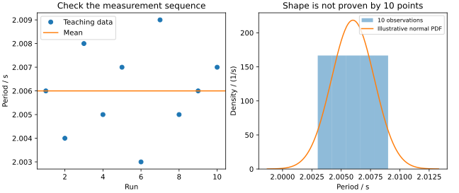

---
assessments:
- placement: footer
  set: experiment.error-analysis.repeated-measurements
author: Physics Learning Wiki Team
description: 从十次单摆计时推导平均值、残差、样本标准差和平均值标准不确定度，说明独立重复、漂移、小样本与置信区间的条件．
learning_objectives:
- anchor: course-concepts
  id: experiment.error-analysis.repeated-measurements.concepts
  title: 重复测量与统计描述：辨认概念与适用条件
- anchor: course-calculation
  id: experiment.error-analysis.repeated-measurements.calculation
  title: 重复测量与统计描述：完成定量计算并检查单位
- anchor: course-analysis
  id: experiment.error-analysis.repeated-measurements.analysis
  title: 重复测量与统计描述：说明方法、结果与限制
page_id: experiment.error-analysis.repeated-measurements
prerequisites:
- measurement-uncertainty
status: review
title: 重复测量与统计描述
---

## 本页学习目标

重复测量与统计描述：辨认概念与适用条件．

重复测量与统计描述：完成定量计算并检查单位．

重复测量与统计描述：说明方法、结果与限制．

## 为什么测十次比测一次有用

同一条件下重复计时，结果仍会变化．平均能减少这种变化对结果的影响，但必须说清「平均了什么」「变化是否独立」「条件是否稳定」．若十次测量都带有同一个计时校准偏差，多测并不能让它自行消失．

本页从一组记录出发，区分三件事：用什么代表测量值的中心，怎样描述单次观测的分散，怎样估计平均值的分散．

## 平均值与残差

设观测值为 $x_1,\ldots,x_n$．用算术平均值作为共同中心的估计：

$$
\bar x=\frac1n\sum_{i=1}^n x_i,\qquad v_i=x_i-\bar x.
$$

残差满足 $\sum_i v_i=0$，这是定义导致的代数关系，不是「真实误差已被消除」的证据．因此不能用残差的算术平均来衡量分散性，要看平方等不会正负抵消的量．

### 为什么样本方差除以观测次数减一

若 $X_i$ 独立同分布，均值为 $\mu$、方差为 $\sigma^2$，有恒等式

$$
\sum_i(X_i-\bar X)^2
=\sum_i(X_i-\mu)^2-n(\bar X-\mu)^2.
$$

对两边取期望，右边分别贡献 $n\sigma^2$ 与 $n\operatorname{Var}(\bar X)=\sigma^2$，所以残差平方和的期望为 $(n-1)\sigma^2$．这给出

$$
s^2=\frac{\sum_i(x_i-\bar x)^2}{n-1},\qquad
s=\sqrt{s^2}.
$$

这里 $s^2$ 是总体方差的无偏估计；$s$ 是样本标准差，描述单次观测的典型分散程度，不能据此称 $s$ 本身也是标准差的无偏估计．只有一次观测时，不能用这条公式从数据内部估计分散性．

## 平均值为何更稳定

对独立同方差观测，平均值的方差为

$$
\operatorname{Var}(\bar X)
=\frac1{n^2}\sum_i\operatorname{Var}(X_i)
=\frac{\sigma^2}{n}.
$$

用 $s$ 估计未知的 $\sigma$，得到平均值的标准不确定度估计

$$
u_A(\bar x)=\frac{s}{\sqrt n}.
$$

这属于利用观测序列进行的 A 类评定．它描述平均值所受的这一重复性分量，不是整个测量结果的全部不确定度．校准与模型输入要另行分析．[^gum]

## 例题：连续二十个周期的十次计时

以下为自编教学数据，单位均为秒．每次计时包含完整的 20 个周期：

| 次序  | 1     | 2     | 3     | 4     | 5     | 6     | 7     | 8     | 9     | 10    |
| --- | ----- | ----- | ----- | ----- | ----- | ----- | ----- | ----- | ----- | ----- |
| 总时间 | 40.12 | 40.08 | 40.16 | 40.10 | 40.14 | 40.06 | 40.18 | 40.10 | 40.12 | 40.14 |

设摆幅和温度在测量期间稳定，计时的重复性影响相互独立，并已检查没有可见漂移．观测的平均总时间和残差平方和为

$$
\bar t=40.12\,\mathrm s,\qquad
\sum_i(t_i-\bar t)^2=0.0120\,\mathrm{s^2}.
$$

所以总时间的样本标准差为

$$
s_t=\sqrt{0.0120/9}=0.0365148\ldots\,\mathrm s.
$$

每次周期估计为 $T_i=t_i/20$，因此

$$
\bar T=2.006\,\mathrm s,\qquad
s_T=s_t/20=0.00182574\ldots\,\mathrm s,
$$

$$
u_A(\bar T)=\frac{s_T}{\sqrt{10}}
=0.000577350\ldots\,\mathrm s.
$$

训练重点是两次不同的缩放：除以 20 是从总时间换算为一个周期，除以 $\sqrt{10}$ 才是平均十次独立观测带来的降低．不能将前一个因子也写成平方根．此时可报告重复性分量为 $u_A(\bar T)=0.00058\,\mathrm s$，但最终周期还要合入其他来源，见 [综合案例](case-studies.md)．

先看顺序图是否漂移，再看分布形状．十个点不足以确认正态分布；图中的正态曲线只是用样本均值和标准差画出的示意．正态分布的尾部延伸到无穷远，不能称为严格有界．

## 相同读数与相关观测

十次显示值完全相同，算得 $s=0$，只说明这组显示值没有可见分散．真实变化可能被分辨率遮住；分辨率、校准等信息仍可能给出非零不确定度．

对相关观测，一般有

$$
\operatorname{Var}(\bar X)=\frac1{n^2}
\left[\sum_i\operatorname{Var}(X_i)
+2\sum_{i<j}\operatorname{Cov}(X_i,X_j)\right].
$$

例如 $X_i=\mu+B+\epsilon_i$，其中 $B$ 是所有观测共有、与独立重复性项 $\epsilon_i$ 独立的校准影响，则平均后仍保留 $\operatorname{Var}(B)$，只有后者的方差除以 $n$．连续采样有自相关或装置随时间漂移时，不应机械套用 $s/\sqrt n$．

??? note "进阶补充：小样本与均值置信区间"
    若观测独立且来自同一正态总体，未知方差时有 $t=(\bar X-\mu)/(s/\sqrt n)$ 服从自由度 $n-1$ 的 Student t 分布．给定双侧置信水平 $1-\alpha$，均值区间为
    
    $$
    \bar x\pm t_{1-\alpha/2,n-1}\frac{s}{\sqrt n}.
    $$
    
    本例取 95% 置信水平，$t_{0.975,9}\approx2.262$，周期均值的半宽为 $0.001306\ldots\,\mathrm s$．其频率学解释是：按同一方法反复抽样构造的区间约有 95% 覆盖固定均值．不能据此宣称已经涵盖校准偏差、全部模型效应或重力加速度的完整不确定度．小样本本身也不能保证观测正态．

## 接下来检查什么

先保留原始顺序，寻找漂移和条件变化；再判断独立、同分布假设；最后报告平均值和所评定分量．统计计算必须建立在实验条件分析上．

## 修约后的残差和怎样校核

精确均值满足残差和为零．若实际使用的修约均值为 $\bar x_r=\bar x+\Delta$，则 $\sum_i(x_i-\bar x_r)=-n\Delta$．最近舍入、末位间隔为 $A$ 时，绝对值不超过 $nA/2$．如 1.00、1.01、1.01 的精确均值为 1.006666…，修到 1.01 后残差和为 -0.01，不是算术错误．原读数与所用均值在相同十进制网格时，可再利用和必须为 $A$ 的整数倍作更紧校核；不能不交代网格就套奇偶规则．

## 正态误差的不同尺度

对于零均值正态误差 $E$，平均绝对误差 $\theta=E|E|=\sigma\sqrt{2/\pi}\approx0.797885\sigma$，或然误差 $\rho$ 定义为 $P(|E|\leq\rho)=1/2$，故 $\rho\approx0.674490\sigma$．它不是「最可能的误差」，也不是标准差．正负一个标准差的覆盖率约 68.27%，不是严格误差界限．均值的这些范围在正态和相应尺度条件下换成均值标准差；小样本未知方差须用前述 t 区间．

## 其他分散性估计和自由度

正态独立同分布下，每个残差方差为 $\sigma^2(n-1)/n$，半正态矩给出 Peters 估计

$$
s_P=\sqrt{\frac\pi2}\frac{\sum_i|x_i-\bar x|}{\sqrt{n(n-1)}}.
$$

它在上述正态模型下对标准差无偏，系数 1.253 只是近似．残差相互相关，不能将其平方直接当作贝塞尔方差并赋予精确卡方分布．也不能混同于相对中位数的 MAD．

极差 $R=x_{\max}-x_{\min}$ 可用 $s_R=R/d_2(n)$ 估计正态尺度，$d_2(n)$ 是标准正态样本极差的期望；例如 $n=5$ 时约为 2.326．R/6 不是任意样本量通用公式．若「最大误差法」指 $M=\max_i|x_i-\bar x|$，系数取决于样本量、分布和中心的估计方式；若指先验允差，则应作 B 类分布建模，不能与最大样本残差混为一谈．

对任一正的尺度估计 $\hat u$，若其相对波动 $r=\operatorname{sd}(\hat u)/E(\hat u)$ 已由明确模型确定，可用 $\nu_{\rm eq}\approx1/(2r^2)$ 作等效自由度近似．因此应区分：

| 估计方法       | 自由度处理                       |
| ---------- | --------------------------- |
| 贝塞尔方差      | 正态条件下精确残差自由度 $n-1$          |
| Peters 标准差 | 由该估计量的相对波动评估等效自由度，非通用 $n-1$ |
| 极差估计       | 由给定样本数的极差矩计算相对波动            |
| 最大残差估计     | 明确中心和分布后计算该顺序统计量的相对波动       |

讲义的近似自由度表不作为无条件精确抽样表复制．需要正式均值区间时，本章主流程仍用贝塞尔方差及其明确的 t 模型．依据：[NIST 极差估计](https://www.itl.nist.gov/div898/handbook/pmc/section3/pmc321.htm)、[GUM 附录 G](https://www.iso.org/sites/JCGM/GUM/JCGM100/C045315e-html/C045315e_FILES/MAIN_C045315e/AG_e.html)．

## 分组观测与历史标准差

若有 $m$ 个独立组，每组均值 $\bar x_j$ 测同一稳定量，则可将组均值作为观测，计算组间样本标准差 $s_g$，总均值的组间标准不确定度为 $s_g/\sqrt m$．组间自由度为 $m-1$，不是总原始次数减一．组内与组间散布回答不同问题；不要把同一来源重复计入．

例：四组均值 10.0、10.2、9.8、10.0 mm，$s_g=\sqrt{0.08/3}=0.163299\,\mathrm{mm}$，总均值 10.0 mm 的标准不确定度 0.0816497 mm．若各组单次方差一致、仅次数不同，应转到 [不等精度结果合并](weighted-measurements.md) 按次数定权．

若先前 20 个同条件独立正态读数给出可靠 $s_{\rm hist}$，本次五个独立读数的均值可估 $u=s_{\rm hist}/\sqrt5$；尺度信息自由度来自历史估计的 19，而不是本次的 4．复用前必须证实过程稳定、分布和量程等相容；这也说明 A/B 类取决于本次使用的信息方式而不是误差来源名称．

## 参考资料与注释

[^gum]: JCGM，[*GUM*](https://doi.org/10.59161/JCGM100-2008E)，2008，第 4.2 节及附录 C、G．选题参考李祝《误差分析与数据处理》课程讲义，文件「02 第二章 随机误差」，「算术平均值」「测量的标准差」「测量的极限误差」．本页计时数据自编，推导按独立同方差条件展开．

## 阅读连接

上一页：[数据记录与有效数字](data-recording.md)．下一页：[不等精度测量与结果合并](weighted-measurements.md)．
