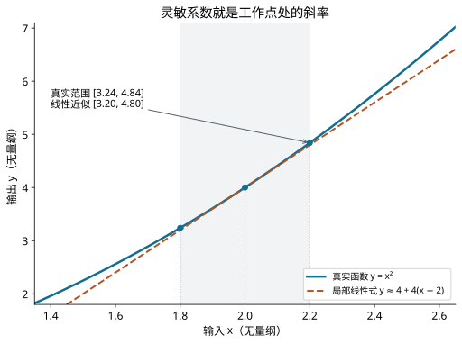

---
assessments:
- placement: footer
  set: experiment.error-analysis.uncertainty-propagation
author: Physics Learning Wiki Team
description: 从测量模型的一阶展开推导灵敏系数与不确定度传播，计算圆柱体体积，并讨论共同校准、协方差和显著非线性的限制．
learning_objectives:
- anchor: course-concepts
  id: experiment.error-analysis.uncertainty-propagation.concepts
  title: 不确定度传播与合成：辨认概念与适用条件
- anchor: course-calculation
  id: experiment.error-analysis.uncertainty-propagation.calculation
  title: 不确定度传播与合成：完成定量计算并检查单位
- anchor: course-analysis
  id: experiment.error-analysis.uncertainty-propagation.analysis
  title: 不确定度传播与合成：说明方法、结果与限制
page_id: experiment.error-analysis.uncertainty-propagation
prerequisites:
- standard-uncertainty
- derivative
status: review
title: 不确定度传播与合成
---

## 输入不确定，计算出来的量会怎样

量到直径和高度以后，圆柱体体积由公式算出．体积并不会因为「没有直接读仪器」就变得精确；直径和高度的不确定度会通过模型传到体积，而且影响大小不同．

本页的目标是写出模型，找到每个输入的灵敏系数，判断独立性，再合成输出的标准不确定度．

## 已知偏差怎样传到结果

先看有符号误差．设输入读数与参考值之差为 $e_i$，输出模型为 $y=f(x_1,\ldots,x_m)$．在参考点附近展开，保留一阶项：

$$
e_y\approx\sum_i c_i e_i,\qquad c_i=\frac{\partial f}{\partial x_i}.
$$

各项带符号代数相加；如果已知偏差，修正值取其相反数．比如 $y=x_1-2x_2$，两项偏差分别为 $+0.03$ 和 $+0.01$，结果偏差约为 $0.03-2(0.01)=+0.01$．这不意味着输出的不确定度也可按同样的带符号方式相加．

例如用弦长 $s=500\,\mathrm{mm}$ 和弓高 $h=50\,\mathrm{mm}$ 求圆的直径，几何关系为 $D=s^2/(4h)+h=1300\,\mathrm{mm}$．设读数的有符号偏差分别为 $e_s=+1\,\mathrm{mm}$、$e_h=-0.1\,\mathrm{mm}$．对模型求偏导，$c_s=s/(2h)=5$、$c_h=1-s^2/(4h^2)=-24$，所以

$$
e_D\approx 5(1)+(-24)(-0.1)=+7.4\,\mathrm{mm}.
$$

由此将未经修正的直径减去偏差，得到约 $1292.6\,\mathrm{mm}$．也可以先修正输入，得到 $s=499\,\mathrm{mm}$、$h=50.1\,\mathrm{mm}$，代回原模型得到 $1292.61996\ldots\,\mathrm{mm}$．二者略有差异，因为前者只保留一阶项．

已知每个输入偏差严格不超过 $a_i$ 时，一阶近似下三角不等式给出保守界限 $|e_y|\lesssim\sum_i|c_i|a_i$．若这些限值只是各自概率范围，则它们不是严格界限．以相同覆盖系数 $k$ 表示且输入不相关时，先把每项除以 $k$ 转为标准差，平方合成后再乘 $k$，才得到概率性方和根形式；输出具有同等覆盖概率还须有合适的联合分布．它不同于 GUM 定义的标准不确定度 $u_c$ 和扩展不确定度 $U=ku_c$．

图中 $f(x)=x^2$ 在 $x=2$ 处斜率为 4．输入范围从 1.8 到 2.2 时，精确输出范围是 3.24 到 4.84，而切线估计为 3.2 到 4.8；差异提醒我们检查一阶近似．

## 从局部变化推导传播式

设测量模型为 $Y=f(X_1,\ldots,X_m)$，输入估计值为 $x_i$，输出估计为 $y=f(x_1,\ldots,x_m)$．输入偏离估计值不大、函数在相关范围内足够平滑时，可作一阶展开：

$$
Y-y\approx\sum_i c_i(X_i-x_i),\qquad
c_i=\left.\frac{\partial f}{\partial X_i}\right|_{X_i=x_i}.
$$

$c_i$ 称为 **灵敏系数**，单位是「输出单位/对应输入单位」．它把该输入的一小点变化换算成输出变化．令 $\delta X_i=X_i-x_i$，把一阶近似的方差展开：

$$
\operatorname{Var}\left(\sum_i c_i\delta X_i\right)
=\sum_i c_i^2\operatorname{Var}(\delta X_i)
+2\sum_{i<j}c_i c_j\operatorname{Cov}(\delta X_i,\delta X_j).
$$

交叉项出现两次，因此带有系数 2；它的正负同时取决于相关方向和两个灵敏系数的符号．用标准不确定度表达，就得到 [不确定度传播](concept:uncertainty-propagation) 的一阶形式：[^gum]

$$
u_c^2(y)=\sum_i c_i^2u^2(x_i)
+2\sum_{i<j}c_i c_j\operatorname{Cov}(x_i,x_j).
$$

这里协方差描述输入量联合不确定性，记号 $x_i$ 指与输入估计相关的量．若输入互不相关，协方差项为零，简化为

$$
u_c(y)=\sqrt{\sum_i[c_i u(x_i)]^2}.
$$

各贡献先换算为相同输出单位，再平方相加．不能把不同量纲的原始输入不确定度直接相加．独立性足以保证不相关；一般情况下不相关未必等于独立．

## 有符号偏差与角度传播

角度的偏差与不确定度也通过导数传递，但前者保留符号，后者按方差合成．

若 $\sin\phi=z=f(\boldsymbol x)$，局部 $\mathrm d\phi=\mathrm dz/\cos\phi$；对余弦、正切、余切反求角度，导数分别为 $-1/\sin\phi$、$\cos^2\phi$、$-\sin^2\phi$，都以弧度计．把它们与 $z$ 对输入的导数相乘，既可传播有符号偏差，也可传播标准不确定度．

例：$\phi=\arcsin z$、$z=0.5$、$u(z)=0.001$，$u(\phi)\approx0.001/\sqrt{1-0.5^2}=0.00115470$ rad，换为约 0.0661595°．当 $z$ 接近 ±1 时斜率发散，分布可能越过定义域，一阶对称区间失效，应检查完整分布．

## 常用模型怎样处理

对 $y=x_1\pm x_2$，若不相关，则 $u_c^2=u_1^2+u_2^2$，因为正负号平方后相同．减法不能保证不确定度也相减．

对非零输入的幂乘积 $y=A\prod_i x_i^{p_i}$，若 $A$ 精确、输入互不相关且可一阶近似，则

$$
\left(\frac{u_c(y)}{|y|}\right)^2
=\sum_i p_i^2\left(\frac{u(x_i)}{|x_i|}\right)^2.
$$

指数来自求导，不是凭运算口诀指定．对于接近零的输入、差值或可能跨越奇点的模型，应回到完整模型与分布检查．有符号的已知修正先代入模型；确定偏移的代数相加、标准不确定度的方差合成与最坏情况限值估计，是不同计算问题．

## 例题：圆柱体体积

设圆柱体足够均匀，测得直径 $d=20.00\,\mathrm{mm}$、高度 $h=30.00\,\mathrm{mm}$．已评定标准不确定度 $u(d)=0.020\,\mathrm{mm}$、$u(h)=0.030\,\mathrm{mm}$；本例假设两项不相关，温度和形状偏离在当前要求下可忽略．

测量模型与灵敏系数为

$$
V=\frac\pi4d^2h,\qquad
c_d=\frac\pi2dh=\frac{2V}{d},\qquad
c_h=\frac\pi4d^2=\frac Vh.
$$

代入可得 $V=9424.77796\ldots\,\mathrm{mm^3}$．相对标准不确定度为

$$
\frac{u_c(V)}V
=\sqrt{\left(2\frac{0.020}{20.00}\right)^2
+\left(\frac{0.030}{30.00}\right)^2}
=0.00223607\ldots.
$$

于是 $u_c(V)=21.0744\ldots\,\mathrm{mm^3}$，报告 $V=9425\,\mathrm{mm^3}$、$u_c(V)=21\,\mathrm{mm^3}$．直径项贡献输出方差的 80%，高度项占 20%．若目标是降低合成不确定度，优先改进直径测量通常更有效；这是针对给定模型和预算的判断．

本例不相关假设需要核查：若直径和高度由同一把量具测得并共用零点修正，就可能出现共同分量，应按下一节处理．

## 共同零点为何可能在差值中消失

设两个位置读数满足 $R_1=x_1+B+E_1$、$R_2=x_2+B+E_2$．其中 $B$ 是共同零点影响，$E_1,E_2$ 为相互独立且与 $B$ 独立的重复性影响．两位置的差为

$$
D=R_2-R_1=x_2-x_1+E_2-E_1.
$$

于是 $u^2(D)=u^2(E_1)+u^2(E_2)$，共同的 $B$ 消去．从协方差公式看，$\operatorname{Cov}(R_1,R_2)=u^2(B)$，正好抵消两项中重复出现的零点方差．若误把两个读数全当成独立，会多算两次共同零点方差．

相反，在和式中正相关可能增大不确定度．「相关性总让不确定度变大」同样不对；结果取决于灵敏系数的符号和相关方向．

当两项标准不确定度都非零时，定义 $r_{ij}=\operatorname{Cov}(x_i,x_j)/[u(x_i)u(x_j)]$，其范围为 $[-1,1]$．两输入的协方差项为 $2c_i c_j r_{ij}u(x_i)u(x_j)$．相关系数必须来自共同来源模型、联合观测或可靠资料，不能为了缩小结果任意设定．拟合参数之间的协方差由同一拟合产生，即使原始观测相互独立，也不能据此把参数协方差置零．

## 一阶近似什么时候不够

传播式使用局部斜率．例如 $Y=X^2$，当 $X$ 的估计为零时，一阶灵敏系数为零；但只要 $X$ 仍有分散，$X^2$ 就会变化．零斜率不表示输出完全确定．

明显弯曲、输入不确定度较大、分母可能接近零，或输出分布显著不对称时，应检查高阶项或使用分布传播方法．非线性不仅可能改变输出不确定度，也可能使 $f$ 作用于输入估计值不能充分代表输出估计．2026 年 GUM 修订特别补充了这一点．[^nonlinear]

本章只在一阶近似可用的例题中计算；更一般处理见 JCGM 101 的 Monte Carlo 方法，不以多加几位小数替代模型检查．

## 计算后的三个检查

每项 $c_i u(x_i)$ 的单位是否等于输出单位？有没有共享校准或重复计入的来源？输出对输入变化是否仍近似线性？通过这些检查后，再修约并报告．

## 从成对数据估计相关性

有配对独立观测 $(x_k,y_k)$ 时，样本相关系数为

$$
r=\frac{\sum_k(x_k-\bar x)(y_k-\bar y)}
{\sqrt{\sum_k(x_k-\bar x)^2\sum_k(y_k-\bar y)^2}}.
$$

先画散点图检查非线性和孤立点，再报告样本量与条件．理论上 $Y=aX+b$、非零方差时，相关系数为 $\operatorname{sign}(a)$；零相关不排除非线性依赖．按象限数或目测斜带只能作粗略探索，不替代上述计算，也不能用样本相关掩盖未观测到的共同校准模型．输入是否相关要同时结合共同来源和配对数据，而非任意选一个缩小输出的系数．

## 自己试一试

$y=x_1-x_2$，两输入各有标准不确定度 0.1，相关系数为 $+0.5$．求输出标准不确定度，并解释与不相关情形相比为何较小．

??? note "答案"
    灵敏系数分别为 $+1$ 和 $-1$，故 $u_c^2=0.1^2+0.1^2-2(0.5)(0.1)(0.1)=0.01$，$u_c=0.1$．共同变化在差值中部分抵消；不相关时结果为 $\sqrt{0.02}$．

## 参考资料与注释

[^gum]: JCGM，[*GUM*](https://doi.org/10.59161/JCGM100-2008E)，2008，第 5.1、5.2 节．本页数值条件自编．

[^nonlinear]: JCGM，[*JCGM 100:2008/Amd.1:2026—Nonlinearity in measurement models*](https://doi.org/10.59161/PPDI3267)，2026，对第 4.1.4 条和 H.1.7 节的修订．分布传播另见 [JCGM 101:2008](https://doi.org/10.59161/JCGM101-2008)．

## 阅读连接

上一页：[标准不确定度的评定](uncertainty-evaluation.md)．下一页：[误差分配与测量方案优化](error-allocation.md)．
