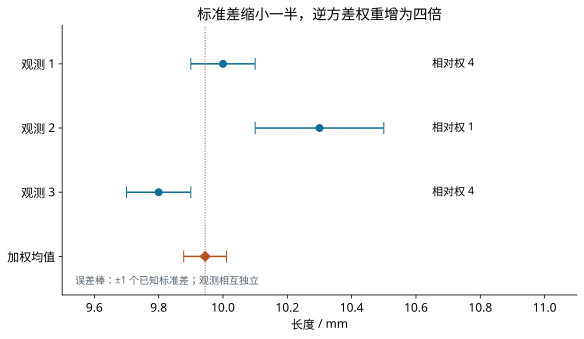

---
assessments:
- placement: footer
  set: experiment.error-analysis.weighted-measurements
author: Physics Learning Wiki Team
description: 推导逆方差加权与合并结果的不确定度，区分绝对方差、相对权重、单位权和共同校准影响．
learning_objectives:
- anchor: course-concepts
  id: experiment.error-analysis.weighted-measurements.concepts
  title: 不等精度测量与结果合并：辨认概念与适用条件
- anchor: course-calculation
  id: experiment.error-analysis.weighted-measurements.calculation
  title: 不等精度测量与结果合并：完成定量计算并检查单位
- anchor: course-analysis
  id: experiment.error-analysis.weighted-measurements.analysis
  title: 不等精度测量与结果合并：说明方法、结果与限制
page_id: experiment.error-analysis.weighted-measurements
prerequisites:
- measurement-uncertainty
status: review
title: 不等精度测量与结果合并
---

## 哪个结果应该多占一点

学习目标：合并同一被测量的独立结果，推导权重，区分已知不确定度与未知共同噪声尺度，并检查共同来源．先读 [重复测量](repeated-measurements.md)；不同温度下真实改变的量不能不经换算直接合并．

## 最小方差与逆方差权

设 $X_i$ 对同一量 $\mu$ 无偏、相互独立，方差 $u_i^2$ 已知．这里 $u_i$ 是第 $i$ 个结果的标准差尺度；若结果是独立重复测量的均值，它可以由该均值的分散性估计，具体评定与有限样本条件还需另行说明．线性组合 $\hat\mu=\sum_i a_iX_i$ 无偏要求 $\sum_i a_i=1$．对方差 $\sum_i a_i^2u_i^2$ 加约束求极小：构造 $F=\sum_i a_i^2u_i^2-\lambda(\sum_i a_i-1)$，逐项求导得到 $2a_i u_i^2=\lambda$．再用系数和为一确定共同因子，所以

$$
w_i=1/u_i^2,\qquad
\hat\mu=\frac{\sum_iw_ix_i}{\sum_iw_i},\qquad
u(\hat\mu)=\frac1{\sqrt{\sum_iw_i}}.
$$

独立正态观测的联合似然正比于 $\exp[-\frac12\sum_i(x_i-\mu)^2/u_i^2]$．最大化似然也得到同一解；最小方差线性无偏的推导本身不需要正态性．

同一仪器单次方差相同、各组次数为 $n_i$ 时，组均值方差为 $\sigma^2/n_i$，故权重比为 $n_i$．例如两组分别测得 3 次和 2 次，组均值为 10.0 mm 和 10.5 mm，则合并值为 $(3\times10.0+2\times10.5)/5=10.2\,\mathrm{mm}$．把两组均值直接相加除以 2 得 10.25 mm，会让第二组每个原始观测占更大权重；在单次精度相同时这并非全部原始数据的等权平均．按次数加权组均值恰好等于合并全部独立原始读数的平均．若组均值含不同漂移或共同偏差，这一结论不适用．

## 例题：三个长度结果

三个独立校准后的结果依次为 10.00、10.30、9.80 mm，标准不确定度为 0.10、0.20、0.10 mm．权重比 4:1:4，故

$$
\hat L=\frac{4(10.00)+10.30+4(9.80)}9
=9.944444\ldots\,\mathrm{mm},\qquad
u(\hat L)=\frac1{\sqrt{100+25+100}}=0.0666667\ldots\,\mathrm{mm}.
$$

报告 $L=9.944\,\mathrm{mm}$、$u(L)=0.067\,\mathrm{mm}$．

图中的横线表示各输入的标准不确定度；合并位置由方差的倒数决定，所以较窄的两个输入占更大比重．较差的结果仍有贡献，但不能仅凭远离其余结果就调小其权重．

??? question "想一想：第二个结果的标准差减半后，权重如何变化？"
    标准差从 0.20 mm 降到 0.10 mm，方差变为原来的四分之一，逆方差权变为四倍．三个权相同后，加权均值等于三个结果的算术平均值，即 10.0333 mm．这种变化须来自新的测量信息，不能仅为得到期待值而人为修改权重．还应计算 $Q=\sum_i(x_i-\hat L)^2/u_i^2$，在相应分布假设下检查结果一致性．本例 $Q=5.555556$，自由度 2；不能为了使约化值等于 1 自动改写已知不确定度．

## 单位权和未知共同尺度

若只知道相对权 $p_i$，假设 $\operatorname{Var}(X_i)=\sigma_0^2/p_i$．$p_i=1$ 时的方差尺度称单位权方差．把每个观测方程和预测值同时乘 $\sqrt{p_i}$，其误差方差统一为 $\sigma_0^2$；只缩放数据、不缩放模型是不对的．残差 $v_i=x_i-\hat\mu$ 满足 $\sum_i p_iv_i=0$．有 $m>1$ 个独立结果时

$$
s_0^2=\frac{\sum_i p_iv_i^2}{m-1},\qquad
u^2(\hat\mu)=\frac{s_0^2}{\sum_i p_i}.
$$

例：10.0、10.2、9.9 mm，权相同但共同方差未知，得到均值 10.033333 mm、$s_0^2=0.0233333\,\mathrm{mm^2}$、均值标准不确定度 0.0881917 mm．对这个例子，三个残差分别为 −0.033333、+0.166667、−0.133333 mm，平方和为 $0.0466667\,\mathrm{mm^2}$；因为估计了一个共同均值，除以 $3-1$ 得 $s_0^2$．整体把相对权乘常数时，$s_0^2$ 同比例改变，最终均值方差不变．已知绝对 $u_i$ 时则用前节公式，不再乘这一残差尺度．

## 共同来源和一般相关组合

若每组都有同一个校准影响 $B$，独立部分标准不确定度为 $u_i$，则先对独立部分定权，最终方差为 $1/\sum_iw_i+u^2(B)$．它不会随组数无限趋零．一般已知协方差矩阵 $\Sigma$ 正定时，令 $\boldsymbol1$ 为全 1 列向量：

$$
\hat\mu=\frac{\boldsymbol1^T\Sigma^{-1}\boldsymbol x}
{\boldsymbol1^T\Sigma^{-1}\boldsymbol1},\qquad
u^2(\hat\mu)=\frac1{\boldsymbol1^T\Sigma^{-1}\boldsymbol1}.
$$

来源不兼容或总体不稳定时应先调查，不把所有数字平均成一个「最佳值」．更一般的参数估计见 [一般线性参数估计](linear-parameters.md)．推导基础见 [参数估计](../../math/probability-statistics/parameter-estimation.md)；合成条件参见 [GUM 第 5 节](https://doi.org/10.59161/JCGM100-2008E)．

## 阅读连接

上一页：[重复测量与统计描述](repeated-measurements.md)．下一页：[系统效应与异常数据](systematic-errors-outliers.md)．
