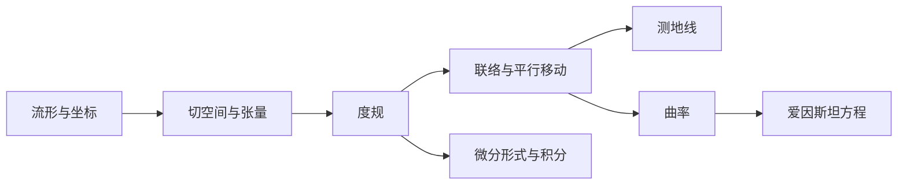

???+ note "阅读前提"
    本页假设你熟悉偏导数、线性代数中的基与线性变换，以及矢量分析中的梯度、散度与旋度．如果这些内容还不熟，可以先读 [线性代数](./linear-algebra/space.md) 与 [矢量分析与场论](./vector-analysis/operators.md)．

本页以 Sean Carroll 的 *Spacetime and Geometry* 第 2–3 章为主线，把广义相对论所需的微分几何压缩成一条可以独立阅读的路线．这里不追求公理化数学的完整性，而是优先回答三个问题：**为什么需要它、它在物理中表示什么、怎样在具体坐标里计算**．

## 0. 为什么物理需要微分几何

牛顿力学与电磁学通常写在平直空间的笛卡尔坐标中．到了狭义相对论，空间与时间被统一成闵可夫斯基时空；到了广义相对论，引力不再是一种额外的力，而是时空的几何性质．这时会出现两个新问题：

1.  **坐标只能是局部的．** 在球面上无法用一个全局笛卡尔坐标覆盖所有点；在弯曲时空中也没有一张“万能坐标纸”．
2.  **普通导数不再张量．** 在不同点比较矢量时，必须先说明“怎样把矢量平行移动过去”；否则偏导数的结果会依赖坐标选择．

微分几何提供的正是这两件事的语言：**流形**描述局部像欧氏空间的弯曲空间，**度规**给出长度与角度，**联络**给出平行移动，**曲率**衡量平行移动是否与路径有关．

***

## 1. 流形与坐标

### 1.1 流形的直观定义

一个 $n$ 维 **流形**（manifold）是一个空间，它在每一点的足够小邻域内都“看起来像” $\mathbb{R}^n$．更具体地说，对每一点都能找到一个 **坐标卡** $(U,\varphi)$：

- $U$ 是流形上的一个开集；
- $\varphi:U\to\mathbb{R}^n$ 把 $U$ 中的点映射到 $n$ 个实数；
- $\varphi$ 是连续且可逆的，逆映射也连续．

如果两个坐标卡 $(U,\varphi)$ 与 $(V,\psi)$ 有重叠，那么在重叠区域上可以定义 **坐标变换**

$$
x'^{\mu}=x'^{\mu}(x^{0},x^{1},\cdots,x^{n-1}) .
$$

若所有坐标变换都足够光滑，就得到一个 **光滑流形**．物理中的时空通常是四维光滑流形，局部坐标写为

$$
(x^{0},x^{1},x^{2},x^{3})=(t,x,y,z)
\quad\text{或}\quad
(t,r,\theta,\varphi) .
$$

### 1.2 坐标不是几何

坐标只是给点“编号”的方式．同一个点在两套坐标下的数值不同，但几何对象本身不随坐标改变．例如平面极坐标

$$
x=r\cos\varphi,\qquad y=r\sin\varphi
$$

在 $r=0$ 处失效，但原点当然没有“坏掉”；类似地，球坐标在南北极失效，也不是球面在那里出了问题．

???+ warning "常见误区"
    “坐标奇点”不等于“时空奇点”．Schwarzschild 度规在 $r=2M$ 处的坐标奇点就是一个典型例子：曲率标量在那里完全有限，换一组坐标就能看出度规是正则的．详见 [广义相对论基础](../modern/general-relativity.md)．

### 1.3 坐标变换与雅可比矩阵

记旧坐标为 $x^{\mu}$，新坐标为 $x'^{\mu}$．坐标变换的局部线性化由 **雅可比矩阵** 给出：

$$
J^{\mu}{}_{\nu}=\frac{\partial x'^{\mu}}{\partial x^{\nu}},
\qquad
(J^{-1})^{\mu}{}_{\nu}=\frac{\partial x^{\mu}}{\partial x'^{\nu}} .
$$

后面所有张量的变换律，本质上都是“每个上指标乘一个 $J$，每个下指标乘一个 $J^{-1}$”．

***

## 2. 切空间、矢量与张量

### 2.1 切矢量：从箭头到导数

在平直空间中，矢量可以画成箭头．在流形上，不同点的“箭头”属于不同的切空间，不能直接相减．更稳妥的定义是把某点的切矢量看成一个 **方向导数算子**：

$$
v=v^{\mu}\frac{\partial}{\partial x^{\mu}} .
$$

它作用在标量函数 $f$ 上，给出沿该方向的变化率：

$$
v(f)=v^{\mu}\frac{\partial f}{\partial x^{\mu}} .
$$

在坐标变换下，

$$
v'^{\mu}=v^{\nu}\frac{\partial x'^{\mu}}{\partial x^{\nu}} .
$$

这就是逆变矢量（contravariant vector）的变换律．**上指标**表示它按雅可比矩阵变换．

### 2.2 余切矢量与一形式

对偶空间中的元素叫 **余切矢量** 或 **一形式**（one-form），写成

$$
\omega=\omega_{\mu}\,\mathrm{d}x^{\mu} .
$$

它与切矢量的配对为

$$
\langle \mathrm{d}x^{\mu},\partial_{\nu}\rangle=\delta^{\mu}{}_{\nu},
\qquad
\langle \omega,v\rangle=\omega_{\mu}v^{\mu} .
$$

在坐标变换下，

$$
\omega'_{\mu}=\omega_{\nu}\frac{\partial x^{\nu}}{\partial x'^{\mu}} .
$$

**下指标**按雅可比矩阵的逆变换．一形式的一个自然例子是标量函数的微分：

$$
\mathrm{d}f=\frac{\partial f}{\partial x^{\mu}}\,\mathrm{d}x^{\mu} .
$$

### 2.3 张量

一个 $(p,q)$ 型张量是接受 $p$ 个一形式与 $q$ 个切矢量、并对每个槽都线性的映射．它的分量有 $p$ 个上指标与 $q$ 个下指标，例如

$$
T^{\mu}{}_{\nu\rho} .
$$

在坐标变换下，每个上指标乘 $\partial x'^{\mu}/\partial x^{\nu}$，每个下指标乘 $\partial x^{\nu}/\partial x'^{\mu}$．因此：

- 只有上下指标完全缩并的表达式才是标量；
- 单独一个 $\partial_{\mu}V^{\nu}$ 一般不是张量；
- 指标位置不是装饰，$T^{\mu}{}_{\nu}$ 与 $T_{\nu}{}^{\mu}$ 一般是不同的对象．

???+ tip "把张量当作“多线性机器”"
    不必一开始就记住所有变换律．先记住：张量是一个与坐标无关的多线性对象；只要把它的分量和基写出来，变换律就自动由基的变换决定．

### 2.4 度规

度规是流形上对称、非退化的 $(0,2)$ 型张量：

$$
g=g_{\mu\nu}\,\mathrm{d}x^{\mu}\mathrm{d}x^{\nu},
\qquad
\mathrm{d}s^{2}=g_{\mu\nu}\,\mathrm{d}x^{\mu}\mathrm{d}x^{\nu} .
$$

它给出曲线的长度、矢量的内积与夹角：

$$
\ell=\int\sqrt{g_{\mu\nu}\dot x^{\mu}\dot x^{\nu}}\,\mathrm{d}\lambda,
\qquad
\langle u,v\rangle=g_{\mu\nu}u^{\mu}v^{\nu} .
$$

本页采用物理学中常用的号差 $(-,+,+,+)$；类时曲线满足 $g_{\mu\nu}\dot x^{\mu}\dot x^{\nu}<0$，类光曲线满足等于零．度规的逆记为 $g^{\mu\nu}$，满足

$$
g^{\mu\rho}g_{\rho\nu}=\delta^{\mu}{}_{\nu} .
$$

度规可以用来升降指标：

$$
v_{\mu}=g_{\mu\nu}v^{\nu},
\qquad
\omega^{\mu}=g^{\mu\nu}\omega_{\nu} .
$$

**例：平面极坐标．** 由 $x=r\cos\varphi,\ y=r\sin\varphi$ 得

$$
\mathrm{d}s^{2}=\mathrm{d}r^{2}+r^{2}\mathrm{d}\varphi^{2},
\qquad
g_{\mu\nu}=
\begin{pmatrix}
1 & 0\\
0 & r^{2}
\end{pmatrix}.
$$

因此 $V_{r}=V^{r}$、$V_{\varphi}=r^{2}V^{\varphi}$．分量与平直笛卡尔坐标不同，但空间仍然是平的：区别来自坐标基，不来自曲率．

***

## 3. 微分形式与外微分

### 3.1 $p$ 形式

完全反对称的 $(0,p)$ 型张量叫 **$p$ 形式**．两个一形式的 **楔积** 满足

$$
\mathrm{d}x^{\mu}\wedge\mathrm{d}x^{\nu}
=-\mathrm{d}x^{\nu}\wedge\mathrm{d}x^{\mu},
\qquad
\mathrm{d}x^{\mu}\wedge\mathrm{d}x^{\mu}=0 .
$$

例如

$$
\omega=\frac{1}{2}\omega_{\mu\nu}\,\mathrm{d}x^{\mu}\wedge\mathrm{d}x^{\nu}
$$

是一个二形式．

### 3.2 外微分

外微分算子 $\mathrm{d}$ 把 $p$ 形式变成 $(p+1)$ 形式，并满足

$$
\mathrm{d}^{2}=0 .
$$

对零形式（标量函数），它就是普通微分：

$$
\mathrm{d}f=\partial_{\mu}f\,\mathrm{d}x^{\mu} .
$$

一个重要的物理例子是电磁势 $A=A_{\mu}\mathrm{d}x^{\mu}$ 与场强二形式

$$
F=\mathrm{d}A .
$$

于是 $F_{\mu\nu}=\partial_{\mu}A_{\nu}-\partial_{\nu}A_{\mu}$，并且 $dF=0$ 自动给出无源麦克斯韦方程．这正是“微分形式让方程不依赖坐标”的典型例子．

### 3.3 积分与 Stokes 定理

在 $n$ 维定向流形上，$n$ 形式可以积分．不变体积元是

$$
\mathrm{d}^{n}x\,\sqrt{|g|},
\qquad
g=\det(g_{\mu\nu}) .
$$

Stokes 定理写成

$$
\int_{M}\mathrm{d}\omega=\int_{\partial M}\omega .
$$

它在三维空间中分别退化为 Gauss 定理、Stokes 定理与平面 Green 公式．因此，微分形式不是另一套记号，而是把“边界上的积分等于内部的导数积分”统一起来．

***

## 4. 联络与协变导数

### 4.1 为什么偏导数不够

考虑矢量场 $V^{\mu}$．在坐标变换下，$\partial_{\nu}V^{\mu}$ 会多出包含二阶导数的项，所以它不是张量．物理上，这是因为不同点的切空间不同；要比较两个矢量，必须先规定“怎样把其中一个平行移动过去”．

### 4.2 协变导数

引入 **联络** $\Gamma^{\rho}{}_{\mu\nu}$，定义

$$
\nabla_{\mu}V^{\nu}
=\partial_{\mu}V^{\nu}
+\Gamma^{\nu}{}_{\mu\rho}V^{\rho},
$$

$$
\nabla_{\mu}\omega_{\nu}
=\partial_{\mu}\omega_{\nu}
-\Gamma^{\rho}{}_{\mu\nu}\omega_{\rho} .
$$

对一般张量，每个上指标加一项 $+\Gamma V$，每个下指标加一项 $-\Gamma\omega$．协变导数把“普通变化”与“坐标基的变化”分开，因此结果是张量．

### 4.3 Levi-Civita 联络

物理中最常用的联络由两个条件唯一确定：

1.  **无挠**：$\Gamma^{\rho}{}_{\mu\nu}=\Gamma^{\rho}{}_{\nu\mu}$；
2.  **度规相容**：$\nabla_{\rho}g_{\mu\nu}=0$．

满足这两个条件的联络叫 **Levi-Civita 联络**，其显式形式为

$$
\Gamma^{\rho}{}_{\mu\nu}
=\frac{1}{2}g^{\rho\sigma}
\left(
\partial_{\mu}g_{\nu\sigma}
+\partial_{\nu}g_{\mu\sigma}
-\partial_{\sigma}g_{\mu\nu}
\right).
$$

度规相容意味着平行移动保持长度与夹角；无挠意味着沿两个方向的“无穷小平行四边形”闭合．

**例：极坐标．** 对 $g_{rr}=1,\ g_{\varphi\varphi}=r^{2}$，非零联络为

$$
\Gamma^{r}{}_{\varphi\varphi}=-r,
\qquad
\Gamma^{\varphi}{}_{r\varphi}
=\Gamma^{\varphi}{}_{\varphi r}
=\frac{1}{r} .
$$

虽然联络不为零，但下一节的黎曼张量为零——这再次说明联络本身不是曲率．

***

## 5. 测地线：最直的路径

### 5.1 平行移动与测地线方程

沿曲线 $x^{\mu}(\lambda)$ 平行移动一个矢量，要求

$$
\frac{D V^{\mu}}{\mathrm{d}\lambda}
\equiv
\frac{\mathrm{d}V^{\mu}}{\mathrm{d}\lambda}
+\Gamma^{\mu}{}_{\rho\sigma}
\frac{\mathrm{d}x^{\rho}}{\mathrm{d}\lambda}V^{\sigma}
=0 .
$$

如果曲线的切矢量自身被平行移动，这条曲线就是 **测地线**：

$$
\frac{\mathrm{d}^{2}x^{\mu}}{\mathrm{d}\lambda^{2}}
+\Gamma^{\mu}{}_{\rho\sigma}
\frac{\mathrm{d}x^{\rho}}{\mathrm{d}\lambda}
\frac{\mathrm{d}x^{\sigma}}{\mathrm{d}\lambda}
=0 .
$$

### 5.2 从长度作用量得到测地线

对类时曲线，取

$$
S=\int \mathrm{d}\lambda\,
\sqrt{-g_{\mu\nu}\dot x^{\mu}\dot x^{\nu}} .
$$

变分并选择仿射参数（类时曲线取固有时），就得到上面的测地线方程．等价地，也可以用不含根号的作用量

$$
S'=\int g_{\mu\nu}\dot x^{\mu}\dot x^{\nu}\,\mathrm{d}\lambda,
$$

它直接给出仿射参数化的测地线方程．

### 5.3 物理意义

- 自由落体沿类时测地线运动；
- 光沿类光测地线传播；
- 在弱场、低速极限下，测地线方程退化为牛顿运动方程 $\ddot{\mathbf x}=-\nabla\Phi$，其中 $g_{00}\approx-(1+2\Phi)$．

测地线不是“在图上看起来最直的线”，而是切矢量被平行移动的曲线；在弯曲时空中，它可能看起来是弯的．

***

## 6. 曲率：平行移动的路径依赖

### 6.1 黎曼张量

沿两条不同路径平行移动同一个矢量，结果一般不同．这种差异由 **黎曼曲率张量** 描述：

$$
[\nabla_{\mu},\nabla_{\nu}]V^{\rho}
=R^{\rho}{}_{\sigma\mu\nu}V^{\sigma} .
$$

用联络表示为

$$
R^{\rho}{}_{\sigma\mu\nu}
=\partial_{\mu}\Gamma^{\rho}{}_{\nu\sigma}
-\partial_{\nu}\Gamma^{\rho}{}_{\mu\sigma}
+\Gamma^{\rho}{}_{\mu\lambda}\Gamma^{\lambda}{}_{\nu\sigma}
-\Gamma^{\rho}{}_{\nu\lambda}\Gamma^{\lambda}{}_{\mu\sigma} .
$$

它满足

$$
R_{\rho\sigma\mu\nu}=-R_{\sigma\rho\mu\nu}
=-R_{\rho\sigma\nu\mu}
=R_{\mu\nu\rho\sigma},
$$

以及第一 Bianchi 恒等式 $R_{\rho[\sigma\mu\nu]}=0$．

### 6.2 Ricci 张量、曲率标量与 Einstein 张量

缩并黎曼张量得到 **Ricci 张量**

$$
R_{\mu\nu}=R^{\rho}{}_{\mu\rho\nu},
$$

再缩并得到 **Ricci 标量**

$$
R=g^{\mu\nu}R_{\mu\nu} .
$$

爱因斯坦张量定义为

$$
G_{\mu\nu}=R_{\mu\nu}-\frac{1}{2}R\,g_{\mu\nu} .
$$

由 Bianchi 恒等式可以证明

$$
\nabla^{\mu}G_{\mu\nu}=0 .
$$

这正是爱因斯坦场方程左边必须是 $G_{\mu\nu}$ 的原因：它的散度自动为零，才能与能量动量守恒相容．

### 6.3 测地偏离与潮汐力

两条相邻测地线的相对加速度由黎曼张量控制：

$$
\frac{D^{2}S^{\mu}}{\mathrm{d}\tau^{2}}
=R^{\mu}{}_{\nu\rho\sigma}
T^{\nu}T^{\rho}S^{\sigma},
$$

其中 $T^{\mu}$ 是测地线的切矢量，$S^{\mu}$ 是两条测地线之间的分离矢量．这就是 **测地偏离方程**，也是“潮汐力”的几何来源．

### 6.4 两个典型例子

- **平面极坐标**：联络非零，但 $R^{\rho}{}_{\sigma\mu\nu}=0$．空间是平的，非零联络只反映坐标基在变化．
- **半径为 $a$ 的球面**：$R_{\theta\varphi\theta\varphi}=a^{2}\sin^{2}\theta$，$R_{\mu\nu}=a^{-2}g_{\mu\nu}$，$R=2a^{-2}$．球面是内禀弯曲的；即使不把它嵌入三维空间，也能通过测地线偏离测量曲率．

真空中的 Schwarzschild 时空满足 $R_{\mu\nu}=0$，但黎曼张量并不为零；曲率仍然存在，只是它的“迹”为零．这与引力波可以在真空中传播是同一件事．

***

## 7. 李导数、Killing 矢量与对称性

### 7.1 李导数

沿矢量场 $X$ 的 **李导数** $\mathcal{L}_{X}$ 描述张量在 $X$ 的流下的变化．对度规，

$$
\mathcal{L}_{X}g_{\mu\nu}
=\nabla_{\mu}X_{\nu}+\nabla_{\nu}X_{\mu} .
$$

如果 $\mathcal{L}_{X}g=0$，则沿 $X$ 的流保持度规不变，$X$ 叫 **Killing 矢量**．其方程为

$$
\nabla_{(\mu}X_{\nu)}=0 .
$$

Killing 矢量对应时空的连续对称性，也对应沿测地线守恒的量：

$$
\frac{\mathrm{d}}{\mathrm{d}\tau}\left(p_{\mu}X^{\mu}\right)=0 .
$$

例如 Schwarzschild 时空的 $\partial_{t}$ 与 $\partial_{\varphi}$ 分别给出能量与角动量守恒．

***

## 8. 积分、Stokes 定理与作用量

在流形上积分时，体积元要乘以 $\sqrt{|g|}$：

$$
\int_{M} f\,\sqrt{|g|}\,\mathrm{d}^{n}x .
$$

对守恒流 $J^{\mu}$，若 $\nabla_{\mu}J^{\mu}=0$，则

$$
\int_{\partial V} n_{\mu}J^{\mu}\,\sqrt{|h|}\,\mathrm{d}^{n-1}x=0,
$$

即流入与流出边界的总通量为零．这是 Gauss 定理在弯曲时空中的形式．

广义相对论的 Einstein-Hilbert 作用量为

$$
S_{\mathrm{EH}}
=\frac{1}{16\pi G}\int \mathrm{d}^{4}x\,\sqrt{-g}\,R,
\qquad
S=S_{\mathrm{EH}}+S_{\mathrm{M}} .
$$

对度规变分并令 $\delta S=0$，就得到爱因斯坦场方程

$$
G_{\mu\nu}=8\pi G\,T_{\mu\nu} .
$$

这条“作用量 $\to$ 场方程”的路线在 [广义相对论基础](../modern/general-relativity.md) 的相关章节中还会展开．

***

## 9. 与广义相对论的联系

| 微分几何对象 | 广义相对论中的含义 |
| :--- | :--- |
| 流形 | 时空 |
| 度规 $g_{\mu\nu}$ | 引力场；时钟与尺子的读数 |
| 测地线 | 自由落体与光的传播路径 |
| 联络 $\Gamma^{\rho}{}_{\mu\nu}$ | 平行移动与惯性系的局部结构 |
| 黎曼张量 | 潮汐力与时空曲率 |
| Ricci 张量、Ricci 标量 | 场方程中的曲率组合 |
| Einstein 张量 | 场方程左边；散度自动为零 |
| Killing 矢量 | 能量、角动量等守恒量 |
| 微分形式 | 电磁场、通量与积分守恒律 |

### 对照 Carroll 的阅读顺序

如果想把本页与教材逐节对应，可以按下面的顺序阅读：

| 本页主题 | Carroll, *Spacetime and Geometry* |
| :--- | :--- |
| 流形与坐标 | §2.2 What Is a Manifold? |
| 切矢量与张量 | §2.3 Vectors Again；§2.4 Tensors Again |
| 度规 | §2.5 The Metric；§2.7 Causality |
| 微分形式与积分 | §2.9 Differential Forms；§2.10 Integration |
| 协变导数与测地线 | §3.2 Covariant Derivatives；§3.3 Parallel Transport and Geodesics |
| 黎曼张量与性质 | §3.6 The Riemann Curvature Tensor；§3.7 Properties of the Riemann Tensor |
| 对称性与 Killing 矢量 | §3.8 Symmetries and Killing Vectors |
| 测地偏离 | §3.10 Geodesic Deviation |
| 场方程 | 第 4 章 Gravitation |

***

## 10. 常见误区

1.  **“弯曲就是弯进更高维空间．”** 内禀曲率不需要嵌入更高维空间；黎曼张量、测地偏离与平行移动都能在流形内部测量曲率．
2.  **“Christoffel 符号不为零就说明空间弯曲．”** 平面极坐标就是反例；判断曲率要看黎曼张量．
3.  **“坐标奇点就是物理奇点．”** Schwarzschild 的 $r=2M$ 是坐标奇点；曲率标量在那里有限．
4.  **“度规和联络是同一个东西．”** 度规给出长度与角度；联络给出平行移动．Levi-Civita 联络把两者联系起来，但概念上不同．
5.  **“平行移动与路径无关．”** 只有在平直空间中才与路径无关；在弯曲空间中，绕闭合回路平行移动会产生 **和乐**（holonomy）．
6.  **“矢量的分量就是矢量本身．”** 分量依赖坐标；矢量是几何对象，分量只是它在某组基下的表示．

***

## 11. 小结与符号表

| 符号 | 名称 | 一句话含义 |
| :--- | :--- | :--- |
| $x^{\mu}$ | 坐标 | 流形上的局部编号 |
| $\partial_{\mu}$ | 坐标基矢量 | 沿坐标方向的方向导数 |
| $\mathrm{d}x^{\mu}$ | 坐标一形式 | 与 $\partial_{\nu}$ 配对为 $\delta^{\mu}{}_{\nu}$ |
| $g_{\mu\nu}$ | 度规 | 长度、角度与因果结构 |
| $\Gamma^{\rho}{}_{\mu\nu}$ | 联络 | 平行移动与协变导数 |
| $R^{\rho}{}_{\sigma\mu\nu}$ | 黎曼张量 | 曲率；平行移动的路径依赖 |
| $R_{\mu\nu}$ | Ricci 张量 | 黎曼张量的迹 |
| $R$ | Ricci 标量 | Ricci 张量的迹 |
| $G_{\mu\nu}$ | Einstein 张量 | 场方程左边的曲率组合 |
| $\nabla_{\mu}$ | 协变导数 | 把普通导数修正为张量 |
| $\mathcal{L}_{X}$ | 李导数 | 沿矢量场 $X$ 的流的变化 |
| $K^{\mu}$ | Killing 矢量 | 保持度规不变的连续对称性 |

!!! note "下一步"
    读完本页后，建议接着读 [广义相对论基础](../modern/general-relativity.md)：那里会把度规、测地线、曲率与 Einstein 方程放到具体的史瓦西时空与经典检验中．若想进一步深入，可以阅读 Carroll 第 2–3 章的完整推导，以及 Schutz 的 *A First Course in General Relativity*．

## 参考资料与注释

1.  Sean M. Carroll, *Spacetime and Geometry: An Introduction to General Relativity*, Cambridge University Press．第 2 章（Manifolds）与第 3 章（Curvature）是本页的主要依据．
2.  Bernard Schutz, *A First Course in General Relativity*, Cambridge University Press．适合作为第一遍入门读物．
3.  Mikio Nakahara, *Geometry, Topology and Physics*, CRC Press．适合进一步学习纤维丛、示性类与规范场论．
