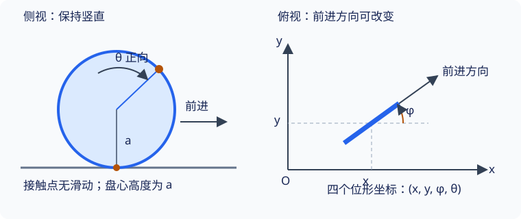

## 约束、自由度与广义坐标

单摆小球在平面内有两个位置分量，却不能任意改变它们：小球必须与悬点保持固定距离．如果始终使用两个位置分量，就必须在运动方程之外维护这一限制．能否一开始就用一个角度表示所有容许位置？

本页要学会三件事：写出约束、数清描述位形所需的独立变量、选取使约束自动满足的坐标．需要会对复合函数求导，并了解 [参考系与坐标系](../kinematics/reference-frames.md)；尚不需要变分法或微分几何．

## 约束限制了什么

**约束（constraint）** 是模型对位置或速度施加的运动学限制．它与实现限制的力有关，但两者不是同一个对象：轻杆长度不变是约束，杆对质点的作用力是约束力．

本文采用惯性参考系，质量和杆长保持不变．先讨论持续成立的等式约束，不处理碰撞、脱离接触等约束切换过程．

### 完整约束与独立性

可以写成仅含位置和时间的等式的约束称为 **完整约束（holonomic constraint）**：

$$
f_a(\boldsymbol r_1,\ldots,\boldsymbol r_N,t)=0,\qquad a=1,\ldots,k
$$

这里 $N$ 是三维空间中的质点数，$k$ 是独立约束数．若这些方程对位置的雅可比矩阵在所讨论区域内具有秩 $k$，则固定时刻的位形空间局部维数为 $3N-k$．平面系统则从 $2N$ 开始计数．“写了几个方程”不能直接代替“有几个独立限制”．

???+ note "例题：平面单摆需要几个坐标？"
    质量为 $m$ 的质点通过长度为 $l$ 的不可伸长轻杆连接固定悬点，运动限制在竖直平面．取悬点为原点，$x$ 向右、$y$ 向上．
    
    位置满足 $x^2+y^2=l^2$．约束的梯度为 $(2x,2y)$，由于 $l>0$，在圆周上不会同时为零，所以这是一个独立约束．两个平面位置分量减去一个限制，留下一个位形自由度．
    
    以竖直向下为零方向，逆时针量取摆角 $\theta$，则
    
    $$
    x=l\sin\theta,\qquad y=-l\cos\theta
    $$
    
    将它们代回约束，得到恒等式 $l^2(\sin^2\theta+\cos^2\theta)=l^2$．这个坐标选择的价值是：以后求出的任意角度运动都自动保持杆长．

{ style="min-width: 600px;" }

### 定常与非定常约束

约束不显含时间称为 **定常约束（scleronomic constraint）**；显含时间称为 **非定常约束（rheonomic constraint）**．这个分类与完整／非完整相互独立．

例如悬点按已知函数 $X(t)$ 水平移动的单摆满足

$$
[x-X(t)]^2+y^2=l^2
$$

它仍是完整约束，仍可用一个摆角表示位置，只是坐标映射也显含时间．“非定常”不表示运动不稳定．

## 位形空间与广义坐标

**位形（configuration）** 描述系统的几何位置与姿态，不包含速度．所有容许位形的集合称为 **位形空间（configuration space）**．本文以它的维数作为 **位形自由度**；没有特别限定时，“自由度”指这一数量．

单摆的位形空间是一条圆周，不是小球运动平面的整个区域．球面上的质点需要两个位置参数；平面双摆则需要两个杆的方向角．质点系的位形空间通常也不是三维物理空间本身．

**广义坐标（generalized coordinates）** 是在某个区域内标记位形的一组参数，记作 $q_1,\ldots,q_n$．首批正文选取独立坐标，使位置写成

$$
\boldsymbol r_i=\boldsymbol r_i(q_1,\ldots,q_n,t)
$$

它们可以是长度或角度，不一定具有相同量纲．广义速度是 $\dot q_\alpha$，而质点的物理速度为

$$
\boldsymbol v_i
=\sum_{\alpha=1}^n\frac{\partial\boldsymbol r_i}{\partial q_\alpha}\dot q_\alpha
+\frac{\partial\boldsymbol r_i}{\partial t}
$$

最后一项不能因为“选了广义坐标”而省略：它描述已知移动约束带来的速度．

### 坐标可能只在局部有效

球面 $x^2+y^2+z^2=a^2$ 有两个位形自由度．常用球面角 $\vartheta,\varphi$ 表示位置，但极点处方位角失去唯一性，需要换用其他局部坐标．这是坐标描述的局限，球面本身并没有消失．

单摆也可以在下半圆取 $q=x$，由 $y=-\sqrt{l^2-x^2}$ 消去 $y$．但同一个 $x$ 在整个圆上对应两个可能高度，而且在 $x=\pm l$ 处该表达的导数发散．因此不能把这组局部坐标用于整个摆动或转动过程．角度也有周期性，连续跟踪转动时可使用展开的角度值．

???+ warning "易错点：位置相同不代表运动状态相同"
    给定位形 $q$ 后，通常还需要速度 $\dot q$ 才能确定动力学初态．“一个坐标足以描述单摆位形”不表示“一个数足以预测它的整个运动”．

## 非完整约束：坐标数与速度数为什么不同

不能化为位置与时间等式的速度约束称为 **非完整约束（nonholonomic constraint）**．先把完整约束消去后，常见线性速度约束为

$$
\sum_{\alpha=1}^n A_{a\alpha}(q,t)\dot q_\alpha+b_a(q,t)=0
$$

若这些速度限制的秩为 $r$，则每个位形处的容许速度有 $n-r$ 个独立分量．它们限制沿哪种方向运动，却不一定减少可到达位形的维数．

### 滚动圆盘的辨析

设半径为 $a$ 的圆盘始终竖直，在水平面上无滑动滚动．为了区分自转姿态，可想象盘面上有一个标记点．用接触位置的平面坐标 $(x,y)$、前进方向角 $\phi$、自转角 $\theta$ 描述位形．已把固定高度和竖直姿态的几何限制消去，所以位形空间局部维数为四．选取 $\theta$ 的正方向使前进弧长为 $a\,\mathrm d\theta$，无滑动条件为

$$
\dot x=a\dot\theta\cos\phi,\qquad
\dot y=a\dot\theta\sin\phi
$$

两条速度限制独立，给定 $\dot\theta$ 和 $\dot\phi$ 后便确定 $\dot x,\dot y$；所以容许速度有两个独立分量．

{ style="min-width: 600px;" }

为什么不能普遍把这些方程积分为两个位置限制？当 $\phi$ 可变化时，位移取决于转向的历史．例如在理想运动学模型中，可先滚过长度 $s$，再原地改变方向角 $\beta$，然后反向滚过同样长度．自转角回到初值，却产生位移 $s(1-\cos\beta,-\sin\beta)$．再把方向恢复，仍可得到不同位置．这说明不能只凭当前两角消去平面位置；这里的路径操作只用于检验容许运动，不是在求圆盘动力学．

若另加固定方向 $\phi=\phi_0$ 的条件，则沿该方向滚动的关系可积分为 $x-x_0=a(\theta-\theta_0)\cos\phi_0$、$y-y_0=a(\theta-\theta_0)\sin\phi_0$，成为另一种、更受限制的模型．

| 模型 | 位形自由度 | 独立容许速度数 |
| --- | --- | --- |
| 固定悬点平面单摆 | 1 | 1 |
| 球面质点 | 2 | 2 |
| 平面双摆 | 2 | 2 |
| 可转向的竖直无滑动圆盘 | 4 | 2 |

???+ warning "术语与方法边界"
    参考讲义用“自由度”表示独立速度分量数，因此称上述圆盘有两个自由度．本站以位形维数为主，并单列速度数；读其他教材时需先辨认口径．含速度不自动意味着非完整：$\dot x-v_0=0$ 可积分为 $x-v_0t=C$．含三角函数也不是不可积的判据．
    
    不等式约束如接触不能穿透，应单独说明单侧接触与是否脱离；不能把它们直接代入这里的等式计数公式．普通独立坐标的拉格朗日方程也不能直接套用于圆盘的四个坐标．

## 文内自测

1. 平面系统写了 $x^2+y^2=l^2$ 和 $2x^2+2y^2=2l^2$，是否剩下零个自由度？

??? note "自测一解答"
    不是．第二个方程是第一个的两倍，两行梯度线性相关，约束秩为一．在 $l>0$ 的圆周上仍有一个位形自由度．

2. 移动悬点单摆取 $x=X(t)+l\sin\theta$、$y=-l\cos\theta$，写出速度，并判断其约束类型．

??? note "自测二解答"
    这是一个非定常完整约束．速度为
    
    $$
    \dot x=\dot X+l\dot\theta\cos\theta,\qquad
    \dot y=l\dot\theta\sin\theta
    $$
    
    位形自由度为一，固定时刻容许速度的集合是带已知平移项的直线，而不是必须穿过零速度的直线．

## 继续学习与参考资料

下一页：[虚位移、理想约束与虚功](virtual-work.md)．返回 [分析力学导读](index.md) 查看路线．

- 高显，《经典力学》，科学出版社，2023 年．
- [Sussman 与 Wisdom，Structure and Interpretation of Classical Mechanics，第 1 章](https://mitp-content-server.mit.edu/books/content/sectbyfn/books_pres_0/9579/sicm_edition_2.zip/chapter001.html)：位形空间、广义坐标与约束．
