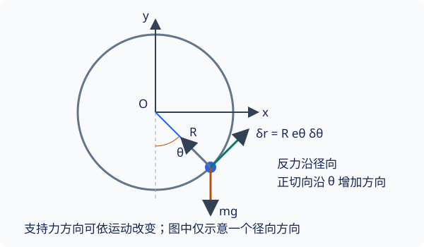

## 达朗贝尔原理与广义力

虚功原理能判断平衡，但圆环上的小环通常正在加速，主动力的切向投影不为零．要把同一思路用于动力学，必须把加速度项一起投影，而不是继续令主动力虚功为零．

本页从 [牛顿运动定律](../dynamics/newton-laws.md) 出发，学习达朗贝尔原理和 **广义力（generalized force）**．需要掌握 [虚位移与理想约束](virtual-work.md)，会使用矢量标量积．

## 把牛顿方程投影到容许方向

在惯性参考系中，对恒定质量 $m_i$ 的质点，有

$$
\boldsymbol F_i^{(a)}+\boldsymbol f_i=m_i\ddot{\boldsymbol r}_i
$$

移项后与容许虚位移作标量积，对所有质点求和．如果约束理想，约束力项消失，得到 **达朗贝尔原理（d'Alembert's principle）**：

$$
\sum_i\left(\boldsymbol F_i^{(a)}-m_i\ddot{\boldsymbol r}_i\right)
\cdot\delta\boldsymbol r_i=0
$$

它的意思是：主动力与惯性项的差在每个容许方向上的投影都为零，剩余法向部分由反力补足．「动平衡」是一种方程改写，不表示运动质点真的处于静止平衡．

???+ warning "惯性项的含义"
    这里的 $-m_i\ddot{\boldsymbol r}_i=-\dot{\boldsymbol p}_i$ 是移到左边的动力学项，不是 $-\boldsymbol p_i$，也不是新增加的物理相互作用．它与 [非惯性参考系的惯性力](../dynamics/inertial-force.md) 需要区分；本页没有变换参考系．

## 广义力：每个坐标变化对应的虚功系数

对完整约束下的独立广义坐标，代入

$$
\delta\boldsymbol r_i=\sum_{\alpha=1}^n
\dfrac{\partial\boldsymbol r_i}{\partial q_\alpha}\delta q_\alpha,
$$

主动力的总虚功成为

$$
\delta W^{(a)}=\sum_\alpha Q_\alpha\delta q_\alpha,
\qquad
Q_\alpha=\sum_i\boldsymbol F_i^{(a)}\cdot
\dfrac{\partial\boldsymbol r_i}{\partial q_\alpha}
$$

$Q_\alpha$ 是与坐标 $q_\alpha$ 配对的广义力．它不是把某个矢量力简单改名；多个质点的力可以共同贡献于同一个 $Q_\alpha$．实际计算时，先固定其他坐标，让 $q_\alpha$ 单独增加；用位置映射求出各质点对应的移动方向，再与各自的力作标量积并求和．这个程序同时保留方向、几何比例和多个受力点的贡献．

{ style="min-width: 600px;" }

### 量纲与势能关系

$Q_\alpha\delta q_\alpha$ 必须具有能量量纲．若 $q_\alpha$ 是长度，广义力具有力的单位；若是无量纲角度，它具有力矩的单位．更一般地，广义力的单位是能量除以相应坐标的单位．

若主动力由位置势能 $V(\boldsymbol r_1,\ldots,\boldsymbol r_N,t)$ 给出，则固定时间的链式法则给出

$$
Q_\alpha=\sum_i(-\nabla_i V)\cdot
\dfrac{\partial\boldsymbol r_i}{\partial q_\alpha}
=-\dfrac{\partial V}{\partial q_\alpha}
$$

这一步不要求约束定常，但这里的势能不含速度．对于额外阻力或外驱动力，可以直接从虚功求相应广义力．

## 独立坐标下的动力学投影

将主动力与惯性项一起代入达朗贝尔原理，有

$$
\sum_\alpha\left[
Q_\alpha-\sum_i m_i\ddot{\boldsymbol r}_i\cdot
\dfrac{\partial\boldsymbol r_i}{\partial q_\alpha}
\right]\delta q_\alpha=0
$$

可以令除 $\delta q_1$ 外的其他变化都为零，而 $\delta q_1$ 任意，得到第一个方括号为零；再逐个选择其他方向，便得到每个方括号分别为零：

$$
\sum_i m_i\ddot{\boldsymbol r}_i\cdot
\dfrac{\partial\boldsymbol r_i}{\partial q_\alpha}=Q_\alpha
$$

现在已消去了理想反力，但左边仍涉及位置矢量的二阶导数．下一页把它重写为动能的导数，就得到统一的拉格朗日方程．

???+ note "例题：竖直圆环上的小环如何运动？"
    使用上一页的固定光滑圆环模型，半径 $R$，质量 $m$，坐标 $\theta$ 从最低点方向逆时针量取，$y$ 向上．本题训练把加速度投影到容许方向，不要求解出 $\theta(t)$．
    
    位置、单位径向与切向矢量为
    
    $$
    \boldsymbol r=R(\sin\theta,-\cos\theta),\qquad
    \boldsymbol e_r=(\sin\theta,-\cos\theta),\qquad
    \boldsymbol e_\theta=(\cos\theta,\sin\theta)
    $$
    
    固定半径下，加速度为 $\boldsymbol a=-R\dot\theta^2\boldsymbol e_r+R\ddot\theta\boldsymbol e_\theta$，虚位移为 $R\boldsymbol e_\theta\delta\theta$．重力 $\boldsymbol F^{(a)}=(0,-mg)$，所以
    
    $$
    Q_\theta=(0,-mg)\cdot R\boldsymbol e_\theta=-mgR\sin\theta
    $$
    
    径向加速度与虚位移垂直，因此达朗贝尔原理化为
    
    $$
    \left(-mgR\sin\theta-mR^2\ddot\theta\right)\delta\theta=0,
    \qquad
    \ddot\theta+\dfrac{g}{R}\sin\theta=0
    $$
    
    正的小角度偏离最低点会产生负角加速度，方向符合回复作用．$g/R$ 的量纲是时间的负二次方．小角度下得到角频率 $\sqrt{g/R}$；把角度移到最高点附近则得到不稳定运动．

???+ warning "反力被消去，不等于反力不存在"
    如果还要计算铁丝对小环的法向力，可把已求出的运动代回牛顿方程的径向分量．消元只是不让未知反力阻碍求切向运动．非完整约束下的变分通常相互受限，不能把上面的每个方括号直接分别置零．

## 文内自测

1. 单摆小球受到水平向右的外力 $F(t)$，求它对摆角的广义力．

??? note "自测一解答"
    $\partial\boldsymbol r/\partial\theta=l(\cos\theta,\sin\theta)$，所以 $Q_\theta^{\rm ext}=F(t)l\cos\theta$．它的单位为 $\mathrm{N\,m}$；小球接近水平位置时，水平力近乎沿杆，广义驱动趋近零．

2. 圆环上的小环受到切向阻力 $\boldsymbol F_D=-cR\dot\theta\boldsymbol e_\theta$，其中 $c>0$，阻力如何改变上例？

??? note "自测二解答"
    阻力的广义力为 $Q_\theta^D=-cR^2\dot\theta$．因此
    
    $$
    mR^2\ddot\theta+mgR\sin\theta+cR^2\dot\theta=0
    $$
    
    $c$ 的单位为 $\mathrm{kg/s}$，每项都是力矩．令 $c=0$ 恢复无阻力方程．

## 继续学习与参考资料

上一页：[虚功与理想约束](virtual-work.md)．下一页：[拉格朗日方程](lagrangian.md)．极坐标加速度的推导可查 [参考系与坐标系](../kinematics/reference-frames.md#平面极坐标系-polar-coordinates)．

- 高显，《经典力学》，科学出版社，2023 年．
- [MIT OpenCourseWare，Lagrangian dynamics、generalized forces 与运动方程](https://ocw.mit.edu/courses/2-003j-dynamics-and-control-i-spring-2007/resources/lec14/)．
