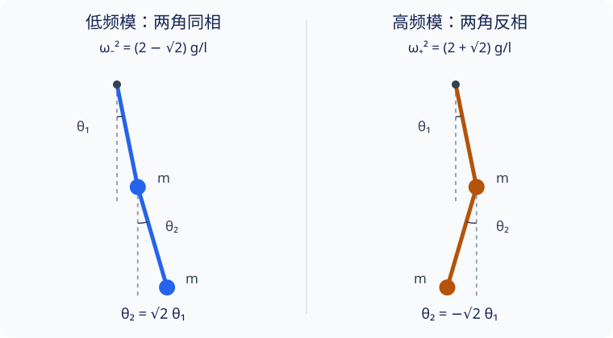

## 从双摆方程接着往下求

[拉格朗日建模实例](lagrangian-modeling.md#例题二平面双摆) 已经建立一般双摆的完整方程．本页取两质量相等、两杆等长，在下垂平衡附近求出实际运动．重点是把矩阵、振型和初始条件接起来，而不只停在两个频率的答案上．

设两质点质量均为 $m>0$，两轻杆长均为 $l>0$，悬点固定，铰链无摩擦，无空气阻力，在均匀重力场的竖直平面中运动．仍取 $x$ 向右、$y$ 向上，两角 $\theta_1,\theta_2$ 分别从竖直向下逆时针量取，都是绝对角．

{ style="min-width: 600px;" }

图中虚线是竖直参考方向，角度为示意；振型比例指杆的角度，不是两个质点的水平位移比．

## 二次能量与矩阵

原模型的能量为

$$
T=ml^2\dot\theta_1^2+\dfrac12ml^2\dot\theta_2^2
+ml^2\dot\theta_1\dot\theta_2\cos(\theta_1-\theta_2),
$$

$$
V=-2mgl\cos\theta_1-mgl\cos\theta_2.
$$

平衡要求两角的正弦为零．在 $\theta_1=\theta_2=0$ 处，两条对角曲率为 $2mgl,mgl$，交叉曲率为零，势能严格极小．其余角取 $0$ 或 $\pi$ 的平衡至少有一个负曲率方向，不属于这里的稳定小振动．

令两角及对应角速度都按小量计数．势能保留余弦的二阶项；动能交叉项中的速度乘积已经为二阶，所以余弦只取一．余弦的二阶修正乘上速度乘积后为四阶，不能混入二次近似．

将势能零点从悬点高度改到下垂平衡，即加上常数 $3mgl$，得到

$$
T^{(2)}=\dfrac12ml^2
(2\dot\theta_1^2+2\dot\theta_1\dot\theta_2+\dot\theta_2^2),
\qquad
V^{(2)}=\dfrac12mgl(2\theta_1^2+\theta_2^2).
$$

因为平衡角为零，$\boldsymbol\eta=\boldsymbol\theta$，因此

$$
M=ml^2\begin{pmatrix}2&1\\1&1\end{pmatrix},\qquad
K=mgl\begin{pmatrix}2&0\\0&1\end{pmatrix}.
$$

两矩阵都正定：第一顺序主子式为正，行列式分别为 $(ml^2)^2$ 与 $2(mgl)^2$．方程为

$$
2\ddot\theta_1+\ddot\theta_2+2\dfrac gl\theta_1=0,\qquad
\ddot\theta_1+\ddot\theta_2+\dfrac gl\theta_2=0.
$$

势能没有交叉项，动能却有，故两角仍然耦合．这正与从完整双摆方程线性化得到的结果一致．

## 两个固有角频率与振型

令 $\lambda=\omega^2l/g$，频率方程化成

$$
0=\det(K-\omega^2M)
=(mgl)^2\left[2(1-\lambda)^2-\lambda^2\right].
$$

展开得 $\lambda^2-4\lambda+2=0$，于是按低频、高频分别记为

$$
\boxed{\omega_-^2=(2-\sqrt2)\dfrac gl},\qquad
\boxed{\omega_+^2=(2+\sqrt2)\dfrac gl}.
$$

共同质量 $m$ 约掉，是因为惯性与重力回复项都同比例随质量变化．这不意味着任意不等质量双摆的频率都与质量比无关．

由特征方程的第二行，

$$
-\lambda a_1+(1-\lambda)a_2=0,
$$

低频根给出 $a_2=\sqrt2a_1$，高频根给出 $a_2=-\sqrt2a_1$．取未经归一化的振型

$$
\boldsymbol a_-=\begin{pmatrix}1\\\sqrt2\end{pmatrix},\qquad
\boldsymbol a_+=\begin{pmatrix}1\\-\sqrt2\end{pmatrix}.
$$

低频模的两角同相，高频模的两角反相；两模中第二杆的角振幅都是第一杆的 $\sqrt2$ 倍．这不是两杆夹角的比例．小角度下质点水平位移为 $x_1\approx l\theta_1$、$x_2\approx l(\theta_1+\theta_2)$，故质点水平位移比为 $1\pm\sqrt2$，与角度比不同．

### 质量归一化

直接计算得到

$$
\boldsymbol a_-^{\mathsf T}M\boldsymbol a_+=0,\qquad
\boldsymbol a_\mp^{\mathsf T}M\boldsymbol a_\mp
=ml^2(4\pm2\sqrt2).
$$

为避免嵌套根式，定义两个正数

$$
n_-=\sqrt{ml^2(4+2\sqrt2)},\qquad
n_+=\sqrt{ml^2(4-2\sqrt2)}.
$$

归一化振型为 $\boldsymbol b_-=\boldsymbol a_-/n_-$、$\boldsymbol b_+=\boldsymbol a_+/n_+$．注意普通点积 $\boldsymbol a_-^{\mathsf T}\boldsymbol a_+=-1$ 并不为零；正交性使用的是质量矩阵．

## 简正坐标与一般初态

先用直观的振型幅值 $u_-,u_+$ 表示位形：

$$
\boldsymbol\theta=\boldsymbol a_-u_-+\boldsymbol a_+u_+,
\qquad
\theta_1=u_-+u_+,\quad
\theta_2=\sqrt2(u_--u_+).
$$

加减两式可直接求逆：

$$
u_-=\dfrac12\left(\theta_1+\dfrac{\theta_2}{\sqrt2}\right),\qquad
u_+=\dfrac12\left(\theta_1-\dfrac{\theta_2}{\sqrt2}\right).
$$

它们已经各自满足独立振子方程，但动能系数尚未归一化．与上一页相同的质量归一化简正坐标为

$$
\boxed{Q_-=n_-u_-,\qquad Q_+=n_+u_+}.
$$

因此模态矩阵及其逆为

$$
B=\begin{pmatrix}
1/n_-&1/n_+\\
\sqrt2/n_-&-\sqrt2/n_+
\end{pmatrix},\qquad
B^{-1}=\dfrac12\begin{pmatrix}
n_-&n_-/\sqrt2\\
n_+&-n_+/\sqrt2
\end{pmatrix}=B^{\mathsf T}M.
$$

代入能量，确有

$$
L^{(2)}=\dfrac12(\dot Q_-^2+\dot Q_+^2)
-\dfrac12(\omega_-^2Q_-^2+\omega_+^2Q_+^2).
$$

给定 $\theta_1(0)=a$、$\theta_2(0)=b$、$\dot\theta_1(0)=v_1$、$\dot\theta_2(0)=v_2$，不必重新解四个三角函数常数．直接取

$$
u_\mp(0)=\dfrac12\left(a\pm\dfrac b{\sqrt2}\right),\qquad
\dot u_\mp(0)=\dfrac12\left(v_1\pm\dfrac{v_2}{\sqrt2}\right),
$$

然后分别求

$$
u_\mp(t)=u_\mp(0)\cos\omega_\mp t
+\dfrac{\dot u_\mp(0)}{\omega_\mp}\sin\omega_\mp t.
$$

最后代回 $\theta_1=u_-+u_+$、$\theta_2=\sqrt2(u_--u_+)$，便得到两角的运动．

## 三组静止释放条件

### 两角等大反向

取 $\theta_1(0)=\theta_0$、$\theta_2(0)=-\theta_0$，两角速度均为零，$|\theta_0|\ll1$．虽然两角一开始反向，却没有满足高频振型要求的比例 $-\sqrt2$，因此两个模态都会被激发：

$$
u_-(0)=\dfrac{\theta_0}{2}\left(1-\dfrac1{\sqrt2}\right),\qquad
u_+(0)=\dfrac{\theta_0}{2}\left(1+\dfrac1{\sqrt2}\right).
$$

于是

$$
\theta_1(t)=\dfrac{\theta_0}{4}
\left[(2-\sqrt2)\cos\omega_-t+(2+\sqrt2)\cos\omega_+t\right],
$$

$$
\theta_2(t)=\dfrac{\theta_0}{2}
\left[(\sqrt2-1)\cos\omega_-t-(\sqrt2+1)\cos\omega_+t\right].
$$

检查 $t=0$ 恢复 $(\theta_0,-\theta_0)$，初始导数为零．进一步对两式求二阶导数，可得 $\ddot\theta_1(0)=-3(g/l)\theta_0$、$\ddot\theta_2(0)=4(g/l)\theta_0$，与原来的两条线性方程一致．初始能量为 $3mgl\theta_0^2/2$，也等于两个模态能量之和．

### 低频纯模与高频纯模

若初始两角为 $(\theta_0,\sqrt2\theta_0)$、初速度均为零，则 $u_+(0)=0$，只有低频模：

$$
\boldsymbol\theta(t)=\theta_0
\begin{pmatrix}1\\\sqrt2\end{pmatrix}\cos\omega_-t.
$$

若改为 $(\theta_0,-\sqrt2\theta_0)$，只有高频模：

$$
\boldsymbol\theta(t)=\theta_0
\begin{pmatrix}1\\-\sqrt2\end{pmatrix}\cos\omega_+t.
$$

角度都过零时，比值写成除法没有意义，但两角间的线性关系始终成立．纯模是线性近似中的运动；较大振幅时，完整双摆的非线性项不能省略，不能保证这些振型比例仍严格不变．

## 另一条路线：直接比较二次型

已经知道频率后，还可不先求振型，而设 $Q_-=a\theta_1+b\theta_2$、$Q_+=c\theta_1+d\theta_2$．要求新旧动能和势能分别相同，便得到

$$
\begin{aligned}
a^2+c^2&=2ml^2,&ab+cd&=ml^2,&b^2+d^2&=ml^2,\\
\omega_-^2a^2+\omega_+^2c^2&=2mgl,&
\omega_-^2ab+\omega_+^2cd&=0,&
\omega_-^2b^2+\omega_+^2d^2&=mgl.
\end{aligned}
$$

这些等式来自平方展开的对应系数；它们是在同时匹配两个二次型，而非仅消去势能交叉项．例如令 $J=ml^2$，将频率代入左列，得到

$$
a^2+c^2=2J,\qquad
(2-\sqrt2)a^2+(2+\sqrt2)c^2=2J.
$$

消去后 $a^2=J(1+1/\sqrt2)$、$c^2=J(1-1/\sqrt2)$．同样处理中列得

$$
ab=\dfrac{1+\sqrt2}{2}J,\qquad
cd=\dfrac{1-\sqrt2}{2}J.
$$

选取 $a,c>0$，便有 $b>0,d<0$，完整解为

$$
a=\dfrac{n_-}{2},\quad b=\dfrac{n_-}{2\sqrt2},
\qquad c=\dfrac{n_+}{2},\quad d=-\dfrac{n_+}{2\sqrt2}.
$$

这正是 $B^{-1}$ 的两行．$(a,b)$ 可以同时反号，$(c,d)$ 也可以同时反号，共有四组符号选择，分别对应给两个简正坐标选择正方向．若振型也相应反号，乘积 $\boldsymbol b_\alpha Q_\alpha$ 不变；这不是四种不同的物理运动．

## 文内自测

1. 两杆初始角相等且静止释放，是否是低频纯模？写出两个振型的初始幅值．

??? note "核对：同向还不够"
    不是．若两角均为 $\theta_0$，则 $u_-(0)=\theta_0(1+1/\sqrt2)/2$、$u_+(0)=\theta_0(1-1/\sqrt2)/2$．同向不意味着满足纯模的角振幅比．
    
2. 将杆长都变为原来的四倍、质量都加倍，两个角频率和振型怎样改变？

??? note "核对：尺度与比例"
    角频率都变为原来的一半，未归一化振型 $(1,\pm\sqrt2)^{\mathsf T}$ 不变．质量归一化系数会改变，因此应区分振型比例不变和归一化向量数值不变．

## 继续学习

上一页：[简正模与简正坐标](normal-modes.md)．返回 [分析力学导读](index.md) 或 [理论力学课程路线](../../courses/theoretical-mechanics.md)．需要理解小振动近似失效后的现象，可阅读 [非线性振动](../oscillation-wave/nonlinear.md)．
