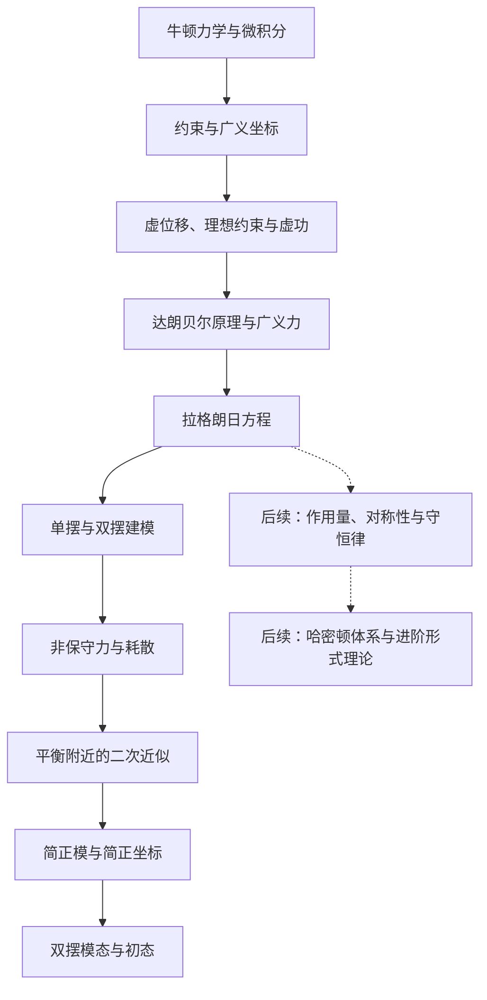

## 分析力学导读

已经会用牛顿第二定律，为什么还要学习拉格朗日和哈密顿的表述？看单摆就能发现一个具体困难：为了求摆角，直角坐标方程通常同时出现水平位置、竖直位置和未知杆力．多一根杆形成双摆后，这种反力与约束的整理更复杂．

分析力学提供一套系统的方法：用合适参数描述容许位形，利用理想约束消去不需要先求的反力，再用动能、势能和广义力建立方程．物理系统没有改变，建模和组织方程的方式改变了．牛顿力学同样可以使用曲线坐标，也仍是计算反力和检查结果的重要工具．

{ style="min-width: 600px;" }

## 从哪里开始，需要什么基础

默认你已学过 [牛顿定律](../dynamics/newton-laws.md)、[功与势能](../dynamics/momentum-energy.md)，能对位置求速度与加速度，并会使用标量积、链式法则和基本偏导．[常微分方程](../../math/differential-equations/ode-intro.md) 帮助理解「建立方程」和「求出轨迹」的区别．

首批采用「从牛顿力学出发」的路线，不要求提前通读变分法、微分几何或相对论．需要极坐标公式时，可查 [参考系与坐标系](../kinematics/reference-frames.md#平面极坐标系-polar-coordinates)；学到作用量时再阅读 [变分法](../../math/variational-methods/calculus-of-variations.md)．

单摆在多页重复出现，但每次承担不同任务：先用它选坐标，再辨认虚位移，再投影力，最后完成能量建模．建议第一次按顺序阅读；已有基础的读者可从对应主题进入．

## 学习路线

| 顺序 | 页面 | 读完应该能做什么 |
| --- | --- | --- |
| 1 | [约束、自由度与广义坐标](constraints-generalized-coordinates.md) | 写约束、数位形变量、解释滚动圆盘的速度限制 |
| 2 | [虚位移、理想约束与虚功](virtual-work.md) | 区分虚位移与实位移，用虚功判断平衡 |
| 3 | [达朗贝尔原理与广义力](dalembert-principle.md) | 把牛顿方程投影到容许方向，计算广义力 |
| 4 | [拉格朗日方程](lagrangian.md) | 解释关键恒等式，理解方程的来源和条件 |
| 5 | [拉格朗日建模实例](lagrangian-modeling.md) | 从单摆、双摆模型自己构造动能势能并建立方程 |
| 6 | [非保守广义力与耗散](nonconservative-forces.md) | 加入阻力和驱动，核对机械能损失率 |
| 7 | [平衡附近的小振动](small-oscillations.md) | 判断近似条件，从二次能量构造质量与刚度矩阵 |
| 8 | [简正模与简正坐标](normal-modes.md) | 求振型、解耦方程，并将初态投影到模态 |
| 9 | [双摆的小振动与模态](double-pendulum-modes.md) | 完成双摆频率、振型和三组初态的求解 |

主题页按任务安排推导、例题与自测，核心方法保持可见．小振动阶段再补充矩阵、特征值和内积工具，不必在进入导论前一次学完．已有建模基础的读者可从第 7 页开始；尚不熟悉单自由度解时，先读 [线性振动](../oscillation-wave/linear-oscillation.md)．

双摆在建模页负责建立完整方程，在小振动专题中负责近似、解耦与初态求解．两次使用同一模型承担不同任务，不需要重新学习一套角度约定．

实线表示已提供正文的阅读主线，虚线表示后续建设方向．

## 贯穿主线的三个判断

**位形描述与初态描述不同．** 单摆用一个角度标记位置，但预测运动还需要角速度．[广义坐标](concept:generalized-coordinate) 不会自动减少动力学所需的初始信息．

**反力能否消去要检查条件．** [理想约束](concept:ideal-constraint) 要求总约束虚功为零，不表示约束力永远不做实功．非完整约束也不能直接当成已消去的完整约束．

**建立方程之后还要检查物理．** 量纲、回复方向、小角度极限和能量变化都能暴露建模错误；复杂公式不应跳过这些检查．

???+ note "一个最小的建模示例"
    对固定悬点轻杆单摆，$q=\theta$ 自动满足长度约束．已知 $T=ml^2\dot\theta^2/2$、$V=-mgl\cos\theta$，构造 $L=T-V$ 后得到 $ml^2\ddot\theta+mgl\sin\theta=0$．
    
    这只是整套方法的缩影：为什么能用一个角度、为什么省略杆力、方程为什么成立，会在前三页与方程页逐步回答．完整建模和边界检查见 [单摆例题](lagrangian-modeling.md)．

## 后续建设与应用连接

| 阶段 | 建设状态与范围 |
| --- | --- |
| 导论与建模 | 本页及六个主题页已提供正文、图解与自测 |
| 小振动与简正模 | 三个专题页已提供二次近似、解耦方法、三原子与双摆应用 |
| 作用量与守恒律 | 待建设：平稳作用量、循环坐标、广义动量、能量函数、诺特定理与完整约束乘子法 |
| 哈密顿体系 | [哈密顿力学](hamiltonian.md) 为占位页；后续补勒让德变换、正则方程、相空间与刘维尔定理 |
| 进阶形式理论 | 待建设：泊松括号、正则变换、母函数与哈密顿—雅可比理论；非完整动力学另设专题 |

单自由度自由、阻尼与受迫振动统一见 [线性振动](../oscillation-wave/linear-oscillation.md)；多自由度小振动的建模与求解放在本模块．中心力与轨道问题进入 [引力模块](../gravitation.md)（建设中），刚体应用进入 [刚体模块](../rigid-body/rigid-body.md)．作用量与哈密顿体系仍为后续建设方向，不是阅读当前小振动主线的前提．

跟课学习可使用 [理论力学课程路线](../../courses/theoretical-mechanics.md)；它串联不同知识模块，不要求所有课程主题都已完成．相对论、场论和量子力学的连接属于后续拓展，不是本组页面的入门门槛．

## 文内自测

1. 为了求单摆的摆角，是否必须先求杆对质点的力？

??? note "自测一解答"
    对本页的固定轻杆、理想约束模型，不必．可选择独立角度，并用约束反力零虚功条件建立切向方程．若还要知道杆力，应把运动代回牛顿方程，或使用后续的约束乘子法．

2. 会背 $L=T-V$，是否就能把任意有摩擦的系统写成无右侧的欧拉—拉格朗日方程？

??? note "自测二解答"
    不能．先确认坐标和约束条件，再把位置势能能描述的作用计入 $V$，额外作用以广义力加入．线性黏滞阻力还可用瑞利耗散函数表示；这部分见 [非保守广义力与耗散](nonconservative-forces.md)．

## 参考资料

- 高显，《经典力学》，科学出版社，2023 年；首批参考「第一部分讲义：分析力学导论」的约束、虚功、达朗贝尔及建模内容．
- [Sussman 与 Wisdom，Structure and Interpretation of Classical Mechanics，第 1 章](https://mitp-content-server.mit.edu/books/content/sectbyfn/books_pres_0/9579/sicm_edition_2.zip/chapter001.html)．
- [David Tong，Classical Dynamics](https://www.damtp.cam.ac.uk/user/tong/dynamics.html)．

开始阅读：[约束、自由度与广义坐标](constraints-generalized-coordinates.md)．
