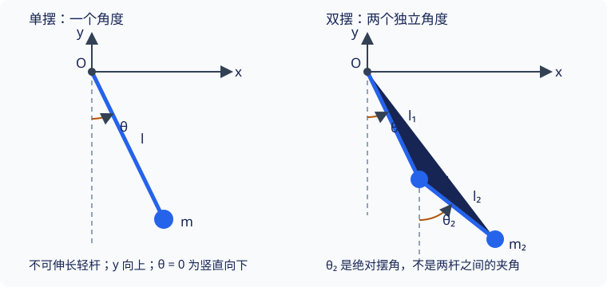

## 拉格朗日建模实例

会写欧拉—拉格朗日方程，并不意味着已经会构造它的输入．单摆与双摆很适合训练这个过程：新增一根杆后，难点不在换一种方程，而在正确表达两个质点的速度与耦合．

本页假定已读 [拉格朗日方程](lagrangian.md)，能对坐标表达式求时间导数．读完应能从模型自己写出动能与势能，建立方程，并判断结果是否合理．这里先得到运动方程，不要求求出全部解析解．

## 一套可重复的建模步骤

1. **系统与假设**：哪些物体有质量，哪些杆或弹簧理想化，约束是否固定、完整、理想？
2. **参考系与坐标**：在惯性参考系中说明正方向，选取独立参数；给出位置映射以验证约束．
3. **位置与速度**：逐个质点求全时间导数，检查是否遗漏移动约束项．
4. **动能与势能**：先写各质点能量，再求和；明确重力势能零点．
5. **运动方程**：构造 $L=T-V$，必要时另加没有计入势能的广义力．
6. **结果检查**：核对量纲、回复方向、无耦合或小角度极限；求解时给出足够的初始位置和速度．

{ style="min-width: 600px;" }

## 例题一：固定悬点单摆

### 模型、坐标与能量

均匀重力场中，质量为 $m>0$ 的质点由长度 $l>0$ 的不可伸长轻杆连接固定悬点，在竖直平面运动．忽略阻力与铰链摩擦．用杆而非绳，是为了让长度约束在整个转动中保持有效，且杆可受拉也可受压．

悬点为原点，$x$ 向右、$y$ 向上，角度 $\theta$ 从竖直向下逆时针量取．位置、速度为

$$
\begin{aligned}
x&=l\sin\theta,& y&=-l\cos\theta,\\
\dot x&=l\dot\theta\cos\theta,& \dot y&=l\dot\theta\sin\theta
\end{aligned}
$$

两项速度平方相加后得 $v^2=l^2\dot\theta^2$．取悬点高度的势能为零：

$$
T=\dfrac12ml^2\dot\theta^2,\qquad
V=-mgl\cos\theta,\qquad
L=\dfrac12ml^2\dot\theta^2+mgl\cos\theta
$$

### 方程与检查

将 $\partial L/\partial\dot\theta=ml^2\dot\theta$ 和 $\partial L/\partial\theta=-mgl\sin\theta$ 代入方程：

$$
\ddot\theta+\dfrac{g}{l}\sin\theta=0
$$

- $g/l$ 的量纲为 $\mathrm{s^{-2}}$，与角加速度匹配．质量约掉，符合重力与惯性质量同比例的模型．
- $|\theta|\ll1$ 时 $\sin\theta\approx\theta$，固有角频率为 $\omega_0=\sqrt{g/l}$．这是小角度近似，不适用于任意振幅．
- 机械能 $E=ml^2\dot\theta^2/2-mgl\cos\theta$ 沿方程满足 $\mathrm dE/\mathrm dt=\dot\theta(ml^2\ddot\theta+mgl\sin\theta)=0$，可作独立检查．

给定 $\theta(0)$ 和 $\dot\theta(0)$ 才确定一条运动．如果改用轻绳，还必须验证张力 $F_{\rm ten}=m(l\dot\theta^2+g\cos\theta)\ge0$；绳松弛后需改换模型，不能继续沿圆周方程求解．

???+ warning "能量方程在转向点不能直接除以角速度"
    从能量守恒求导只得到 $\dot\theta(ml^2\ddot\theta+mgl\sin\theta)=0$．当 $\dot\theta=0$ 时，不能直接消去这个因子．对已知光滑的非静止运动，可在转向点两侧用运动方程并连续延拓；但单独一条能量关系不能在所有静止情形替代动力学方程．本页用拉格朗日方程作为建模依据，以能量作检查．

### 为什么不能把受限的位置分量当成两个独立坐标

若直接写 $L=m(\dot x^2+\dot y^2)/2-mgy$，并对 $x,y$ 各套一条无约束方程，会得到 $\ddot x=0$、$\ddot y=-g$，描述的是自由落体．问题不在笛卡尔坐标，而在遗漏了 $x^2+y^2=l^2$ 与相应反力．

可以用角度把约束消去，也可以在后续的乘子法中保留冗余坐标和约束方程．不能既保留受限坐标，又假定它们的变分相互独立．

??? note "补充解法：用水平位置作为局部坐标"
    在下半圆且 $|x|<l$ 时，可令 $y=-\sqrt{l^2-x^2}$．得到
    
    $$
    L=\dfrac{ml^2\dot x^2}{2(l^2-x^2)}+mg\sqrt{l^2-x^2},
    $$
    
    对 $x$ 建立方程为
    
    $$
    \dfrac{ml^2\ddot x}{l^2-x^2}
    +\dfrac{ml^2x\dot x^2}{(l^2-x^2)^2}
    +\dfrac{mgx}{\sqrt{l^2-x^2}}=0
    $$
    
    在这段坐标有效区域内代入 $x=l\sin\theta$、$\cos\theta>0$，可还原角度方程．它增加了计算量，也无法跨过 $x=\pm l$，说明选坐标既要正确，也要方便．

## 例题二：平面双摆

### 模型与位置映射

两个质点质量为 $m_1,m_2>0$，两根不可伸长轻杆长度为 $l_1,l_2>0$，上端固定、关节无摩擦，运动在竖直平面内．忽略杆的质量和空气阻力．沿用 $x$ 向右、$y$ 向上，两个角 $\theta_1,\theta_2$ **各自相对于竖直向下方向**量取，不是第二杆相对第一杆的角度．

$$
\begin{aligned}
\boldsymbol r_1&=(l_1\sin\theta_1,-l_1\cos\theta_1),\\
\boldsymbol r_2&=\boldsymbol r_1+(l_2\sin\theta_2,-l_2\cos\theta_2)
\end{aligned}
$$

两个距离约束已自动满足，两角独立．记 $\Delta=\theta_1-\theta_2$，求导后第二个质点的速度平方为

$$
v_2^2=l_1^2\dot\theta_1^2+l_2^2\dot\theta_2^2
+2l_1l_2\dot\theta_1\dot\theta_2\cos\Delta
$$

交叉项来自两个速度贡献的标量积：上杆带动第一个关节，下杆相对关节转动；第二质点的绝对速度是二者之和．它不是另外添加的一种力，也不能因为「两根杆」就删掉．

### 构造能量

$$
\begin{aligned}
T&=\dfrac12(m_1+m_2)l_1^2\dot\theta_1^2
+\dfrac12m_2l_2^2\dot\theta_2^2
+m_2l_1l_2\dot\theta_1\dot\theta_2\cos\Delta,\\
V&=-(m_1+m_2)gl_1\cos\theta_1-m_2gl_2\cos\theta_2
\end{aligned}
$$

注意第一项动能与势能都含 $m_1+m_2$：第一根杆的运动同时改变两质点的位置．仍令 $L=T-V$．

### 两条耦合方程

令 $B=m_2l_1l_2$．对第一角，有

$$
\begin{aligned}
\dfrac{\partial L}{\partial\dot\theta_1}
&=(m_1+m_2)l_1^2\dot\theta_1+B\dot\theta_2\cos\Delta,\\
\dfrac{\mathrm d}{\mathrm dt}\dfrac{\partial L}{\partial\dot\theta_1}
&=(m_1+m_2)l_1^2\ddot\theta_1+B\ddot\theta_2\cos\Delta
-B\dot\theta_2(\dot\theta_1-\dot\theta_2)\sin\Delta,\\
\dfrac{\partial L}{\partial\theta_1}
&=-B\dot\theta_1\dot\theta_2\sin\Delta-(m_1+m_2)gl_1\sin\theta_1
\end{aligned}
$$

对第二角，有

$$
\begin{aligned}
\dfrac{\partial L}{\partial\dot\theta_2}
&=m_2l_2^2\dot\theta_2+B\dot\theta_1\cos\Delta,\\
\dfrac{\mathrm d}{\mathrm dt}\dfrac{\partial L}{\partial\dot\theta_2}
&=m_2l_2^2\ddot\theta_2+B\ddot\theta_1\cos\Delta
-B\dot\theta_1(\dot\theta_1-\dot\theta_2)\sin\Delta,\\
\dfrac{\partial L}{\partial\theta_2}
&=B\dot\theta_1\dot\theta_2\sin\Delta-m_2gl_2\sin\theta_2
\end{aligned}
$$

分别相减，混合速度乘积消去，得到

$$
\begin{aligned}
(m_1+m_2)l_1^2\ddot\theta_1
+B\cos\Delta\,\ddot\theta_2
+B\sin\Delta\,\dot\theta_2^2
+(m_1+m_2)gl_1\sin\theta_1&=0,\\
m_2l_2^2\ddot\theta_2
+B\cos\Delta\,\ddot\theta_1
-B\sin\Delta\,\dot\theta_1^2
+m_2gl_2\sin\theta_2&=0
\end{aligned}
$$

每项都有能量或力矩量纲．两个方程必须一起求解，需要两角和两角速度共四个初始量．

### 如何确认耦合结果合理

在下垂平衡附近，令两角及其运动幅度都小，保留一阶项．此时速度平方与 $\sin\Delta$ 的乘积是高阶项，$\cos\Delta\approx1$，得到

$$
\begin{aligned}
(m_1+m_2)l_1^2\ddot\theta_1+B\ddot\theta_2+(m_1+m_2)gl_1\theta_1&=0,\\
B\ddot\theta_1+m_2l_2^2\ddot\theta_2+m_2gl_2\theta_2&=0
\end{aligned}
$$

小角度并没有消除耦合：第一条方程仍含第二角的加速度，第二条也仍含第一角的加速度．若两质量均为 $m$、两杆长均为 $l$，频率为 $\omega_\pm^2=(2\pm\sqrt2)g/l$，但只知道这两个数还不能确定运动；还需要每个频率对应的振型及初态在振型上的分量．[平衡附近的小振动](small-oscillations.md) 从能量解释上述近似，[双摆模态](double-pendulum-modes.md) 接着完成频率、振型与初态求解．

加速度系数矩阵的行列式为

$$
m_2l_1^2l_2^2\left(m_1+m_2\sin^2\Delta\right)>0,
$$

所以在正质量、正杆长假设下可以由两条方程确定两角加速度．将第一方程乘 $\dot\theta_1$、第二方程乘 $\dot\theta_2$ 后相加，得到 $\mathrm d(T+V)/\mathrm dt=0$，也是检查交叉项符号的办法．

若物理上移去第二个质点和第二根杆，第一方程恢复单摆方程．不能把 $m_2=0$ 直接当成仍有两个正常动力学自由度的模型，因为这会使动能矩阵退化．

## 文内自测

1. 双摆公式中的第一项动能为什么不能写成 $m_1l_1^2\dot\theta_1^2/2$？

??? note "自测一解答"
    第二个质点的绝对速度包含第一关节的运动，所以它也贡献 $m_2l_1^2\dot\theta_1^2/2$．漏掉这一项等于把第二质点错误地放在一个固定关节上．

2. 若把第二坐标改为两杆夹角 $\psi=\theta_2-\theta_1$，能否直接在上面方程中把 $\theta_2$ 的名字换成 $\psi$？

??? note "自测二解答"
    不能．必须代入 $\theta_2=\theta_1+\psi$、$\dot\theta_2=\dot\theta_1+\dot\psi$，重新表达 $L$ 后对新坐标求导．独立坐标变换不改变物理运动，但改变了偏导时固定哪些变量．

## 继续学习与参考资料

上一页：[拉格朗日方程](lagrangian.md)．下一页：[非保守广义力与耗散](nonconservative-forces.md)，为建模步骤加入阻力和外驱动．返回 [分析力学导读](index.md)．

- 高显，《经典力学》，科学出版社，2023 年．
- [David Tong，The Lagrangian Formalism](https://www.damtp.cam.ac.uk/user/tong/dynamics/dynhtml/S2.html)：广义坐标、拉格朗日建模与小振动．
