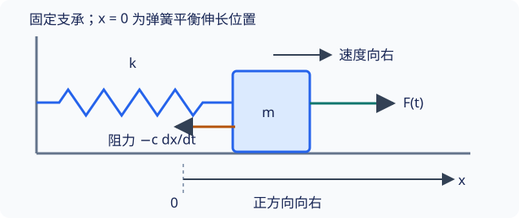

## 非保守广义力与耗散

真实摆会停下来，弹簧振子也常受到阻力．如果仍只用保守部分的 $L=T-V$ 并令方程右侧为零，就把导致能量损失的作用遗漏了．解决办法是保留这些力的广义力；对于线性黏滞阻力，还可以用一个标量函数统一表达．

本页需要 [拉格朗日方程](lagrangian.md) 和 [广义力的虚功定义](dalembert-principle.md)．读完应能区分势能、额外广义力和耗散函数，建立阻尼振子方程，并核对耗散功率．

## 不把所有主动力都塞进势能

将位置势能能描述的力计入 $V(q,t)$，把其余主动力的广义力记作 $Q_\alpha^{\rm extra}$，则

$$
\frac{\mathrm d}{\mathrm dt}\frac{\partial L}{\partial\dot q_\alpha}
-\frac{\partial L}{\partial q_\alpha}=Q_\alpha^{\rm extra},
\qquad L=T-V
$$

例如角度为 $\theta$ 的单摆若受到水平外力 $F(t)$，其额外广义力是 $Fl\cos\theta$；若受到切向黏滞阻力，广义力与 $\dot\theta$ 成反向比例．这两种作用都应从力的方向和位置映射计算，不能只凭大小往角度方程右侧添加．

## 瑞利耗散函数从哪里来

先限定在相对于静止介质的线性黏滞阻力模型．对第 $i$ 个质点，在选定笛卡尔轴上有

$$
F_{Di,x}=-c_{ix}v_{ix},\qquad
F_{Di,y}=-c_{iy}v_{iy},\qquad
F_{Di,z}=-c_{iz}v_{iz},
$$

其中 $c_{ix},c_{iy},c_{iz}\ge0$，可依位置或时间变化，但这里不依赖速度．定义 **瑞利耗散函数（Rayleigh dissipation function）**

$$
\mathcal R(q,\dot q,t)
=\frac12\sum_i\left(c_{ix}v_{ix}^2+c_{iy}v_{iy}^2+c_{iz}v_{iz}^2\right)
$$

先把它看作物理速度的函数，就有 $\boldsymbol F_{Di}=-\partial\mathcal R/\partial\boldsymbol v_i$．再使用运动学恒等式 $\partial\boldsymbol v_i/\partial\dot q_\alpha=\partial\boldsymbol r_i/\partial q_\alpha$，链式法则给出

$$
\begin{aligned}
Q_\alpha^D
&=\sum_i\boldsymbol F_{Di}\cdot\frac{\partial\boldsymbol r_i}{\partial q_\alpha}\\
&=-\sum_i\frac{\partial\mathcal R}{\partial\boldsymbol v_i}\cdot
\frac{\partial\boldsymbol v_i}{\partial\dot q_\alpha}
=-\frac{\partial\mathcal R}{\partial\dot q_\alpha}
\end{aligned}
$$

如果还受到没有计入 $V$ 的外驱动力，记其广义力为 $Q_\alpha^{\rm drive}$，方程便为

$$
\boxed{\frac{\mathrm d}{\mathrm dt}\frac{\partial L}{\partial\dot q_\alpha}
-\frac{\partial L}{\partial q_\alpha}
+\frac{\partial\mathcal R}{\partial\dot q_\alpha}
=Q_\alpha^{\rm drive}}
$$

本页用 $\mathcal R$ 表示耗散函数，避免与矢量力 $\boldsymbol F_D$ 混淆．它不应当被加入势能，也不通过修改 $L=T-V$ 来重复计算阻力．

### 与耗散功率的关系

在上述线性阻力模型中，阻力对质点做功的功率为负：

$$
P_D=\sum_i\boldsymbol F_{Di}\cdot\boldsymbol v_i=-2\mathcal R
$$

因此 $2\mathcal R$ 是损失功率的正值大小，单位为瓦特，而不是焦耳．当坐标映射不显含时间时，$\mathcal R$ 是广义速度的二次齐次函数，也有 $\sum_\alpha Q_\alpha^D\dot q_\alpha=-2\mathcal R$．若约束移动，不能无条件把这条广义坐标功率关系照搬：必须计入坐标映射中的已知移动项以及装置做功．

???+ warning "适用范围：不是所有摩擦都有这一个公式"
    库仑滑动摩擦并不与速度成线性关系；静摩擦还需要判断接触是否滑动．这里的二次 $\mathcal R$ 不能直接覆盖它们．运动介质中的阻力应使用相对介质速度重新建模，此时 $2\mathcal R$ 与质点在实验室系损失的机械功率也需重新辨析．

## 例题：水平弹簧的阻尼振子

质量 $m>0$ 的滑块沿水平直线运动，弹簧劲度系数 $k>0$，平衡伸长位置作为 $x=0$．忽略其他摩擦，阻力为 $-c\dot x$，$c\ge0$，外驱动力沿 $x$ 正向为 $F(t)$．支承固定且理想，所以只有一个坐标 $q=x$．

{ style="min-width: 600px;" }

能量与耗散函数为

$$
T=\frac12m\dot x^2,\qquad
V=\frac12kx^2,\qquad
\mathcal R=\frac12c\dot x^2,
\qquad Q_x^{\rm drive}=F(t)
$$

代入含耗散的方程，得到

$$
m\ddot x+c\dot x+kx=F(t)
$$

每一项都是力，$c$ 的单位为 $\mathrm{kg/s}$．这个方程与直接写牛顿方程完全一致，说明新方法仍描述同一个物理模型．

### 从运动方程检查能量

机械能为 $E=T+V$．将方程乘 $\dot x$，可得

$$
\frac{\mathrm dE}{\mathrm dt}=F(t)\dot x-c\dot x^2
$$

外力输入功率为 $F\dot x$，阻力损失功率为 $c\dot x^2=2\mathcal R$．外力不一定总在输入能量，输入功率的符号取决于力与速度．

无驱动时 $\mathrm dE/\mathrm dt\le0$；若 $c>0$，只有瞬时 $\dot x=0$ 时损失率为零，这不代表阻尼消失．关闭阻尼 $c=0$ 后，恢复无阻尼弹簧振子；同时令 $F=0$，能量守恒．

### 方程如何描述衰减

对 $F=0$，定义 $\gamma=c/(2m)$、$\omega_0=\sqrt{k/m}$．在欠阻尼条件 $\gamma<\omega_0$ 下，特征根为 $-\gamma\pm\mathrm i\sqrt{\omega_0^2-\gamma^2}$，所以

$$
x(t)=A\mathrm e^{-\gamma t}\cos(\omega_dt+\varphi),
\qquad \omega_d=\sqrt{\omega_0^2-\gamma^2}
$$

$A,\varphi$ 由初始位置和速度确定．若给定 $x(0)=x_0$、$\dot x(0)=0$，也可写为

$$
x(t)=x_0\mathrm e^{-\gamma t}
\left[\cos(\omega_dt)+\frac{\gamma}{\omega_d}\sin(\omega_dt)\right]
$$

临界阻尼和过阻尼不再采用这个振荡形式，具体解法见 [二阶常系数线性微分方程](../../math/differential-equations/second-order-ode.md) 和 [线性振动](../oscillation-wave/linear-oscillation.md)．这里的机械能瞬时变化不是简单地把位移包络平方当成精确的能量表达式，仍应使用 $T+V$ 检查．

## 文内自测

1. 固定单摆小球受 $\boldsymbol F_D=-c\boldsymbol v$，求 $\mathcal R$、阻尼方程和损失功率．

??? note "自测一解答"
    $v^2=l^2\dot\theta^2$，所以 $\mathcal R=cl^2\dot\theta^2/2$．方程与功率为
    
    $$
    ml^2\ddot\theta+cl^2\dot\theta+mgl\sin\theta=0,
    \qquad \frac{\mathrm dE}{\mathrm dt}=-cl^2\dot\theta^2
    $$
    
    角度是无量纲量，$\partial\mathcal R/\partial\dot\theta=cl^2\dot\theta$ 具有力矩单位．

2. 把振子的耗散函数写成 $\mathcal R=c\dot x^2$，仍称 $c$ 是力 $-c\dot x$ 的系数，会产生什么错误？

??? note "自测二解答"
    求导得到 $2c\dot x$，会把阻力加倍．在线性模型中，$1/2$ 保证速度偏导恰好给出所需阻力；对应损失功率才是 $2\mathcal R$．

## 继续学习与参考资料

上一页：[拉格朗日建模实例](lagrangian-modeling.md)．首批主线到此完成，可返回 [分析力学导读](index.md)，选择下一阶段的作用量与守恒律路线．[哈密顿力学](hamiltonian.md) 仍在建设中．

- 高显，《经典力学》，科学出版社，2023 年．
- [MIT OpenCourseWare，弹簧、阻尼器与拉格朗日运动方程](https://ocw.mit.edu/courses/2-003j-dynamics-and-control-i-spring-2007/resources/lec14/)．
