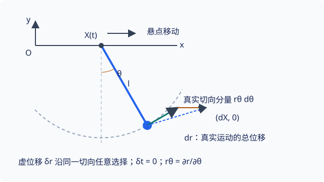

## 虚位移、理想约束与虚功

把小球限制在光滑圆环上时，支持力保证它不离开轨道，却未必决定沿轨道的运动．如果只问小球沿轨道是否平衡，能否不先求出支持力？关键是把力投影到约束容许的方向．

本页学习如何构造 **虚位移（virtual displacement）**，以及何时可以利用理想约束消去反力．先读 [约束与广义坐标](constraints-generalized-coordinates.md)，并复习 [功与势能](../dynamics/momentum-energy.md)．

## 冻结时间后，哪些位置变化仍被允许

虚位移是在固定时刻、满足该时刻约束的假想无穷小位形变化，记作 $\delta\boldsymbol r_i$．它不需要等于真实运动的方向，也不涉及真的经过一段时间；等时条件是 $\delta t=0$．

对完整约束 $f_a(\boldsymbol r_1,\ldots,\boldsymbol r_N,t)=0$，虚位移满足

$$
\sum_i\nabla_i f_a\cdot\delta\boldsymbol r_i=0
$$

而真实运动对时间求导后满足

$$
\sum_i\nabla_i f_a\cdot\boldsymbol v_i
+\frac{\partial f_a}{\partial t}=0
$$

非定常约束下，两者的区别正是是否包含约束自身随时间移动的项．即使约束定常，虚位移也是所有容许方向中的任意选择，真实速度却由当前运动状态决定．

对独立广义坐标 $q_\alpha$，固定时间使虚位移展开为

$$
\delta\boldsymbol r_i
=\sum_\alpha\frac{\partial\boldsymbol r_i}{\partial q_\alpha}\delta q_\alpha
$$

这里的 $\delta q_\alpha$ 相互独立，可以逐个取正、负或零．

{ style="min-width: 600px;" }

### 移动悬点的具体比较

取 $x$ 向右、$y$ 向上，悬点位置为 $(X(t),0)$，摆角仍从竖直向下逆时针量取．位置与两类位移为

$$
\begin{aligned}
\boldsymbol r&=(X+l\sin\theta,-l\cos\theta),\\
\delta\boldsymbol r&=l(\cos\theta,\sin\theta)\delta\theta,\\
\mathrm d\boldsymbol r&=(\dot X,0)\mathrm dt
+l(\cos\theta,\sin\theta)\dot\theta\,\mathrm dt
\end{aligned}
$$

虚位移切于冻结后的圆周．真实位移还包含悬点移动，通常不切于同一条冻结的圆周．

## 理想约束为什么能消去反力

把每个质点所受力分成主动力 $\boldsymbol F_i^{(a)}$ 和约束力 $\boldsymbol f_i$．主动力是重力、弹簧力等用于驱动运动的力；这种划分取决于模型，并不等同于外力／内力划分．

**虚功** 是力与虚位移的标量积．若所有容许虚位移都满足

$$
\sum_i\boldsymbol f_i\cdot\delta\boldsymbol r_i=0,
$$

就称约束为 **理想约束（ideal constraint）**．零虚功要求的是整个系统的代数和，不要求每一个内约束力分别做零虚功．

- 光滑曲面的支持力沿法向，虚位移沿切向，二者垂直．移动曲面也可以具有这个性质．
- 不可伸长轻杆两端的轴向力大小相等、方向相反；长度不变使两端虚位移在杆方向上的差为零，因此两端虚功相消．
- 干摩擦、滚动阻力等是否属于理想约束，需检查模型和容许位移，不能只凭名称判断．固定支承上的理想无滑动滚动通常将静摩擦作为零虚功约束反力；这不包含滚动阻力矩．

???+ warning "零虚功不等于不做实功"
    移动悬点例子中，设杆对小球的径向力为 $\boldsymbol f=F_r(\sin\theta,-\cos\theta)$，$F_r$ 可正可负．它与 $\delta\boldsymbol r$ 正交，虚功为零，但实际功率为
    
    $$
    \boldsymbol f\cdot\boldsymbol v=F_r\dot X\sin\theta,
    $$
    
    通常不为零．驱动悬点的装置能够向小球传递能量．

## 虚功原理：沿每个容许方向都没有剩余驱动力

静力平衡时 $\boldsymbol F_i^{(a)}+\boldsymbol f_i=0$．与虚位移作标量积、对质点求和，再使用零虚功条件，得到 **虚功原理**：

$$
\sum_i\boldsymbol F_i^{(a)}\cdot\delta\boldsymbol r_i=0
\qquad\text{对任意容许虚位移成立}
$$

在可双向变化的独立坐标、理想等式约束模型下，这给出平衡的切向条件；法向部分由约束反力承担．还要确认所需反力能由实际装置提供，单侧接触和只能受拉的绳不能不加检查．非定常约束一般不能维持静止平衡，本页的平衡例题使用固定约束．

若主动力有与速度无关的势能 $V$，则其虚功是 $-\delta V$．因此平衡条件是势能在每个独立坐标方向上的一阶导数为零．驻点可以是极小、极大或更一般的驻点；平衡与稳定必须分开判断．

???+ note "例题：竖直圆环上哪里能平衡？"
    质量为 $m$ 的小环套在固定、光滑的竖直圆形铁丝上，半径为 $R$．套环可由铁丝提供所需法向力，不发生脱离．取环心为原点，$y$ 向上，角度 $\theta$ 从最低点方向逆时针量取：
    
    $$
    x=R\sin\theta,\qquad y=-R\cos\theta,
    \qquad\delta y=R\sin\theta\,\delta\theta
    $$
    
    唯一主动力为重力，虚功为 $-mg\delta y=-mgR\sin\theta\,\delta\theta$．由于 $\delta\theta$ 任意，平衡要求 $\sin\theta=0$：最低点和最高点都是平衡位形．
    
    势能 $V=-mgR\cos\theta$ 的二阶导数是 $mgR\cos\theta$．最低点二阶导数为正，微小偏离后受回复作用，是稳定平衡；最高点为负，是不稳定平衡．不必先求法向支持力，就能完成这两项判断．

??? note "补充：稳定性判断的范围"
    多自由度系统要检查势能二阶型；正定二阶型是标准自然力学系统稳定平衡的充分条件．若二阶项为零或存在速度相关作用，不能只沿用本例的一维判据．

## 文内自测

1. 固定单摆恰在转向点，真实速度为零，它的虚位移是否也必须为零？

??? note "自测一解答"
    不必须．虚位移只由该时刻的约束限制，仍可以沿圆周切向任意取值．零真实速度是运动状态，不能当成额外几何约束．

2. 在光滑平台上，由一根不可伸长轻杆连接的两个质点共同平移，杆的两个端力是否都分别做零虚功？

??? note "自测二解答"
    不一定．设两个端力为 $\boldsymbol f$ 和 $-\boldsymbol f$，两端虚位移为 $\delta\boldsymbol r_1$、$\delta\boldsymbol r_2$．总虚功为 $\boldsymbol f\cdot(\delta\boldsymbol r_1-\delta\boldsymbol r_2)$．杆长不变使差位移的轴向分量为零，所以总和为零；单个端力的虚功仍可能非零．

## 继续学习与参考资料

上一页：[约束与广义坐标](constraints-generalized-coordinates.md)．下一页：[达朗贝尔原理与广义力](dalembert-principle.md)，把静力平衡扩展到加速运动．

- 高显，《经典力学》，科学出版社，2023 年．
- [MIT OpenCourseWare，Lagrangian dynamics 与 admissible variations](https://ocw.mit.edu/courses/2-003j-dynamics-and-control-i-spring-2007/resources/lec14/)．
