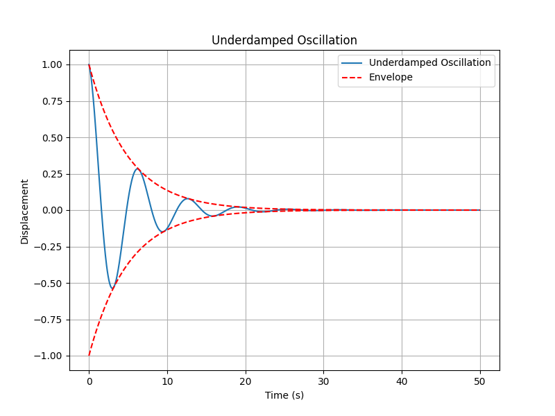
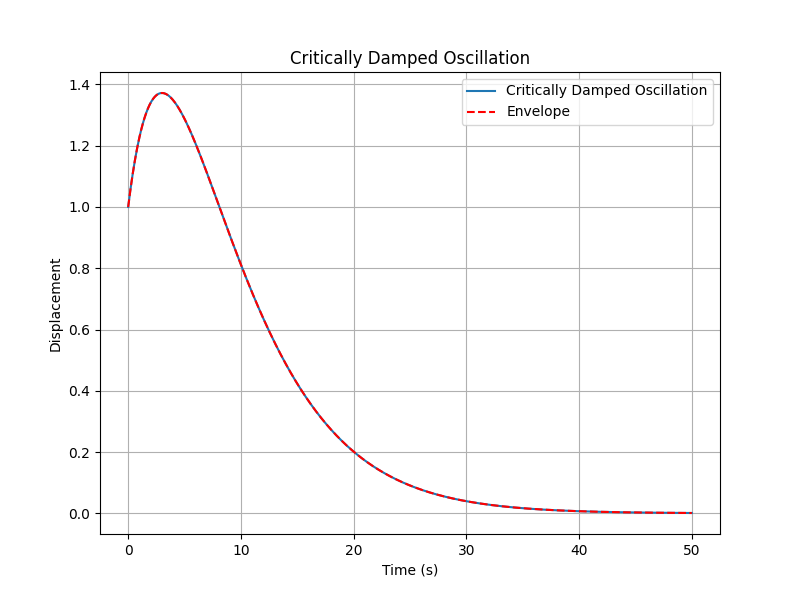
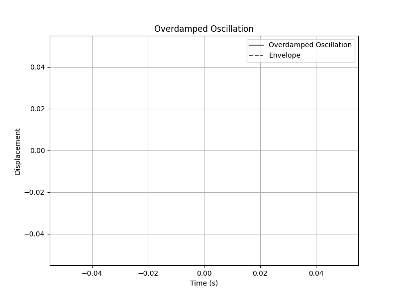
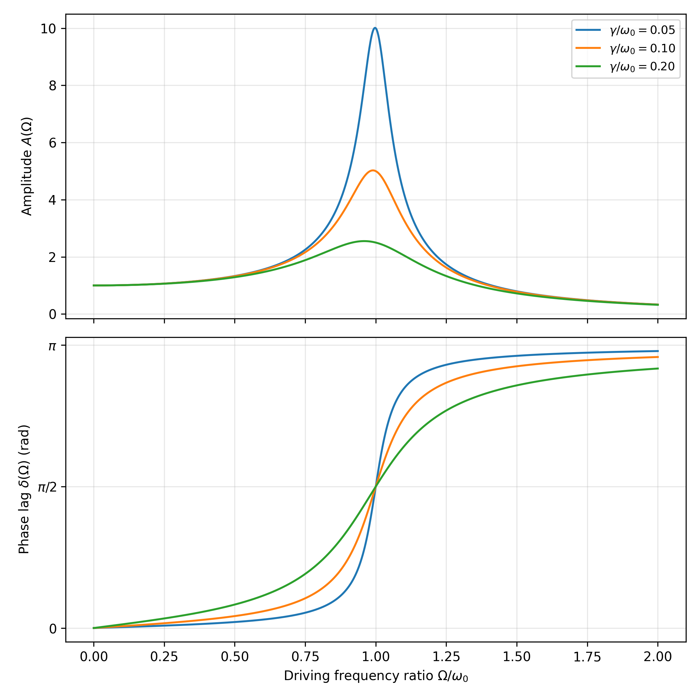

线性振动用对位移及其导数为线性的 [微分方程](concept:differential-equation) 描述．小幅度运动常可作这种近似，但「小」本身不是充分条件；为什么平衡附近会出现线性回复作用，见 [平衡附近的小振动](../analytical/small-oscillations.md)．本页先掌握单自由度的求解工具，再进入多自由度系统．

## 简谐振动

位移按单一正弦或余弦规律变化的运动称为简谐振动．先明确一个模型：质量 $m>0$ 的滑块在固定水平轨道上运动，弹簧劲度系数 $k>0$，以平衡位置为 $x=0$，向右为正，忽略阻力和外驱动．

### 运动方程推导

弹簧回复力为 $F=-kx$，牛顿第二定律给出

$$
m\ddot x=-kx,\qquad
\ddot x+\omega_0^2x=0,\qquad
\omega_0=\sqrt{\dfrac{k}{m}}.
$$

负号表示位移为正时加速度为负，不表示速度始终为负．滑块越过平衡位置时仍有速度，因而不会停在那里．$\omega_0$ 是模型决定的固有角频率，不由初始振幅决定．

### 解的形式

试探 $x=\mathrm e^{rt}$，得到 $r^2+\omega_0^2=0$，故实通解可写为

$$
x(t)=C\cos\omega_0t+D\sin\omega_0t
=A\cos(\omega_0t+\phi).
$$

给定 $x(0)=x_0$、$\dot x(0)=v_0$，直接得到

$$
\boxed{x(t)=x_0\cos\omega_0t+\dfrac{v_0}{\omega_0}\sin\omega_0t},
$$

$$
A=\sqrt{x_0^2+\dfrac{v_0^2}{\omega_0^2}},\qquad
A\cos\phi=x_0,\quad -A\omega_0\sin\phi=v_0.
$$

求相位时要同时满足这两个关系，不能只用正切忽略象限．$A=0$ 时物体静止在平衡位置，相位没有物理意义．「运动方程」指微分方程，而 $x(t)$ 是满足初态的一条运动解．

例如从正位移 $x_0$ 静止释放，解为 $x=x_0\cos\omega_0t$；若从平衡处以速度 $v_0$ 向右出发，解为 $x=(v_0/\omega_0)\sin\omega_0t$．同一模型的频率相同，初态改变振幅与相位．

固定悬点单摆则满足 $\ddot\theta+(g/l)\sin\theta=0$．在下垂位置附近、角度以弧度计且 $|\theta|\ll1$ 时，用 $\sin\theta\approx\theta$ 得 $\omega_0=\sqrt{g/l}$．角振幅必须与初速度一起保证运动始终在小角度范围内．若使用轻绳，还须保持张力非负；完整建模见 [单摆例题](../analytical/lagrangian-modeling.md#例题一固定悬点单摆)．

近似精度取决于所需误差，不能用一个固定角度界限替代判断．例如 $\sin\theta=\theta-\theta^3/6+\cdots$ 表明回复项的相对修正约为 $\theta^2/6$；长期相位误差还会积累．

### 周期与频率

$$
T_{\rm period}=\dfrac{2\pi}{\omega_0},\qquad
f=\dfrac{1}{T_{\rm period}}=\dfrac{\omega_0}{2\pi}.
$$

$f$ 的单位为赫兹，$\omega_0$ 的单位为 $\mathrm{rad/s}$．本页以 $T_{\rm period}$ 表示周期，避免与动能混淆．

### 相位

相位 $\psi=\omega_0t+\phi$ 同时决定位置和速度，不能只凭一个位置判断相位：同一位置可能正在向左或向右运动．相位可连续增长，也可按模 $2\pi$ 表示，不必强制限制在某个开区间．

两个同频振动相位差为 $\Delta\phi=\phi_1-\phi_2$．差为 $0$（模 $2\pi$）时同相，差为 $\pi$ 时反相．讨论超前或滞后需指定所取的相位差分支．

#### x, v, a 三者的相位关系

对位移逐次求导：

$$
\begin{aligned}
x&=A\cos\psi,\\
v&=-A\omega_0\sin\psi
=A\omega_0\cos(\psi+\pi/2),\\
a&=-A\omega_0^2\cos\psi
=A\omega_0^2\cos(\psi+\pi).
\end{aligned}
$$

取各振幅为正，速度相位比位移超前 $\pi/2$，加速度与位移反相．在正向最大位移处，速度为零、加速度向负方向，能直接检查这些符号．

### 用复数表示简谐振动

由 Euler 公式，可以用复数记号统一处理正弦、余弦：

$$
\widetilde x(t)=\widetilde A\mathrm e^{\mathrm i\omega_0t},
\qquad \widetilde A=A\mathrm e^{\mathrm i\phi},\qquad
x(t)=\operatorname{Re}\widetilde x(t).
$$

实际位移始终取实部．求导对应乘 $\mathrm i\omega_0$，二次求导对应乘 $-\omega_0^2$．线性实系数方程允许先求复解再取实部；计算能量这样的平方量时则应先恢复实位移与实速度，不能直接把复数平方当成真实能量．

## 能量分析

### 动能与势能

取平衡处势能为零：

$$
E_k=\dfrac12m\dot x^2,\qquad E_p=\dfrac12kx^2.
$$

代入简谐解，动能与势能分别正比于 $\sin^2\psi$ 和 $\cos^2\psi$．转向点能量全部为势能，经过平衡位置时全部为动能．

### 总能量守恒

$$
E=E_k+E_p=\dfrac12kA^2,\qquad
\dot E=\dot x(m\ddot x+kx)=0.
$$

周期平均给出 $\langle E_k\rangle=\langle E_p\rangle=E/2$．这里是同一个经典振子运动的时间平均，不是在讨论热平衡下的统计分配．

给定振幅 $A$，由能量还可求速度大小 $|v|=\omega_0\sqrt{A^2-x^2}$，但速度方向须由运动阶段判断．

### 简谐振动的几何表示

长度为 $A$ 的旋转矢量以角速度 $\omega_0$ 转动，其水平投影为 $A\cos\psi$．这个表示帮助追踪相位；滑块本身仍沿直线运动，并没有在圆周上转动．

## 简正模

多个坐标耦合后，一个坐标一般同时包含多个频率．简正模是各坐标以固定比例、同一固有角频率变化的特殊运动．完整的 [简正模与简正坐标](../analytical/normal-modes.md) 在分析力学模块统一讲授，需要先掌握拉格朗日建模和二次近似．原有 [三原子纵向振动例题](../analytical/normal-modes.md#零模三原子纵向振动) 已并入该页，包含整体平移零模与两个内部振动模的完整求解．

## 阻尼振动

### 阻尼运动方程

加入相对于静止介质的线性黏滞阻力 $-c\dot x$，其中 $c>0$，得

$$
m\ddot x+c\dot x+kx=0,\qquad
\ddot x+2\gamma\dot x+\omega_0^2x=0,\qquad
\gamma=\dfrac{c}{2m}.
$$

$c$ 的单位为 $\mathrm{kg/s}$，$\gamma$ 的单位为 $\mathrm{s^{-1}}$．从广义力与耗散函数建立同一方程，见 [非保守广义力与耗散](../analytical/nonconservative-forces.md)．

### 解的形式

试探指数解，得到特征根 $r=-\gamma\pm\sqrt{\gamma^2-\omega_0^2}$．判别式决定三种运动：

| 条件 | 通解 | 运动特征 |
| --- | --- | --- |
| 欠阻尼：$0<\gamma<\omega_0$ | $x=A\mathrm e^{-\gamma t}\cos(\omega_dt+\phi)$，$\omega_d=\sqrt{\omega_0^2-\gamma^2}$ | 振荡包络衰减 |
| 临界阻尼：$\gamma=\omega_0$ | $x=(C_1+C_2t)\mathrm e^{-\omega_0t}$ | 重根，无周期振荡 |
| 过阻尼：$\gamma>\omega_0$ | $x=C_1\mathrm e^{r_1t}+C_2\mathrm e^{r_2t}$ | 两个负实根，无周期振荡 |

临界阻尼是振荡与非振荡根之间的边界．不能不指定初态和「回到平衡」的判据，就把它称为任意情况下返回最快的运动．无周期振荡也不保证任意初态下都不穿过平衡位置．

??? note "三种运动的示意图"
    
    
    
    
    

对欠阻尼运动，初始条件形式为

$$
x(t)=\mathrm e^{-\gamma t}
\left[x_0\cos\omega_dt+
\dfrac{v_0+\gamma x_0}{\omega_d}\sin\omega_dt\right].
$$

额外的 $\gamma x_0$ 来自对指数因子求导．因此静止释放时，不能简单地把初相位设为零．

### 能量衰减

精确的机械能变化率是

$$
E=\dfrac12m\dot x^2+\dfrac12kx^2,\qquad
\dot E=-c\dot x^2\le0.
$$

位移包络按 $\mathrm e^{-\gamma t}$ 衰减，不表示瞬时能量严格等于 $E(0)\mathrm e^{-2\gamma t}$．例如静止释放瞬间 $\dot E(0)=0$，而后一个表达式会给出非零损失率．弱阻尼 $\gamma\ll\omega_0$ 时，对快速振荡作局部周期平均，才可用平滑的指数衰减近似描述平均能量．

同一线性欠阻尼模型中，相邻同向峰值相隔 $T_d=2\pi/\omega_d$，其绝对值之比给出对数减缩：

$$
\delta_{\log}=\ln\dfrac{|x(t_p)|}{|x(t_p+T_d)|}=\gamma T_d.
$$

这条同相位取样关系是精确的；它与瞬时能量为纯指数是不同命题．

## 受迫振动

### 驱动运动方程

施加沿正方向的简谐外力 $F(t)=F_0\cos\Omega t$，其中 $F_0>0$ 为力的幅值、$\Omega>0$ 为驱动角频率：

$$
m\ddot x+c\dot x+kx=F_0\cos\Omega t,
\qquad
\ddot x+2\gamma\dot x+\omega_0^2x=\dfrac{F_0}{m}\cos\Omega t.
$$

除以质量后，右侧必须是加速度量纲．外力可持续输入能量，完整解为齐次解加一个特解；初始条件由二者共同满足．

### 无阻尼驱动与共振增长

先令 $c=0$．当 $\Omega\ne\omega_0$，取 $x_p=C\cos\Omega t$，代入得

$$
C=\dfrac{F_0}{m(\omega_0^2-\Omega^2)}.
$$

从平衡处静止出发的完整解为

$$
x(t)=\dfrac{F_0}{m(\omega_0^2-\Omega^2)}
\left(\cos\Omega t-\cos\omega_0t\right).
$$

无阻尼时齐次振动不会自行消失，不能说足够久后一定只剩驱动频率．共振 $\Omega=\omega_0$ 时，原来的特解形式失效，取极限或直接代入验证可得

$$
x(t)=\dfrac{F_0}{2m\omega_0}t\sin\omega_0t.
$$

它满足零初位移与零初速度．振荡包络随时间增长；真实系统中阻尼、非线性或装置限制会终止这种无限增长，小振动近似也可能先失效．

### 稳态解

现在取 $c>0$．齐次解会衰减，长时间响应由同频特解支配．用上一节的复数工具，设 $x_p=\operatorname{Re}(\widetilde X\mathrm e^{\mathrm i\Omega t})$，得到

$$
\widetilde X=\dfrac{F_0/m}{\omega_0^2-\Omega^2+2\mathrm i\gamma\Omega}.
$$

写成 $\widetilde X=A\mathrm e^{-\mathrm i\delta}$：

$$
x_p=A\cos(\Omega t-\delta),\qquad
A=\dfrac{F_0/m}{\sqrt{(\omega_0^2-\Omega^2)^2+4\gamma^2\Omega^2}},
$$

$$
\delta=\operatorname{atan2}(2\gamma\Omega,\omega_0^2-\Omega^2).
$$

$\operatorname{atan2}(y,x)$ 同时用两个分量确定象限，这里 $0<\delta<\pi$．低频时响应近乎同相，高频时近乎反相；在 $\Omega=\omega_0$ 时滞后 $\pi/2$．只用普通反正切会丢掉高频分支．

暂态究竟多久可忽略，应看衰减最慢的特征根．欠阻尼包络时间尺度为 $1/\gamma$；过阻尼时慢根为 $-\gamma+\sqrt{\gamma^2-\omega_0^2}$，不能一概使用 $t\gg1/\gamma$．

### 共振现象

固定 $m,k,c,F_0$ 扫描驱动频率，位移振幅最大等价于其分母平方

$$
D(\Omega)=(\omega_0^2-\Omega^2)^2+4\gamma^2\Omega^2
$$

最小．求导得

$$
D'(\Omega)=4\Omega(\Omega^2-\omega_0^2+2\gamma^2).
$$

因此只有 $0<\gamma<\omega_0/\sqrt2$ 时存在非零频率的位移共振峰：

$$
\Omega_r=\sqrt{\omega_0^2-2\gamma^2},\qquad
A(\Omega_r)=\dfrac{F_0/m}{2\gamma\sqrt{\omega_0^2-\gamma^2}}.
$$

阻尼更大时，振幅随正频率增加而下降，最大值在静态极限．「欠阻尼」并不足以保证存在位移共振峰．在 $\Omega=\omega_0$ 处，

$$
A(\omega_0)=\dfrac{F_0/m}{2\gamma\omega_0},
$$

但它一般不是峰值；弱阻尼时两者才很接近．

### 功率共振与品质因数

将原方程乘 $\dot x$，得 $\dot E=F(t)\dot x-c\dot x^2$．稳态一个周期后能量回到原值，所以外力平均功率等于耗散功率：

$$
\langle P\rangle=\dfrac12cA^2\Omega^2
=\dfrac{F_0^2\gamma}{m}\dfrac{\Omega^2}{D(\Omega)}.
$$

令 $y=\Omega^2$，比例因子的导数为

$$
\dfrac{\mathrm d}{\mathrm dy}
\dfrac{y}{y^2+(4\gamma^2-2\omega_0^2)y+\omega_0^4}
=
\dfrac{\omega_0^4-y^2}
{\left[y^2+(4\gamma^2-2\omega_0^2)y+\omega_0^4\right]^2}.
$$

因此正频率的平均功率峰在 $\Omega=\omega_0$，与位移峰的频率一般不同．这里假定驱动力幅值不随扫描频率变化，且阻尼为线性常系数．

对这个模型定义品质因数 $Q=\omega_0/(2\gamma)$．半功率点满足 $|\omega_0^2-\Omega^2|=2\gamma\Omega$，所以

$$
\Omega_1=\sqrt{\omega_0^2+\gamma^2}-\gamma,\qquad
\Omega_2=\sqrt{\omega_0^2+\gamma^2}+\gamma,\qquad
\Delta\Omega=2\gamma.
$$

在本模型中这个功率带宽关系精确成立；弱阻尼时两半功率点近似关于 $\omega_0$ 对称，且 $Q$ 越大，峰相对越窄．

例如设定一组教学数据：半功率点为 $98$ 与 $102\,\mathrm{rad/s}$．则 $\gamma=2\,\mathrm{s^{-1}}$，$\omega_0=\sqrt{\Omega_1\Omega_2}\approx100\,\mathrm{rad/s}$，$Q\approx25$．这些数值用于练习，不是实验测量记录．

## 文内自测

1. 滑块在正向最大位移处静止释放，它此刻的加速度与能量损失率分别怎样？

??? note "核对"
    无论有无线性阻尼，加速度均为 $-\omega_0^2x_0$；无驱动时损失率为 $c\dot x^2=0$．零瞬时损失率不代表后续无耗散．
    
2. 若 $\gamma=0.8\omega_0$，自由运动是否振荡？扫描驱动频率时是否有非零位移共振峰？

??? note "核对"
    自由运动欠阻尼，仍振荡；但 $\gamma>\omega_0/\sqrt2$，没有非零位移共振峰．两个判据回答的是不同问题．

## 应用

单摆与弹簧振子训练机械建模；线性电路可出现相同形式的微分方程，但参数与能量含义需重新对应．多自由度应用接续 [小振动近似](../analytical/small-oscillations.md)、[简正模](../analytical/normal-modes.md) 与 [双摆模态](../analytical/double-pendulum-modes.md)．振幅大到不能忽略高阶回复项时，进入 [非线性振动](nonlinear.md)．

## 参考资料

- 阻尼与受迫振动的求解工具见 [二阶常系数微分方程](../../math/differential-equations/second-order-ode.md)；本页以同一机械模型推导能量、位移峰和功率峰．
